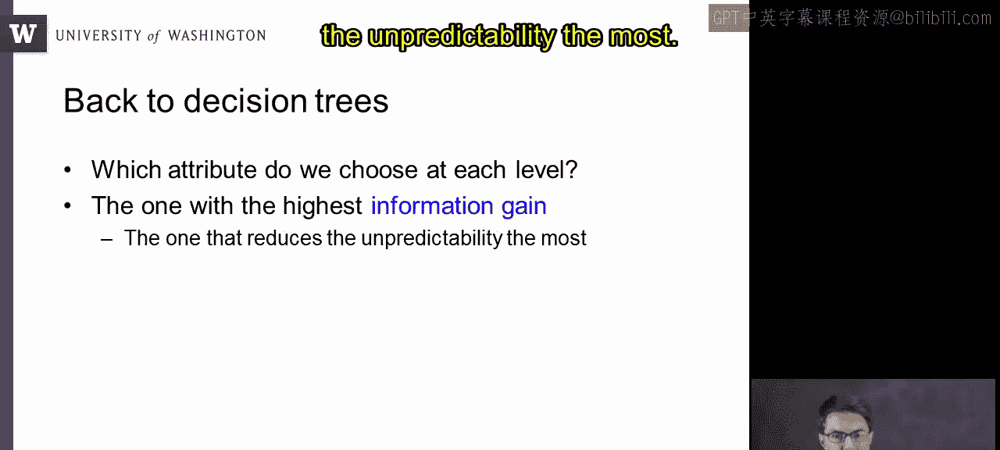

# 杜克大学《大规模数据科学（预测分析，交流数据科学结果，第2、3课⧸共3课有视频）｜Data Science at Scale》中英字幕 p38 37_测量熵.zh_en -BV1xf421Q7bH_p38-

。

So let's look at an example。 So assuming you're flipping a coin。

And we see the same expression here on this slide that we saw on the last slide。

 except that this should say x instead of I x or I is fine， it doesn't make any difference。

 but they should be the same。Then you expand this expression this way， if it's a fair coin。

 then you have 0。5 times the log of 0。5 plus 0。5 times the log of 0。5。

 this representing heads and this representing tails。Okay， and if you compute that。

 the answer is one。And this。Is appropriate because we imagine flipping a coin gives us exactly one bit of information。

Right， it tells us the result。one。50，50 choice。Okay， so things are either on or they're off。

 And when you tell me the answer， I've learned1 bit of information。All right。

 so now consider if we're rolling to die， there are six outcomes each having a probability of one over six。

 and so use the same expression。16 times the log of 16。And add all those up。

 which is just multiply by six in this case。 and you get。Interview of 2。58。Okay。

So what this says is that when I roll a die and get the answer， I've learned more information。

 this is less predictable。More unpredictable。Right。It's a higher number。

 more unpredictable than flipping a coin。Which agrees with our intuition。All right。

So now imagine rolling a weighted die that had these probabilities， you know。

 values one through five were all 10% chance， and it had a 50% chance of rolling 86 every time。Well。

 we can do the same thing。 And there's that。Bug again。X。So this is 0，10% times a log of 10%。Times 5。

Plus0。5 log 0。5。 And so here you get 2。16。 So here a weighted die。Is。Goodness， less unpredictable。

Then a fair die， right， which again agrees with our intuition。Right， because we。

If you had to bet what was going to come up， you would bet on。That a six would be rolled。

So how do you apply entropy to a data set as opposed to a random variable Well。

 you can do it with respect to the class label， so you have 891 passengers in the Titanic data set and 342 of them survived。

 then you can compute entropy。From those you sets so 342 of8 91 log 342 of rate 91 plus 549 of rate 91 and so on gives you an entropy of 0。

96。 So this is almost one bit of information and this makes sense because 342 is about half of 891 right so it's about。

You， you learned a lot by。Identified someone as having lived or died。

 but then say there were only 50 survivors well。Din。The data set is inherently more predictable。

Right。Because most people。Didn did not survive， and that's reflected in this calculation。

 you get an entropy value of 0。31， so it's inherently less unpredictable or more predictable okay。

So fine， so that's entropy going back to decision trees。Now。

 which attribute do we want to choose at the。At each level。

 right we're we're going to build a tree and we have to make a choice of which attributetropy we're going to use to split on okay and the one the one we're going to pick is the one with the highest information gain and we're going to use entropy to compute information gain。

 And another way of saying that is is the one that reduces the unpredictability。The most。

