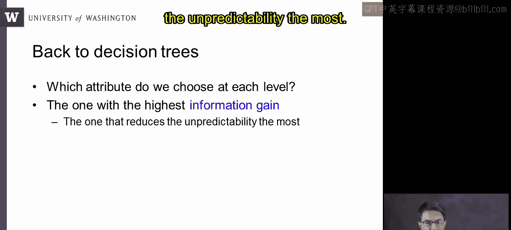

# 大规模数据科学：第2课：测量熵 📊

在本节课中，我们将要学习信息论中的一个核心概念——熵。熵用于量化一个随机变量的不确定性或信息量。我们将通过几个简单的例子来理解熵的计算方法，并探讨如何将熵的概念应用于数据集，特别是决策树构建中的属性选择。

---

## 熵的定义与公式

上一节我们介绍了信息量的概念，本节中我们来看看如何用熵来度量一个随机变量的整体不确定性。熵的公式如下：

**公式：**
\[
H(X) = -\sum_{i=1}^{n} P(x_i) \log_2 P(x_i)
\]

在这个公式中：
*   \( H(X) \) 表示随机变量 \( X \) 的熵。
*   \( P(x_i) \) 表示结果 \( x_i \) 发生的概率。
*   \( \log_2 \) 是以2为底的对数，这使得熵的单位是“比特”。

这个公式计算了所有可能结果的信息量的期望值（加权平均）。

---

## 熵的计算示例

以下是几个通过具体例子计算熵的过程，帮助我们直观理解其含义。

### 抛掷一枚公平硬币

假设我们抛掷一枚公平的硬币。它有两种等可能的结果：正面或反面。

**计算过程：**
\[
H(X) = -[0.5 \times \log_2(0.5) + 0.5 \times \log_2(0.5)] = 1
\]

计算结果为1比特。这很合理，因为抛一次公平的硬币恰好能提供1比特的信息，它告诉我们一个“是”或“否”的答案。

### 投掷一个公平的骰子

现在考虑投掷一个公平的六面骰子。每个面出现的概率都是 \( \frac{1}{6} \)。

**计算过程：**
\[
H(X) = -6 \times [\frac{1}{6} \times \log_2(\frac{1}{6})] \approx 2.58
\]

计算结果约为2.58比特。这个值比抛硬币的熵值高，说明投骰子的结果更难以预测，这与我们的直觉一致。

### 投掷一个有偏的骰子

最后，考虑一个有偏的骰子：点数1到5出现的概率各为10%，而点数6出现的概率为50%。

**计算过程：**
\[
H(X) = -[5 \times (0.1 \times \log_2(0.1)) + (0.5 \times \log_2(0.5))] \approx 2.16
\]

计算结果约为2.16比特。这个值低于公平骰子的熵值，说明这个有偏骰子的结果更容易预测（因为我们可以倾向于猜测结果是6），这同样符合我们的直觉。

---

## 将熵应用于数据集

我们如何将熵的概念应用于一个具体的数据集，而不是抽象的随机变量呢？一个常见的方法是针对数据集中的类别标签计算熵。

以泰坦尼克号数据集为例，该数据集有891名乘客。

**情况一：生存者比例接近一半**
*   假设有342名乘客幸存。
*   幸存概率 \( P(幸存) = 342/891 \approx 0.384 \)
*   未幸存概率 \( P(未幸存) = 549/891 \approx 0.616 \)
*   计算熵：\( H \approx 0.96 \) 比特

这个值接近1比特，意味着通过了解一个人的生存状态，我们能获得接近1比特的信息。这很合理，因为幸存与未幸存的比例并非极度不平衡。

**情况二：生存者比例很低**
*   假设只有50名乘客幸存。
*   幸存概率 \( P(幸存) = 50/891 \approx 0.056 \)
*   未幸存概率 \( P(未幸存) = 841/891 \approx 0.944 \)
*   计算熵：\( H \approx 0.31 \) 比特

这个熵值低得多，说明数据集本身更具可预测性（大多数人没有幸存），因此知道结果所提供的信息量也更少。

---

## 熵在决策树中的应用

回到决策树的构建问题。在每一层，我们需要选择一个属性来分割数据。

我们应该选择哪个属性呢？答案是选择能带来**最大信息增益**的属性。信息增益可以用熵来计算。另一种理解方式是：选择那个能最大程度**减少不确定性**的属性。

下一节中，我们将具体学习如何计算信息增益，并利用它来构建更有效的决策树。

---

## 总结

本节课中我们一起学习了熵的概念与计算。我们了解到：
1.  熵是度量随机变量不确定性的数学工具。
2.  通过抛硬币、掷骰子等例子，我们看到结果越等可能，熵值越高，不确定性越大。
3.  我们可以针对数据集的类别标签计算熵，以衡量其内在的可预测性。
4.  在决策树算法中，熵是计算信息增益的基础，而信息增益则指导我们选择最佳的分割属性。