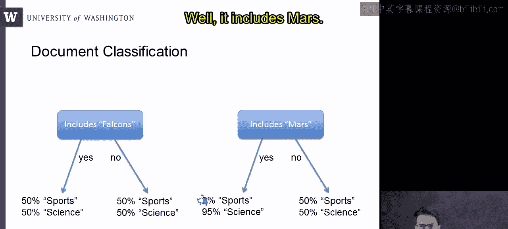

# 杜克大学《大规模数据科学（预测分析，交流数据科学结果，第2、3课⧸共3课有视频）｜Data Science at Scale》中英字幕 p39 38_使用信息增益构建树.zh_en -BV1xf421Q7bH_p39-

。

Okay， so how do we compute this information gain and how do we use it to make decisions in building the decision tree？

So let's go back to this simpler example of。Did。You know。

Predicing when we're going to play golf or do some other outdoor activity。Okay。

So before we've made any decision about the decision tree。

 we've got 14 records and9 of which are labeled。 yes， they're positive examples。

 and so we can compute the unpredictability， the entropy of this。Data set。Just as we have with the。

Titaically setting with the die rolls and so on， and we get 0。

94 Now if we choose the outlook attribute to be the root of our tree or to be the next node in the tree。

Then we see that we'll have four records。That are overcast that represent overcast right if we choose the attribute outlook。

 then the value overcast has four records， all of which。A yes。And so， the。

Entropy of that choice is going to be 0。It entirely， it's 100% predictable。

 it's zero unpredictability。Alright。And the value rainy。Has two nos and three yeses。Okay， so。

Five records total。3，8 of 5。Lg two， three out of5， plus5 two over5， log two， two over five。Is 0。97。

And then finally， if it's sunny。Then you have three nos and two yeses。And it's the same value， 0。97。

Okay， and so now the expected new entropy， if we have chosen outlook。You compute expected value。

 expected value is the probability of making that choice times the value of that choice so。

4our out of 14 has a value of0。5 out of 14 is a value 0。97 and 5 out of 14 as 0。97 again。

And so compute the total there and at zero point。6，9。Now。

The gain here is the difference between where we started and where we end up。All right， so。

Considering temperature。Well， here we have。4 records。Sorry， for the value cool， we have four records。

 one， two， three， four。And we have yes， yes。No， and yes。And so three of them are yes out of four。

 and you can compute the formula million you get 0。81 and you can do the same thing for rainy。

 up excuse me。Hot。And they should be mild。All right。So with Ho。

 we have exactly two records or yes out of four， and so that's 50，50。

 and remember that's always unpredictability of one。ok。And then finally when it's mild。

 there's six records4， yes， and we get unpredictably of 0。92。

 and so then you plug in the formula and the expected new entropy is 0。91。

And so the gain here is less than it was for Out。And finally we can finally。

 next we can consider humidity and here there's only two values， seven records have normal humidity。

And six of those are yes， and so the entropy is 0。59 if you plug in the numbers and if humidity is high。

 there's seven records there as well， and only two of them are yes， and the entropy here is 0。86。

 and so the expected new entropy here is 0。725。And finally， windy。

 there's also two values only two values here， so if it is windy， there's eight records with windy。

 six of which。Indicate we played。And the interview is 0。81， and the。When it's not windy。

There are five records， three of which we played。 and the value years， 0。

97 and run through the numbers and you use 0。87。 Okay， so now we have。

A computation for every possible choice of attribute。And we compute these four games。

 and it's really just the minimum since we're subtracting the same amount， same value every time。

And so outlook， the first one we did is indeed the one with the highest gain。

 and so that's the one we'll pick。And so this sort of makes sense if you think about it。

 you we went through the calculations here just to sort of try to help you internalize what's going on with entropy。

 but it does sort of make sense， it's the one that if you can choose an attribute that tells you exactly what's going on。

You know。You want to pick that one， right， so if you if you always play when it's sunny。

That attribute tells you a lot of information by selecting that so you want that one at the top。

 you want the most discriminative choices at the top。Okay。

And just like you showed with that document classification example， you know we put， well。

 if the document includes the word Sunday， then we go over here and then we check and see if there's a sports team reference it and determine the sports and over here we。

We'll choose if。Something related to sciences in it。 So it really it wasn't much use。

To pick Sunday at the top， and in fact， I guess I have that on the next slide here。

Which of these two has the higher information gain？If you include the word Falcons。

 well Falcons might appear in some science articles and they also appear in some sports articles。

 and so let's say that down the tree， about half are sports and about half are science on both branches。

Okay but it includes the word Mars， it's not too likely to be about sports。

 and so only about 2% of the articles that include the word Mars will be about sports while 95% will be about science。

Let's let's make sure that adds up to 100。Fine， so which one of these has the higher information gain。

 Well， its includes Mars， and so that one would be chosen first。

