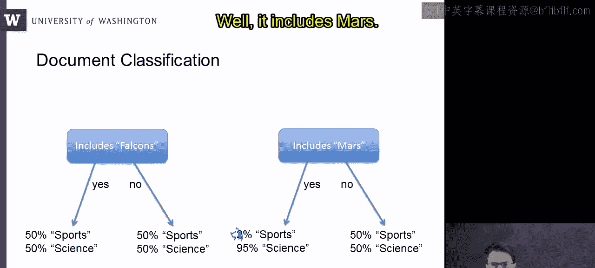

# 决策树构建：第1课：使用信息增益构建决策树

在本节课中，我们将学习决策树构建的核心步骤：如何计算信息增益，并利用它来选择最佳的属性作为树的分支节点。我们将通过一个预测是否打高尔夫球的简单例子，来一步步演示这个过程。

## 概述

决策树是一种通过一系列规则对数据进行分类的模型。构建树的关键在于，每一步都选择能带来最大“信息增益”的属性进行划分。信息增益衡量的是，根据某个属性划分数据后，数据“不确定性”的减少程度。不确定性通常用“熵”来量化。

上一节我们介绍了熵的概念，本节中我们来看看如何具体计算信息增益并用于决策树构建。

## 计算初始熵

在开始构建决策树之前，我们有一个包含14条记录的数据集。其中9条记录标记为“是”（打高尔夫），5条标记为“否”（不打高尔夫）。

我们可以计算这个数据集的初始熵，它代表了当前数据的不确定性。熵的计算公式为：

**Entropy(S) = -p_yes * log₂(p_yes) - p_no * log₂(p_no)**

其中，`p_yes` 是“是”类别的比例，`p_no` 是“否”类别的比例。

代入我们的数据：
*   p_yes = 9/14 ≈ 0.643
*   p_no = 5/14 ≈ 0.357

计算得到初始熵约为 **0.94**。

## 计算各属性的信息增益

接下来，我们需要评估每个属性（如天气、温度、湿度、风力）作为划分标准能带来多少信息增益。信息增益的计算公式为：

**Gain(S, A) = Entropy(S) - Σ (|S_v| / |S|) * Entropy(S_v)**

其中，`A` 是待评估的属性，`S_v` 是属性 `A` 取值为 `v` 的子集。

以下是针对每个属性的计算过程：

### 1. 天气 (Outlook)

如果选择“天气”属性，数据会根据其取值（晴朗、多云、下雨）被分成三个子集。

*   **多云 (Overcast)**：4条记录，全部为“是”。该子集的熵为 **0**（完全确定）。
*   **下雨 (Rainy)**：5条记录（3个“是”，2个“否”）。计算熵约为 **0.97**。
*   **晴朗 (Sunny)**：5条记录（2个“是”，3个“否”）。计算熵同样约为 **0.97**。

现在计算选择“天气”属性后的期望新熵：
期望新熵 = (4/14)*0 + (5/14)*0.97 + (5/14)*0.97 ≈ **0.69**

因此，选择“天气”带来的信息增益为：
信息增益(天气) = 初始熵(0.94) - 期望新熵(0.69) = **0.25**

### 2. 温度 (Temperature)

如果选择“温度”属性，数据会根据其取值（凉爽、适中、炎热）被分成三个子集。

以下是各子集的计算结果：
*   **凉爽 (Cool)**：4条记录（3个“是”，1个“否”），熵约为 **0.81**。
*   **炎热 (Hot)**：4条记录（2个“是”，2个“否”），熵为 **1**（完全不确定）。
*   **适中 (Mild)**：6条记录（4个“是”，2个“否”），熵约为 **0.92**。

计算期望新熵：
期望新熵 = (4/14)*0.81 + (4/14)*1 + (6/14)*0.92 ≈ **0.91**

因此，选择“温度”带来的信息增益为：
信息增益(温度) = 0.94 - 0.91 = **0.03**

### 3. 湿度 (Humidity)

如果选择“湿度”属性，数据会根据其取值（正常、高）被分成两个子集。

以下是各子集的计算结果：
*   **正常 (Normal)**：7条记录（6个“是”，1个“否”），熵约为 **0.59**。
*   **高 (High)**：7条记录（2个“是”，5个“否”），熵约为 **0.86**。

计算期望新熵：
期望新熵 = (7/14)*0.59 + (7/14)*0.86 = **0.725**

因此，选择“湿度”带来的信息增益为：
信息增益(湿度) = 0.94 - 0.725 = **0.215**

### 4. 风力 (Windy)

如果选择“风力”属性，数据会根据其取值（有风、无风）被分成两个子集。

以下是各子集的计算结果：
*   **有风 (True)**：8条记录（6个“是”，2个“否”），熵约为 **0.81**。
*   **无风 (False)**：6条记录（3个“是”，3个“否”），熵为 **1**。

计算期望新熵：
期望新熵 = (8/14)*0.81 + (6/14)*1 ≈ **0.87**

因此，选择“风力”带来的信息增益为：
信息增益(风力) = 0.94 - 0.87 = **0.07**

## 选择最佳属性

比较所有属性的信息增益：
*   信息增益(天气) = **0.25**
*   信息增益(湿度) = 0.215
*   信息增益(风力) = 0.07
*   信息增益(温度) = 0.03

“天气”属性具有最高的信息增益。因此，在构建决策树时，我们应该首先选择“天气”作为根节点进行划分。这很直观：一个能直接告诉你确切结果的属性（如“多云”时总是打高尔夫）包含的信息量最大，应该放在树的顶部。

## 核心思想与类比

这个原理可以推广到其他分类问题。例如，在区分“体育”和“科学”文章时：
*   如果根据“是否包含‘猎鹰’（Falcons）”划分，可能两边都混有体育和科学文章，信息增益较低。
*   如果根据“是否包含‘火星’（Mars）”划分，包含“火星”的文章极大概率属于科学类，这个属性能带来很高的信息增益，因此应该优先被选择。

信息增益指导我们选择**最具区分度**的属性，将其放在决策树的高层，从而用最少的步骤最有效地对数据进行分类。

## 总结

本节课中我们一起学习了决策树构建的核心机制。我们首先计算了数据集的初始熵以衡量其不确定性。然后，我们逐步计算了每个候选属性划分数据后带来的信息增益。通过比较这些增益值，我们选择了增益最大的“天气”属性作为决策树的根节点。这个过程确保了决策树能够以最高效的方式，即用最少的判断步骤，来学习数据中的分类规则。