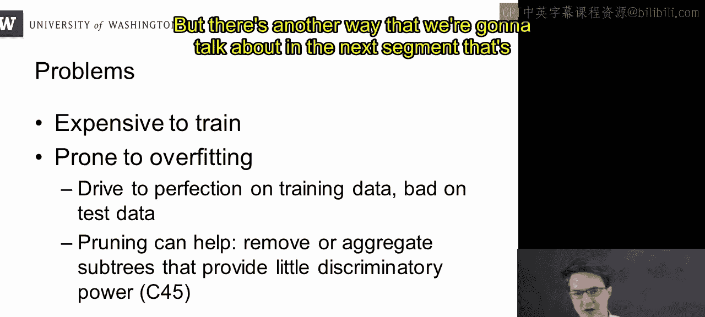

# 杜克大学《大规模数据科学（预测分析，交流数据科学结果，第2、3课⧸共3课有视频）｜Data Science at Scale》中英字幕 p40 39_构建树：ID3算法.zh_en -BV1xf421Q7bH_p40-

。

So what's the algorithm here Okay， so just summarize this algorithm。

 which is called the ID 3 algorithm。Sum all attributes are discrete and we can discretize continuous attributes by binning them in particular intervals and I'll give you a。

A method to do a few slides。And then you're going to choose the attribute with the highest information gain and create branches。

 one for each value， the attribute。And then partition the examples based on the selected attributes so far and you repeat with the remaining attributes on the remaining set of examples。

 okay， and so you sort of recursively apply this。And then the stopping additions are well。

 when there's no more examples。Left or all the examples。

Alllong a branch are assigned the same label because there's no more decisions to make at that point。

Okay， and so this in this way， you can apply this algorithm and build up a decision tree on your data set。

 And as you can see， this isn't too hard to implement the。

Maybe trickiest thing if you're not familiar with it is this notion of information game。

 which we went through， but other than that， it's。I hope you can imagine trying to write a program that would do this。

 there's a little bit of bookkeeping to do about building up this data structure。

 but it's not too complicated。Okay， so what are some problems with this decision tree algorithm Well。

 one is that it's expensive to train you have to sort of keep inspecting these big chunks of the data set when you make every decision。

And it's also prone to overfitting。Which we haven't drilled into， but this is。In general。

 what overfitting means you do really， really well on your training data。

 but you do poorly on test data， which is to say that the model doesn't generalize。

And so you can imagine that you get these decision trees that are very。

 very good at making very precise decisions about the training set。

 but you give it one new example that hasn't seen before and it puts it into some bucket。

That may or may not be right okay and so so there's ways around this。

 you can try to prune branches of the tree that are over specializedized to particular conditions。

Okay，And so remove or aggregate subries that don't provide much discriminatory power。

But there's another way that we're going to talk about in the next segment thats。

Very， very powerful， okay。