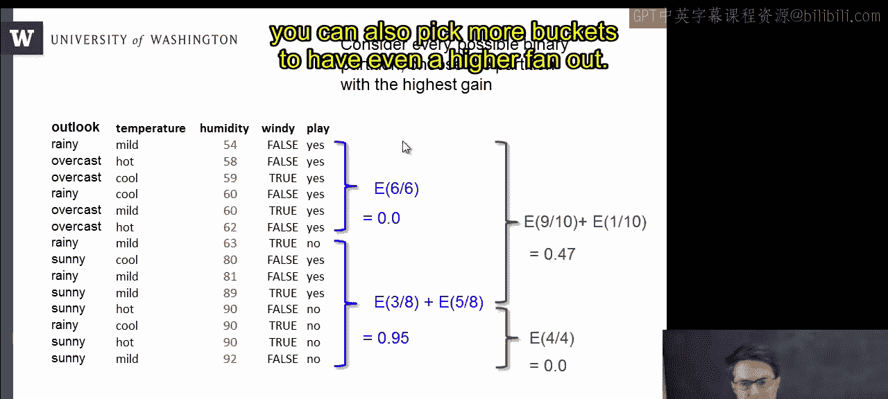

# 杜克大学《大规模数据科学（预测分析，交流数据科学结果，第2、3课⧸共3课有视频）｜Data Science at Scale》中英字幕 p41 40_构建树：C4.5算法.zh_en -BV1xf421Q7bH_p41-

。

Let's talk about how to split continuous attributes to。

Make a decision with a reasonable number of branches。

 So one thing is you could split on every unique value。But， given that。You know。

 a measurement value is a floating point number， it's unlikely for there to be。Too much grouping。

 in which case you'll have an individual branch for every possible value in the data set。

Every possible work in the data set。Which。Gives you no information gain or sorry。

 It gives you a lot of information gain， but doesn't actually help that much。

 It sort of instantly overfits。 Okay， so you want to sort of bucket these things。

 So how can you do this。 So imagine。With this weather data set。

Instead of having humidity labels of normal and high。

 we actually had the percent humidity as a number Okay， and so one way to bucket this might be that。

 you know， we're going to say between 60 and 70 is one bucket and between 70 and 80s another bucket and so on。

 but that requires some domain knowledge。And ends up being sort of an extra decision you have to make when you're modeling this data and we're trying to avoid decisions when we're applying these machine learning techniques。

 we don't want parameters in the system unless we have to。Okay， so。

What's a way to do this sort of algorithmically， Well， you can imagine that。

If we sort the data set in increasing order of humidity。Pointing the wrong screen。That。

Every every point in this。Humidity data represents a possible place to split it into two choices。

 high and low。 Okay， And so what we can do is just evaluate each one of those choices。

And measure the information gain and choose the point which gives us the highest information gain。

Okay。And so here's what that might look like。I haven't actually checked。Every single one。

 But I sort of eyeballed and saw that。 wow， you know， the first several。

Have solid yeses all the way up to here。 So this might be a pretty good candidate to split on because on one branch。

 we know we're going to have nothing but yeses。 and that's what we're looking for here。

 We're looking for reducing unpredictability。In gain。Okay， and another good place to split。

 perhaps is down here because there's a lot of yeses， all but one above it and。Kns above this。

 which sort of makes sense because as the humidity goes up。We have。We're less likely to play outside。

So fine， so if you go ahead and compute the entropy here， here is six out of six or all yes。

 which means it's zero entropy， totally predictable。

 and here it's three out of8 plus5 out of8 entropy。Is 0。95。And here，9 out of 10 or one out of 10。

 that means it's a lower number， as we'd expect because it's pretty predictable， right，90% chance of。

Being a yes。And here， four out of four is0。 is。You know， zero， okay。

 and so now you do the expectation。And say add out of 14 cases with time is 0。

95 plus 6 out of 14 cases。Of  zero is a pretty low number，0。54。

 but here over here it's an even lower number。 and so the right place to split is here and I didn't check the others。

 but clearly these are the。The only places that will matter because it didn't change in between there。

 which actually suggests an optimization。Okay， so again。

 we consider every possible binary partition and choose a partition with the highest game as a way to turn any continuous variable into a discrete variable so that you can。

W on this。 And you could actually do this more with。

Instead of just true false or instead of just high low。

 you could also pick more buckets to have a even higher fan out。

