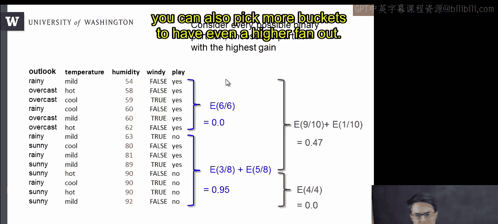

# 大规模数据科学：2.3：构建决策树：C4.5算法

在本节课中，我们将学习如何处理决策树中的连续属性。具体来说，我们将探讨如何将像湿度百分比这样的连续数值，有效地分割成离散的区间，以便在决策树中进行分支决策，同时避免过度拟合。

上一节我们介绍了信息增益和熵的基本概念，本节中我们来看看当属性是连续值时，如何应用这些概念。

## 处理连续属性

决策树算法（如ID3）最初是为分类属性设计的。然而，现实数据中经常包含连续属性（如温度、湿度）。直接按每个唯一值分割会产生过多分支，导致模型过度拟合且无法泛化。

因此，我们需要一种方法，将连续值“分桶”成有限的、有意义的离散区间。我们不希望依赖领域知识手动设定阈值，而是寻求一种自动化的、基于数据的算法方法。

## C4.5算法的分割策略

C4.5算法采用了一种系统的方法。其核心思想是：将连续属性排序后，**每一个可能的分割点都代表一个将数据划分为“高”和“低”两个部分的候选方案**。算法会评估所有这些候选分割点，并选择能带来**最高信息增益**的那个点。

以下是该过程的具体步骤：

1.  **排序**：首先，根据该连续属性的值，将数据集中的所有实例从小到大排序。
2.  **生成候选分割点**：每两个相邻的不同值之间，都可以作为一个潜在的分割点。例如，在湿度值序列中，每个值都代表一个“低于或等于此值”与“高于此值”的分界点。
3.  **评估信息增益**：对于每一个候选分割点，计算将数据按此点分为两部分后的信息增益。
4.  **选择最佳分割**：选择能带来最大信息增益的那个分割点。这个点就将连续属性转换成了一个二元离散属性（例如，“湿度 ≤ 75%” 和 “湿度 > 75%”）。

## 实例分析：湿度数据分割

假设我们的天气数据集中的“湿度”不再是“正常/高”的标签，而是具体的百分比数值。我们已将其排序。

通过观察，我们可能会发现一些有潜力的分割点。例如，在某个点之前，所有实例的“是否玩耍”结果都是“是”，这意味着该分支的熵为0，具有完美的可预测性。

为了量化比较，我们需要计算每个候选点的信息增益。信息增益的计算公式基于熵：

**Entropy(S) = - Σ (p_i * log₂(p_i))**

其中 `p_i` 是集合 `S` 中第 `i` 类所占的比例。

然后，对于按分割点 `t` 划分后的数据，其期望熵为：

**Gain(S, A_t) = Entropy(S) - [ (|S_left|/|S|) * Entropy(S_left) + (|S_right|/|S|) * Entropy(S_right) ]**

其中 `A_t` 表示在点 `t` 分割的属性，`S_left` 和 `S_right` 是分割后的两个子集。

通过计算比较，我们可以确定信息增益最高的分割点。在实际操作中，由于属性值排序后，信息增益只会在类别标签发生变化的地方产生显著变化，这本身也提供了一种优化计算的方法。

## 扩展到多路分割

上述方法将连续属性转换为一个二元（是/否）决策。理论上，可以递归地应用此过程来创建多个桶，从而实现更高阶的分支（例如，低、中、高）。然而，在C4.5中，通常在一次分割中只产生两个分支，后续如果需要，可以在子节点上继续对同一属性进行分割。

本节课中我们一起学习了C4.5算法处理连续属性的核心方法。关键点在于：通过**排序数据、评估所有可能二元分割的信息增益，并选择最佳者**，我们可以将任何连续变量转化为可用于决策树分裂的离散形式。这种方法减少了建模时的人为参数设定，让数据本身驱动最佳分割点的选择。