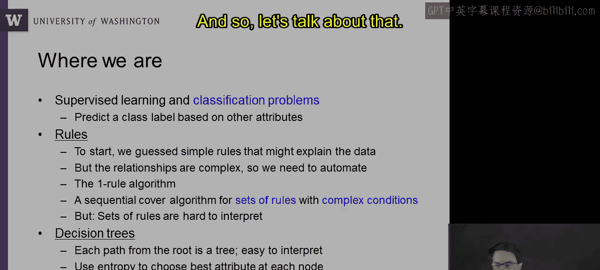

# 杜克大学《大规模数据科学（预测分析，交流数据科学结果，第2、3课⧸共3课有视频）｜Data Science at Scale》中英字幕 p42 41_规则和树回顾.zh_en -BV1xf421Q7bH_p42-

。

Okay， so where are we， We're talking about supervised learning and we're talking specifically about classification problems where we predict a class label based on the other attributes。

 And so we gave an example of。Predicting whether or not we play some sport based on a few different attributes representing the weather。

Or predicting whether a passengerboard the Titanic did or did not survive based on things like their gender。

 their age， the fare they paid and so on okay and so to get started here。

 we talked about just you know manually guessing simple rules that might explain the data and as you might imagine。

 the relationships between the attributes in the class label are complex and so you know your intuition。

Maybe wrong。 and so you need some way to automate the search for。These kinds of rules， okay。

So we talked about this one rule algorithm that will。

Proceduralize the process of choosing a good rule。And that worked fine。

 but know obviously it's pretty limited right it can only find very simple kinds of relationships。

 and so we also talked about a sequential cover algorithm that looks for that builds up sets of rules that may have multiple conditions in them okay。

You know， so great。 So a set of rules that are themselves complex are。

More descriptive of the data and therefore have better strength as a classifier。

 but they're also harder to interpret。 And one of the points that we've been making in this class is that you know。

 communicability of these。Models， commicability of the results is important。 Okay。

 and so a single rule is easy。 A set of complex rules is perhaps less so。

And for that reason and for other reasons， we can talk about decision trees and we sort of showed that a decision tree。

Hai。As was about say it can be constructed from a set of rules。

 know each path from the root is a rule， but that's not quite true。

 Constructing a decision tree from a set of rules is not necessarily trivial。

 going the other direction is pretty is straightforward as we described。

 every path from the root is a rule but but there is a relationship。 Moreover， given a decision tree。

 it's pretty easy to interpret， I would。Claim， right， you just sort of take your。

Date item and look at the root node and answer the question you know is。

Is the gender male or female female will then go on this branch。

 male good on this branch So it's very easy to understand what what's going on。

 It's also easy to understand what the most important decisions are because they bubble up to the top and so if someone's asking you well you know how is your model behaving。

 why does it make one decision over another， you can sort of answer those questions okay？

And so we talked about using how you make the decision of which attributes you select。At each level。

 and we talk about entropy。Being a measure of sort of the purity， right。

 the game is to try to make an entire branch。啊啊。Pure with respect to a class label， right。

 everyone down this branch。Survivveed。Okay， and so interviewpy gave us a way to do that。

 And then we talked about a few extensions for numeric attributes where you could split based on at a particular level。

 as opposed to。You know， I said if you don't have。Ginger male and female， but rather you have。

A number like humidity or the fare they paid you have to be a little more careful you don't want to have a thousand different branches coming out of a node one for each unique value rather you want to bucket them somehow and so what's the way to bucket them well one idea is just to find a split point that's listened to two children everything below this value goes one way and everything above this value goes another way and we talk about how to find that threshold okay so fine so where we are now is that decision trees are potentially prone to overfitting and so。

Let's talk about that。

