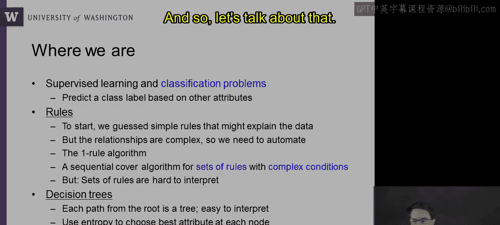

# 大规模数据科学（预测分析，交流数据科学结果）：第2课：规则和树回顾 🌳

在本节课中，我们将回顾监督学习中的分类问题，重点讨论从简单规则到决策树的演变过程。我们将探讨如何自动寻找规则、决策树的构建与解释，以及它们各自的优缺点。

---

上一节我们介绍了如何手动猜测简单规则来解释数据。然而，数据属性与类别标签之间的关系通常很复杂，直觉可能出错。因此，我们需要自动化地搜索这些规则。

我们首先讨论了**单规则算法**，它能够程序化地选择一个好规则。这种方法有效，但显然非常有限，因为它只能发现非常简单的关联关系。

为了处理更复杂的关系，我们接着介绍了**顺序覆盖算法**。该算法能够构建包含多个条件的规则集。

以下是顺序覆盖算法的核心思想：
*   它从寻找一个能覆盖部分数据的规则开始。
*   然后，它移除已被该规则覆盖的数据点。
*   接着，它在剩余数据上重复此过程，寻找下一个规则。
*   最终，它生成一组规则，共同描述整个数据集。

一组复杂的规则能更好地描述数据，因此作为分类器具有更强的能力。但它们也更难解释。本课程强调的一点是，模型和结果的可交流性非常重要。

单个规则易于理解。一组复杂规则则可能不那么直观。基于这个原因以及其他考虑，我们引入了决策树。

---

上一节我们提到了规则集，本节中我们来看看决策树。我们曾指出，决策树可以从一组规则构建而来。严格来说，从规则集构建决策树并非易事。但反过来则相对直接：正如我们所描述的，从根节点到叶节点的每一条路径就是一条规则。两者之间存在关联。

更重要的是，给定一个决策树，它非常易于解释。你只需取一个数据项，查看根节点并回答问题，例如“性别是男还是女？”，然后根据答案沿着相应分支前进。因此，很容易理解模型的工作原理。

决策树也易于理解哪些决策最重要，因为它们会“浮”到树的顶部。如果有人问你模型如何运作，或者为什么做出某个特定决策，你可以根据树的结构来回答这些问题。

---

我们讨论了如何在决策树的每一层选择属性来做出决策。我们引入了**熵**作为衡量“纯度”的指标。游戏的目标是试图让整个分支在类别标签上变得“纯净”，例如，该分支下的所有人都幸存了。

熵的公式为：
**H(S) = - Σ pᵢ log₂(pᵢ)**
其中 `pᵢ` 是集合 `S` 中第 `i` 类出现的概率。

信息增益帮助我们选择能最大程度减少不确定性的属性进行分割。

---

接着，我们讨论了对数值属性的几种扩展。对于像湿度或票价这样的数值，你不能为每个唯一值创建一个分支。相反，你需要以某种方式将它们分桶。

一个想法是找到一个**分割点**，将数据分成两部分：低于该值的走一个分支，高于该值的走另一个分支。我们讨论了如何找到这个最佳阈值。

---

目前我们认识到，决策树可能容易**过拟合**。这意味着树可能变得过于复杂，完美地拟合了训练数据中的噪声，从而导致在新数据上表现不佳。

在接下来的课程中，我们将探讨如何应对决策树的过拟合问题，以及提升模型泛化能力的方法。

---

本节课中我们一起学习了从简单规则到决策树的演进，理解了单规则算法和顺序覆盖算法的原理，掌握了决策树的构建、解释方法以及用于选择分割属性的熵与信息增益概念。我们还探讨了如何处理数值属性，并指出了决策树可能面临的过拟合挑战。