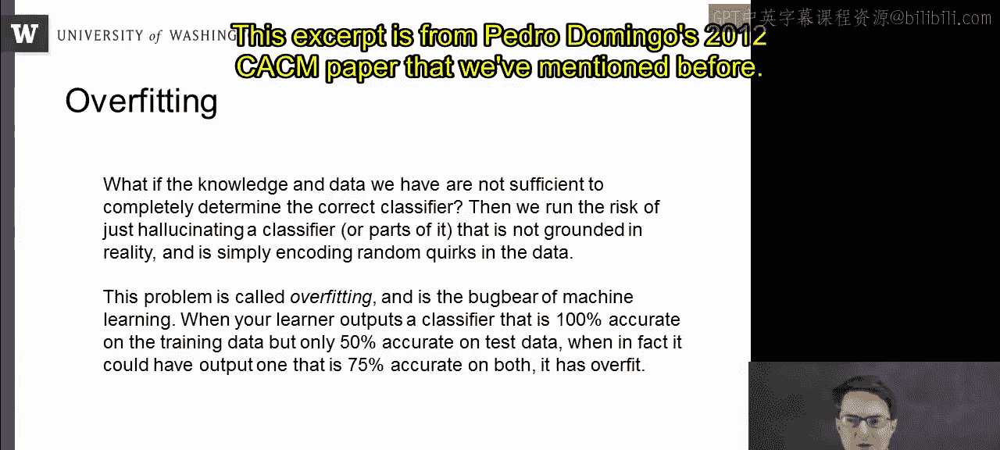
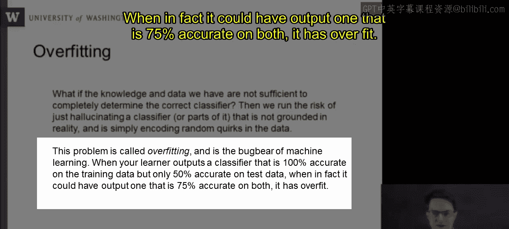
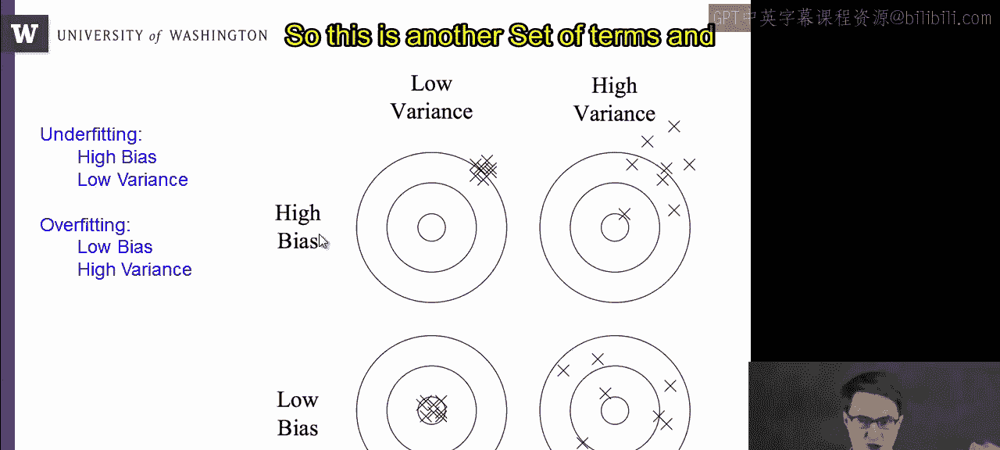

# 杜克大学《大规模数据科学（预测分析，交流数据科学结果，第2、3课⧸共3课有视频）｜Data Science at Scale》中英字幕 p43 42_过拟合.zh_en -BV1xf421Q7bH_p43-

。

This excerpt is from Pedro Domingo's 2012 CacM paper that we've mentioned before。

 so you know what if the knowledge and data we have are not sufficient to completely determine the correct classifier。

 so it could be that weve you know designed a classifier that is responding to what he calls random quarks in the data as opposed to sort of uncovering some kind of fundamental truth it doesn't have any predictive power in the real world it just sort of describes this particular data set and so the problem here is overfitting and you know he says it's the bugbear machine learning a lot of machine learning problems。

Really reduce to how do we avoid overfitting， right。

 Because you can always train a model on this on a particular data set。 But how do you avoid。呃。

Specializing it into this data set and making sure it has some predictive power in the real world okay and so you know the case to look out for here is your learner outputs to classifier that is 100% accurate on the training data。

 but only 50% accurate on test data。When in fact， it could have output one that is 75% accurate on both。

 it has overfi。

Okay， and so I want to call out that this is really the definition to think of when anything about overfitting。

 low error on training data and higher air on test data。

So an image that sometimes is called to mind when you're talking about overfitting。Is this one。

 which is， you know， I've， I've fit two polynomials to a small set of。Data points。

One with a high degree， I think 10 and the other with a low degree in this case。

 actually still pretty high at five。And you can sort of see that。A couple things。

 one is that the red curve is exactly matching the data， okay？嗯。But you can also see that。

 the sort of。What appears to be the trend in the data probably is better described by the green line。

 and in fact it was generated by a model that's sort of adding some random noise to a curve。

 and so the green line probably does actually reflect the actual underlying data model。

 the underlying process which generated the data。But the other point to look out for here is。It's。

Sensitive to change to perturbations in the data。 If I move one of these points。

Just one of these points a little bit。 How much does that curve change and the green one would not change much while the red one might okay。

 but I actually don't think this curve fitting model is the best image to call up when you think about overfitting because it's it's in my mind。

 it's a little bit specific to。Polynomial curves and the number of degrees of freedom。Working with。

 Okay， so it's not always clear， at least to me， how to map this。

Image that I call up my head of overfitting two machine learning problems。

 So I think a more useful one is。1 that's。Actually associated with a Wikipedia page on our article related overfitting。

Release under Creative Commons is this that over time your error。

goeses down for both your training set and your test set。

 but at some point it continues to go down for your training set I'm pointing the wrong screen this continues to go down。

H。On your training set， but then it starts to creep up on your test set。 And so at this point。

 you know he's put a little symbol here to indicate that's where overfitting has set in。

 And so I think this is the image you should call to mind when you're thinking about overfitting problems。

 this difference between the error on your training set and the error on a test set Now。

 in some cases， it's tough because the test set。You know， maybe。嗯。You know what is the test set。

 is it something you actually have your hands on where you can measure this hair。

 or is it more like the predictive power in the real world， But regardless。

 any kind of estimate you have over。The error。That you're actually achieving on data that you didn't train on。

I is what to look out for when these start to diverge， that means you overfit。So。

Other language to be familiar with around this concept， You know， is the model able to generalize。

 That's when it's that's when you're， if， if， if it is able to generalize， then you are not overfit。

 Okay， Can it deal with unseen data or doesn't overfit the data to test on。 So in order to。

Solve for this you test on。Hold out data。Okay， so one way to do this is split the data to be modeled into training and test set。

Just in a fixed way， train the model in the training set， evaluate the model in the training set。

 and then evaluate a model in the test set， and the difference between those two again is a measure ability of the model's ability to generalize a measure of how overfit it is。

Now， doing this just once， splitting your training and test is。Not。

The most powerful mechanism to do this。 And in a couple of slides。Give you a better one。

Another image to kind of call to mind when you're thinking about overfitting is also comes from。

Peter Domingo's paper， which is。The distinction between bias and various variances， excuse me。

 So in the underfi case， right， you you're。Missing the mark。

 you're not describing the data very well， but you might have low variance。

 You you're clearly missing the mark。And then you know high bias and high variance， well。

 then you're sort of just way off the mark。 you haven't you know your learner is not producing anything useful at all。

 but in the overfit case， you might have very， very low bias， but you have。A。

High variance now the way to interpret this language I'm using the high variance is variance when you when you add more data or when you perturb the data or when you evaluate on a different data set。

 what's your quality look like。How well do you do？Okay， and so if you have。Low by， so。

You have low bias on your test set。But it's sensitive to the data。

That's where the high variance comes from， then you're in an overfit。Scenario。And in the other case。

 well， you're not very sensitive to the data， you have low variance。RightBut your' bias。

 but you have high bias， you're wrong， you're getting the wrong answer。

 So this is like if I just have a model that's always predicting， you know。

 let's say I have a model that says on the tougher the Titanic data set that everybody dies all the time while this is very insensitive to the data right。

 it has low variance。No matter what data set I give it， I always produces the same answer。

 but it has high bias， it's wrong the error is high while overfitting is the other way around。

 maybe I' get an exact answer on my training set where I have very， very low bias。

 but as soon as I had one more data point it changes drastically。So this is another。嗯。

Insteadt of terms and kind of concepts to think about when you think about overfitting。

