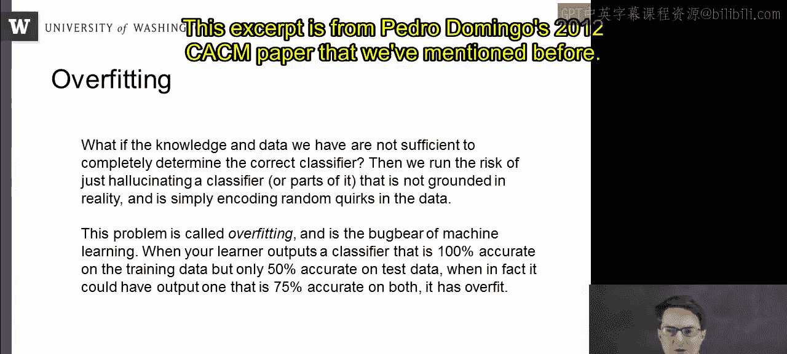
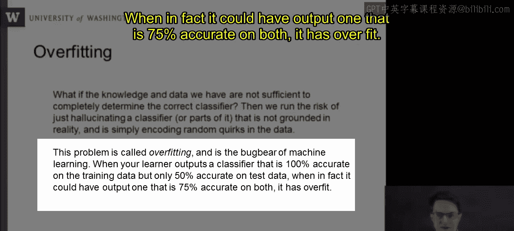
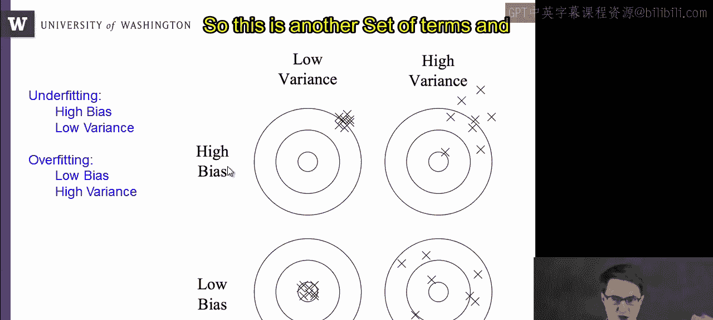

# 大规模数据科学（预测分析，交流数据科学结果，第2、3课⧸共3课有视频）：第42节：过拟合 👾

在本节课中，我们将要学习机器学习中的一个核心问题——过拟合。我们将了解它的定义、识别方法以及相关的概念，如偏差与方差。

---

这段摘录来自我们之前提到过的 Pedro Domingo 在 2012 年发表的 CacM 论文。

如果我们的知识和数据不足以完全确定正确的分类器，那么情况会如何？我们可能设计出一个分类器，它只是在响应数据中所谓的“随机噪声”，而不是揭示某种基本事实。这样的分类器在现实世界中没有任何预测能力，它仅仅描述了当前这个特定的数据集。这里的问题就是**过拟合**。他指出，过拟合是机器学习中许多问题的症结所在。

---

许多机器学习问题最终都归结为：**我们如何避免过拟合？**

因为你总是可以在一个特定的数据集上训练出一个模型。但如何避免模型过度“特化”于这个数据集，并确保它在现实世界中具有预测能力呢？这里需要警惕的情况是：你的学习器输出了一个分类器，它在训练数据上准确率达到 100%，但在测试数据上只有 50% 的准确率。而实际上，它本可以输出一个在两者上都能达到 75% 准确率的分类器。这就是过拟合。

---

我想强调，这是思考过拟合时最核心的定义：**训练数据上的低误差，以及测试数据上的高误差**。

在讨论过拟合时，有时会联想到下面这个图像。我为少量数据点拟合了两个多项式，一个次数很高（我认为是10次），另一个次数较低（在这个例子中，实际上5次也算相当高了）。你可以看到几个现象：首先，红色曲线完全匹配了数据点。但其次，数据中呈现的趋势可能更适合用绿线来描述。实际上，这些数据是由一个模型生成的，该模型在一条曲线上添加了一些随机噪声。因此，绿线可能更真实地反映了生成数据的底层过程或模型。这里需要注意的另一点是：**模型对数据扰动的敏感性**。如果我稍微移动其中一个数据点，红色曲线可能会发生很大变化，而绿色曲线则变化不大。

但我认为这个曲线拟合的例子并不是思考过拟合的最佳图像，因为它在我脑海中有点特定于多项式曲线和自由度数量。至少对我来说，如何将这个图像映射到一般的机器学习问题上并不总是那么清晰。

我认为一个更有用的图像是下面这个，它实际上来自维基百科上关于过拟合的文章，采用知识共享许可发布。这个图像展示了随着时间（或训练过程）推移，你的误差变化情况：对于训练集和测试集，误差最初都会下降。但在某个点之后，训练集误差继续下降，而测试集误差却开始上升。图中用一个小符号标出了过拟合开始发生的点。我认为，当你思考过拟合问题时，应该调用这个图像：**训练集误差和测试集误差之间的差异**。

在某些情况下，这很棘手，因为测试集可能并非你实际可以测量误差的数据，而更像是“在现实世界中的预测能力”。但无论如何，任何基于你未训练过的数据所估计出的误差，都是需要关注的指标。当这两个误差开始分道扬镳时，就意味着你过拟合了。

围绕这个概念，还有一些其他需要熟悉的术语。例如，模型是否能够**泛化**？如果模型能够泛化，那么你就没有过拟合。模型能否处理未见过的数据？或者它是否过度拟合了用于测试的数据？

为了解决这个问题，你需要使用**保留数据**进行测试。一种方法是，将用于建模的数据固定地划分为训练集和测试集。在训练集上训练模型，先在训练集上评估模型，然后在测试集上评估模型。这两者之间的差异再次衡量了模型的泛化能力，或者说衡量了其过拟合的程度。

然而，仅仅进行一次数据划分并不是最强大的机制。在接下来的几张幻灯片中，我会介绍一个更好的方法。

另一个在思考过拟合时可以联想到的图像同样来自 Peter Domingo 的论文，它区分了**偏差**和**方差**。在**欠拟合**的情况下，你偏离了目标，没有很好地描述数据，但你可能具有低方差。在**高偏差高方差**的情况下，你完全偏离了目标，你的学习器没有产生任何有用的东西。而在**过拟合**的情况下，你可能具有非常低的偏差，但却有**高方差**。这里“高方差”的意思是：当你添加更多数据、扰动数据或在不同的数据集上评估时，你的模型性能（质量）表现如何？如果你在测试集上具有低偏差，但对数据很敏感（这就是高方差的来源），那么你就处于过拟合的场景。反之，如果你对数据不敏感（低方差），但偏差很高（总是得到错误的答案），那就是欠拟合。例如，在泰坦尼克号数据集上，如果一个模型总是预测“所有人都会死亡”，那么它对数据非常不敏感（低方差），但偏差很高（错误率很高）。而过拟合则是另一种情况：也许我在训练集上得到了完全正确的答案（极低的偏差），但只要我增加一个数据点，结果就会发生剧烈变化。这是思考过拟合时的另一组术语和概念。

---

---

**总结**

本节课中，我们一起学习了机器学习中的核心挑战——过拟合。我们明确了其定义：**模型在训练数据上表现优异（低误差），但在未见过的测试数据上表现显著变差（高误差）**。我们探讨了如何通过观察训练误差与测试误差的曲线来识别过拟合的发生点，并引入了**偏差-方差权衡**的概念来深入理解模型复杂度与泛化能力之间的关系。最后，我们提到了使用**保留测试集**是评估模型是否过拟合的基本方法。理解并避免过拟合，是构建具有实际预测能力的稳健模型的关键。