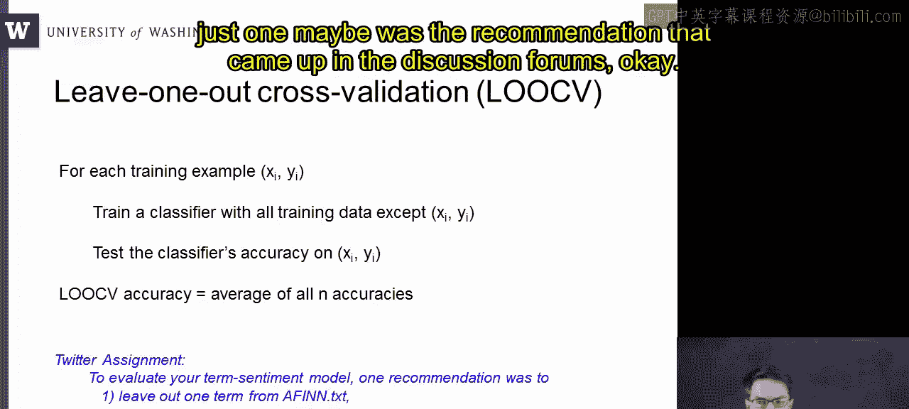

# 杜克大学《大规模数据科学（预测分析，交流数据科学结果，第2、3课⧸共3课有视频）｜Data Science at Scale》中英字幕 p44 43_评估：留一法交叉验证.zh_en -BV1xf421Q7bH_p44-

。

Okay， so we talked about overfitting。 but backing up a step。

 we need to talk about evaluating a model and seeing how good it is。

 So we've touched on this when we talk about rules。

 we touched on this when we talk about decision trees。 But I want to go over the。

Main terms you need to be familiar with okay so maybe the most important thing to take away from this entire segment is about dividing your data into training sets and test sets and so when you work on CAGle you'll be given a training set into a test set。

 but you should take the training set and split it again。So， this。

May seem somewhat obvious that you can't evaluate on the same data that youre training on because。

 of course， you'll do well。 But this actually wasn't all that。

Cl to people when they were first exploring some of these machine learning approaches in the 80s。

 it actually took a little while to sort of align what the statisticians already。You know。

 would have realized with the sort of algorithmic approach。

That the machine learning crowd was exploring。 Okay， so this is absolutely critical， right。

 It means it'， it's meaningless to evaluate a model on the same data you trained it on。

 Absolutely meaningless。 Okay， so how can you do this。 Well。

 one way is to just set aside a certain amount of data。A certain percentage as the test data。

And leave it at that and then do all your training on the training data。But。

Some of more aggressive way is to do cross validation， which is。Leave out a certain amount。

For testing， but then repeat that， right， Leave out a different do another random sample。嗯。

And evaluate on that Okay， so say tenfold cross validation would say lead out 10% as test data train on the remaining 90%。

Evaluate on the set aside data。And then repeat now kfold tends to mean that you're going to split this into chunks。

I ahead of time as opposed to actually doing a random sample in each case。

But both are valid and they have somewhat different properties okay。

 and we're not going to go into a lot of detail on this。Okay。

So and 10% is a reasonable number to think about。A special case of this method is leave one out cross validation。

 which is take a single element from your data。Set it aside。 Train on the remaining。啊。Records。

 the remaining data and then evaluate on that one set aside data data point to see if you classified correctly Now repeat that on every single data item in the set。

And you'll have a pretty good idea of how well you're doing overall， okay？

And this also has some properties both both good and bad that we're not going to go into a lot of detail。

 And then finally， a related concept that I do want to go into a little bit of detail on in a bit is the bootstrap where you take a。

Data set and you resample from it with replacement， so you may generate duplicates。

And this has some very nice properties for statistical analysis in general。

 so any statistic you derive。From this bootstrap set of samples。

 it turns out to be a very good estimator of the actual population statistic。

And we'll learn that detail in a little bit。Now， I want to have one slide on this lead1 outcro validation。

Just because I want to make a point about where this came up previously in this course， so again。

 for each training example， X Y where Y is the class label and X is all the other attributes。

We just sort of lump them together and assume。For notation purposes。

 train and classifier with all the training data， except this one particular value X and then test the classifiers accuracy on X。

 Does it get it right or does it get it wrong Okay And then the lead one out cross validation accuracy is the average of all the other of。

Your performance on all the set aside data。Okay， and so the place we saw this before was in the Twitter assignment where one of the recommendations to debug and evaluate your term sentiment model。

 not the tweet sentiment model， but the term sentiment model was to。Take one of the terms out of the。

Ahen do text file。And see what sentiment your model predicted for that term。

 and you could broadly just make sure that it was sort of positive when the aphi said it was positive and negative。

 when ahen said it was negative。And of course， this was sensitive to the exact tweet data set you were working with。

But it would be a good way to sort of sanity check and make sure that you're producing the right values。

 And so one of the challenges if you remember was， well， the ahen it was a pretty。

 the an vi covered a lot of。Obviously positive and obviously negative words， therefore。

 you didn't didn't leave you a lot to test with right because Ain was one of the inputs well。

 that's okay using this lead one out cross validation。 it is one of the inputs。

 but leave something out of the quote training set。

Even though we didn't think of it as really training a model。

 but in some sense we were leave one out and then see what value you predict for that one that you left out。

Okay。And you could do this， you could do a k fold cross foundation as well。

 by leaving out a whole bunch but。Just one maybe was。

 was the recommendation that came up in in the discussion forums， okay。

