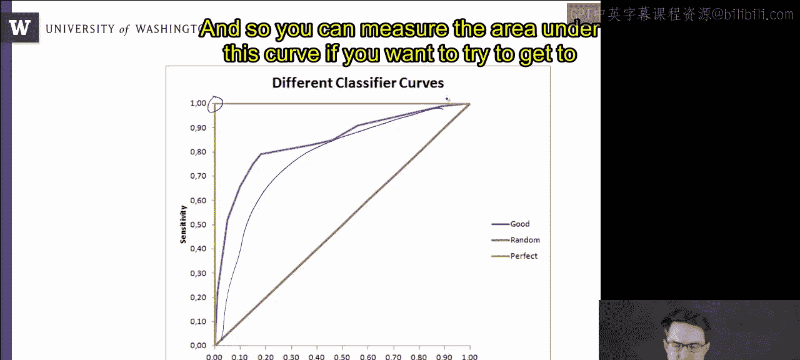

# 杜克大学《大规模数据科学（预测分析，交流数据科学结果，第2、3课⧸共3课有视频）｜Data Science at Scale》中英字幕 p45 44_评估：准确率和ROC曲线.zh_en -BV1xf421Q7bH_p45-

。

Okay， so what we have talked about is just measuring accuracy and we've mentioned this term confusion matrix before we showed this when we were looking at the rule based models。

 So going into a little more detail here。If you are looking at a。2 class model youve got。

Predicted positive and predicted negative as columns and the true positive and the true negative as the rows。

 then you can。Put the numbers。In this matrix and the blue numbers are what you got correct and the red numbers are what you got incorrect。

 Okay， And so a is the。True values that you predicted to be true， and the。D is the。

True negatives that you predicted to be。Negative， okay， And so here accuracy was， well。

 just add up everything you got correct and divide it by the total。 Okay， so this is straightforward。

So why not use this all the time？You know， in many cases。

 it isn't necessarily enough to really tell you anything。 So how do you interpret 90% accuracy。

 I that good is that bad， you know what is it is 99% accuracy really， really good， Well， it depends。

 It depends on the problem。 And so you need some kind of a baseline to compare this with at least or you need to use a different measure。

 So possible baselines here is a base rate。Hi and you can define this by just。

Trivially predicting the most frequent class。 So， for example， the Titanic data set。

 this would be everybody survived or everybody did not survive to be on which one was more frequent。

 And I don't actually remember the top my head which one was。

It leads in the trainees that were looking at okay。

 so take the most frequent class and just assume that that applies to everyone and that's the one you're trying to beat。

Okay。Another baseline is just sort of the random rate。

 which a lot of times you could sort of assume is 50% for a binary class。

 but you might actually apply prior knowledge and so you have a little bit more nuanced probability probability distribution。

 for example， if you sort of know that。H。60% of。The passengers didn't survive。 You could。

YouTake that as your baseline。ok。And in some cases。

 it may even get complicated because you have some sort of complicated model。

 you may need to take your prior knowledge and sample from that distribution and so on。But fine。

 so some sort of random， randomized。Baseline， and another one might be a naive。

Baseline that's a little bit less naive than the base rate。And not necessarily random。

 but uses a little bit of domain knowledge， for example。

 take some kind of simple default or pre-existing model that you would come up with without having to apply any kind of sophisticated technique so for example。

 all female survived right you need some sort of a baseline to compare against and so you're measuring how well you're doing relative to that and this comes up actually in the Caal competitions because many times you're given a starting point solution and so you want to measure accuracy relative that as opposed to accuracy overall perhaps。

Okay， so there's a few other performance measures that are computable from the confusion matrix。

 and I just want to flash them up briefly so that they're included in the slides for reference。

 but I'm not going to spend a lot of time on them。So one is this notion of lift。

Which you'll seeize in the marketing literature。 Another is precision and recall。

 which are concepts borrowred from information retrieval。And the third is the ROC plots。

 these receiver operator characteristic plots， which is a historical term。

And here they are trying to capture these two notions of sensitivity and specificity。Okay。

 and so sensitivity is the， is the proportion of。True examples you got right。

 And specificity is the proportion of false examples you got right。

One class and the other survived and not survived。And each。嗯。You know。

 test case generates a single point on this curve， but in many cases。

 there'll be a threshold that you can set。To carve out an entire curve as opposed to a single point。

 So， for example， if you've got a model that says， you know， creatinine levels in the blood。

Determine。A diagnosis。 Well， what should the threshold？ How high is too high。啊。

How you know how high this should the creatinine levels be before you make the certain diagnosis versus the other diagnosis okay。

 and so if you say if you change that threshold， what you'll do is，Carve out a curve here。

 and so the point here is that there's perfect is up at this point。Right， it gets。Everything right。

 It makes no mistakes。 And a random classifier is this red line in between。 and these curves are。

More often in between。These two okay， and so you can measure the area under this curve。

If you want to try to get to a single number。