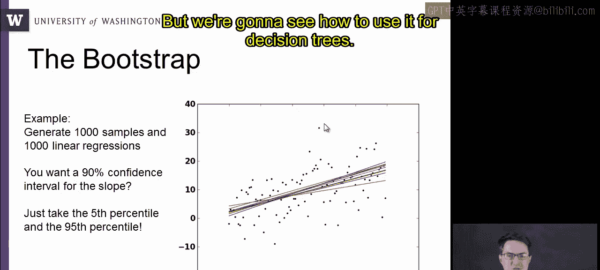

# 杜克大学《大规模数据科学（预测分析，交流数据科学结果，第2、3课⧸共3课有视频）｜Data Science at Scale》中英字幕 p46 45_自助法回顾.zh_en -BV1xf421Q7bH_p46-

。

， we talked about cross validation。To break your data set up into pieces in order to validate your model and in general。

 splitting things into training sets and test sets。

 which is crucially important to make any sense whatsoever。 And but a related notion here is。

Reampling your data set or maybe more general notion is to resample your data set and another use of this is the bootstrapap。

 which is a very， very general and very very powerful technique coming out of the statistics community in 1979。

Here's how it works。 Given a dataset set of size in。

 you draw in samples from that same data with replacement to create a new data。

Then repeat this a whole bunch of times。 Now， what you have is a bunch of different sample data sets drawn from the same population。

You can compute whatever statistics youre interested in on each one of these。

Or you can train a model， which is the context we're talking about。

And you can interpret each of these as a sort of individual experiment。

And this is exactly what the frequentist perspective calls for。 right。

 If you remember the definition of a confidence interval， it says that。Under repeated experiments。

95% of the time， this confidence interval will contain the true mean or the true whatever staistic you're interested in。

 Okay， And so this is giving you a direct simulation of that。And interpretation of the statistics。

 Okay， And so this is a fantastic use of computational resources。 right。

 It means you don't have to sort of have this precise analytic model of the world of what's going on。

 You can just rerun experiments。 And in 1979， this seemed like， wow。

 this is gonna to be very computationally intensive it's not really feasible。 Now。

 for most of these data sets， it's absolutely trivial。 And so this is a very。

 very powerful technique。😊，Al right， so you see an example。 this is probably pretty clear。

 but I just want to make sure you。See how it works。

 Imagine that the original data set you're given is just 1，2，3，4，5，6。

 Then you're gonna draw multiple samples from this。Simple data set with replacement。

 so you might get four， three，4，2，1，6， and you notice four came twice， two， three，6，1， three。

5 and three came twice and so on。And now for each one of these samples。

 you can compute the statistic you're interested in。 Sa just the mean。

 And what you'll get is an unbiased estimate of the true。Amin。Okay。So great。

 so that's a pretty trivial case if you have a more complicated data set。Like this。

 And you want to do a slightly more complicated stat， such as fitter regression line。 Well。

 same thing。 these are all your points。And。You can draw bootstrap samples from them。So this is a。

100 points， I think I said100， this is just 100 points。

Draw 100 samples from this data with replacement。And then refit a regression line to it。

And I've done that here 10 times or so。 And you see that the the line does wiggle because some of these points were missing。

 So， for example， this， this outlier up here may have been missing in some of the samples。

Some of the bootstrap samples and therefore， didn't influence the line。 And so it shimms around。

But it stays sort of confined to the data because you're still drawing from the same sample data set。

 And so by reasoning about how much that wiggles， you can。

Compute things like confidence intervals over these statistics。

 So if you want to a 90% confidence interval for the slope of this regression line， just do this。

A bunch of times。Take the fifth percentile and take the 95th percentile， and you've got it。Okay。

So this is really， really general， really， really powerful associated closely with。

Statistics community as opposed to the algorithmic modeling kind of machine learning community。

 but we're going to see how to use it。

For decision trees。