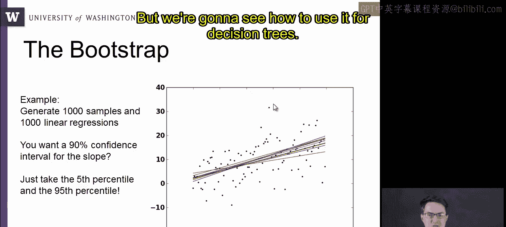

# 大规模数据科学：第2课：自助法回顾 🎯

在本节课中，我们将学习一种名为“自助法”的强大统计技术。自助法通过从原始数据集中有放回地重复抽样，来模拟多次实验，从而帮助我们评估模型的稳定性并计算统计量的置信区间。

## 概述

上一节我们介绍了交叉验证，它将数据集划分为多个部分以验证模型，并强调了将数据分为训练集和测试集的重要性。本节中，我们来看看一个相关的概念：对数据集进行重采样。一个更通用的概念是数据集的“重采样”，而自助法就是其一种非常重要的应用。自助法是一种于1979年源自统计学界的、非常通用且强大的技术。

## 自助法的工作原理

以下是自助法的运作方式。给定一个大小为 `n` 的数据集，你从该数据中有放回地抽取 `n` 个样本，以创建一个新的数据集。然后，将此过程重复多次。现在，你便拥有了从同一总体中抽取的多个不同的样本数据集。

你可以在这些样本中的每一个上计算你感兴趣的任意统计量。或者，在我们讨论的上下文中，你可以训练一个模型。你可以将其中每一个都视为一次独立的实验。这正是频率主义视角所要求的。

如果你还记得置信区间的定义，它指出：在重复实验中，有95%的时间，这个置信区间会包含真实的均值或你感兴趣的任何真实统计量。因此，自助法为你提供了对该过程的直接模拟和统计量的解释。

这是一种对计算资源的绝妙利用。这意味着你无需对世界或正在发生的事情拥有精确的分析模型，你只需重新运行实验即可。在1979年，这看起来计算量会非常大，似乎不太可行。但现在，对于大多数数据集来说，这绝对是轻而易举的。因此，这是一种非常强大的技术。

## 一个简单的例子

你可能已经看懂了，但我还是想确保你明白它是如何运作的。想象一下，你得到的原始数据集只是 `[1, 2, 3, 4, 5, 6]`。然后，你需要从这个简单的数据集中有放回地抽取多个样本。

例如，你可能得到 `[4, 3, 4, 2, 1, 6]`，请注意 `4` 出现了两次。或者得到 `[2, 3, 6, 1, 3, 5]`，其中 `3` 出现了两次，依此类推。

现在，对于这些样本中的每一个，你都可以计算感兴趣的统计量，比如均值。你将得到对真实均值的无偏估计。

## 应用于更复杂的数据集

这是一个相当简单的例子。如果你有一个更复杂的数据集，比如下图所示，并且你想做一个稍微复杂一点的统计，例如拟合一条回归线，方法也是一样的。

这些是你的所有数据点。你可以从中抽取自助法样本。假设这里有100个点。从这些数据中有放回地抽取100个样本，然后重新拟合一条回归线。

我在这里重复了大约10次。你会看到这条线确实会摆动，因为有些点在部分样本中缺失了。例如，上方的这个离群点可能在部分自助法样本中缺失了，因此没有影响那条线的拟合，导致线会来回移动。但它仍然大致被限制在数据范围内，因为你仍然是从同一个样本数据集中抽取的。

因此，通过分析这种摆动程度，你可以计算这些统计量的置信区间等。如果你想得到这条回归线斜率的90%置信区间，只需多次执行此过程，取第5百分位数和第95百分位数，你就得到了它。

## 总结

本节课中，我们一起学习了自助法。这是一种非常通用且强大的技术，与统计学界（而非算法建模类的机器学习界）紧密相关。我们看到了它如何通过有放回地重采样来模拟重复实验，从而估计统计量的变异性并计算置信区间。接下来，我们将探讨如何将其应用于决策树。