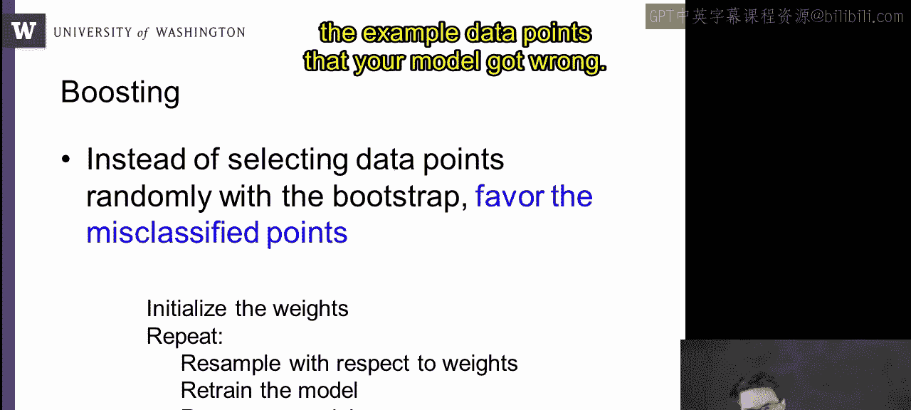

# 杜克大学《大规模数据科学（预测分析，交流数据科学结果，第2、3课⧸共3课有视频）｜Data Science at Scale》中英字幕 p47 46_集成：装袋、提升.zh_en -BV1xf421Q7bH_p47-

。

So we talked about reampling and we talked about the bootstrap and we talked about cross validation where you're splitting your training set in different sense in order to validate your results。

 So one idea that might occur to you is well， look， you know， we have all these different。

Subsets of our training that line around， why don't we train different classifiers on each one and combine their results。

So instead of trying to use it to validate one particular classifier。

 why do we just make a whole bunch of different classifiers and so the question that you need to answer is well look。

 can we does it actually make sense does it work to take a bunch of not very good classifiers and combine them will it actually get better and the answer。

Is not trivial to find out， but it was found out。 And the answer is yes。 Okay。

 And so you can average the results of different models and you get a couple of benefits。

 One is the strength will go up。 The classification performance will be better。

 and you can drive it up by design。But more importantly， perhaps it's more resilience to noise。

 and so you reduce the chance of overfitting by having a bunch of different classifiers。

All work in tandem。 Okay， so why， why wouldn't you do this， Well， there's two reasons。

 One is it's time consuming， right， obviously。Training a bunch of different classifiers is more expensive than training just one。

 but also you know they the behavior of your model becomes difficult to explain right when you have a whole bunch of different models all sort of voting on the answer。

It's difficult to。Take some intuition for what。Logic is actually being applied。

 and so remember we said a big just like one rule was easier to understand than a big set of rules。

One decision tree was easy to understand a big set of decision trees is perhaps not。

But that's not going to stop us from doing it。 Okay。

 so the idea here is that there's this wisdom of the crowds model。 Well。

 it works when you're talking about these digital artifacts as well， these generated models。

All right， so how do we actually do this， Well， one technique is called bagging。

 which is a port manteau of。Botttrap in aggregating。

 And so the idea here is to draw your in bootstrap samples。

 retrain the model separately on each sample just as we described， and then average the results。

 And so if you're talking about a regression problem that we haven't。Gonet to detail yet on。

 Then you would actually literally just average the results if it's classification where you're only picking a discrete。

Class label， Then you do a majority vote。 Okay， and so this works really。

 really well for overfi models。 It resists overfitting。

Because it decreases variance without changing the bias， so without moving the answer around。

 right it just shrinks everything。To that answer。 And if you remember。

 we put up that plot where high variances tended to mean overfit。 It means that yourre。

Specialized to the training data。 And you're very sensitive to the training data。 Okay。

 but it doesn't help much with。Models that do have a high bias with with wrong models and you remember high bias。

 low variance models are。More or less insensitive to the training data。

 and so all that you're doing with bagging is taking different permutations of the training data so if you're not getting a good signal out of the training data at all anyway。

 this isn't going to help much okay。So another technique is boosting。

Exemplified by this algorithm Ada boost。Okay， so here。

 instead of selecting data points randomly with the bootstrap。

 you want to favor the misclassified point so on each step。All right。So。Take a bootstrap sample。

 retrain a model， see what。An。Ex。Inspect the mistakes that the classifier made。Okay。

 and recompute the weights。For the next round of bootstrap， giving。

Extra weight to the example data points that your model got wrong。

