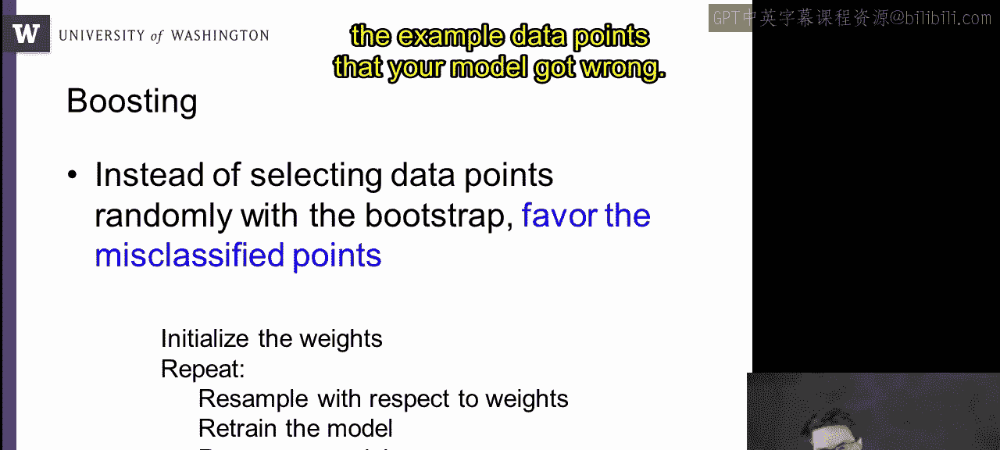

# 大规模数据科学：第2课：集成学习：装袋与提升 🧠

在本节课中，我们将学习集成学习的基本概念，特别是两种核心方法：装袋和提升。我们将探讨如何通过组合多个较弱的模型来构建一个更强大、更稳健的预测模型。

---

上一节我们讨论了重采样、自助法和交叉验证，这些方法通过分割训练集来验证模型性能。本节中我们来看看一个自然的延伸想法：既然我们拥有训练集的不同子集，为何不在每个子集上训练不同的分类器，然后组合它们的结果呢？

与其用这些子集来验证单个分类器，不如直接创建一系列不同的分类器。这里的关键问题是：将一堆表现不佳的分类器组合起来，真的能获得更好的性能吗？这个问题的答案并非显而易见，但已被证实是肯定的。

通过平均不同模型的结果，你可以获得几个好处。一是**分类性能会提升**，并且可以通过设计来进一步提高。但或许更重要的是，它能**增强对噪声的抵抗力**。通过让多个分类器协同工作，可以降低过拟合的风险。

那么，为什么不总是这样做呢？主要有两个原因。第一，这**非常耗时**，训练多个分类器显然比训练一个更昂贵。第二，当有一大堆模型共同“投票”决定答案时，模型的**行为会变得难以解释**。我们之前提到，一条规则比一大套规则更容易理解；一棵决策树也易于理解，但一大片决策森林可能就不是了。不过，这并不会阻止我们使用这种方法。

这里的核心理念是“群体的智慧”，这个概念同样适用于这些生成的数字模型。

---

那么，我们具体如何实现呢？以下是两种主要技术。

## 装袋法

装袋是“自助聚合”的合成词。其核心思想是：从数据中抽取自助样本，在每个样本上独立地重新训练模型，然后聚合结果。

具体步骤如下：
1.  从原始训练集中抽取多个自助样本。
2.  在每个自助样本上独立训练一个基学习器。
3.  对于回归问题，直接对各个模型的预测结果取平均值。
4.  对于分类问题，则采用**多数投票**的方式决定最终类别。

装袋法对于**高方差、易过拟合的模型**效果非常好。它通过**降低方差而不改变偏差**来抵抗过拟合，这意味着它不会改变预测的中心趋势，只是让预测结果更稳定地收敛于该中心。回忆我们之前展示的图表，高方差通常意味着过拟合，即模型对训练数据过于敏感。然而，装袋法对于本身**偏差就很高**的模型帮助不大。高偏差、低方差的模型对训练数据本身就不太敏感，因此，仅仅对训练数据进行不同排列组合的装袋，如果无法从数据中获得有效信号，就不会有太大改善。

---

上一节我们介绍了通过随机抽样组合模型的装袋法。本节中我们来看看另一种思路：提升法。

## 提升法

提升法以**AdaBoost**算法为代表。与装袋法随机选择数据点不同，提升法在每一步都**更关注被错误分类的样本点**。

其基本流程如下：
1.  首先，从训练集训练一个基学习器。
2.  然后，**检查该分类器犯的错误**。
3.  接着，**重新计算样本权重**，增加被错误分类数据点的权重。
4.  基于新的权重分布，进行下一轮抽样（或直接训练），训练下一个分类器。
5.  重复此过程，并将所有弱分类器组合成一个强分类器，通常根据每个分类器的准确性进行加权投票。

这种方法让后续的模型能够专注于纠正前序模型所犯的错误，从而逐步提升整体模型的性能。

---

在本节课中，我们一起学习了集成学习的两种强大技术：装袋与提升。装袋法通过自助采样构建多个独立模型并聚合结果，有效降低方差、防止过拟合。提升法则通过关注错误样本、迭代调整，让一系列弱分类器协同工作，逐步提升模型性能。理解这两种方法的原理与适用场景，将帮助你构建更稳健、更准确的数据科学模型。