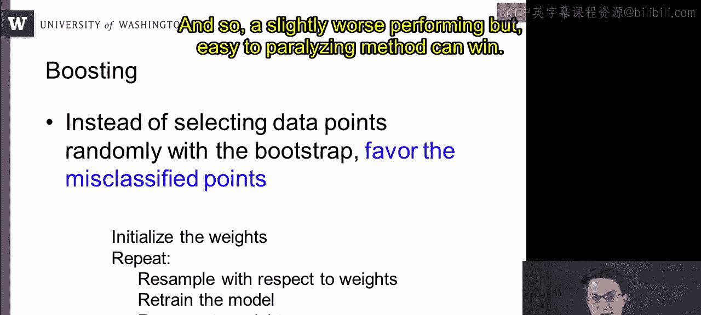

# 杜克大学《大规模数据科学（预测分析，交流数据科学结果，第2、3课⧸共3课有视频）｜Data Science at Scale》中英字幕 p48 47_提升演练.zh_en -BV1xf421Q7bH_p48-

。

Okay， so let's see what this looks like a little more precisely。Okay， so for each。Step T。

We've got a vector of weights， which represent the probability of selecting example I in the samples。

 That's this D。 So D， F T， D of I is。The probability of selecting I in the sample。

 and these are initialized to equal probability to uniform。Probability， and then x and y。

X sub I and y sub are your。嗯。Record and your label。Okay。I saying data point example and record。

 I think sort of interchangeably， which probably isn't all that helpful。bearear with me。

 so H subt is the trained classifier at step T using the sample drawn according to the weights。

D okay。Now。Compute the error by adding up all the weights。For everything that was misclassified。

Or this epsilon in' say error。 compute this epsilon by adding up the weight for everything that was misclassified。

 And that's what this。Incantation is down here right so this says for the model H sub T。

 apply it to x sub I where it's not equal to where the classifier tells you something different than the actual class label than include it in a set and add up all the excuse me add up all the Ds for those。

Okay， then compute what's called the odds。Which is the odds given a probability is that probability over 1 minus that probability。

Okay。So compute the odds of misclassifying and then weight those values。

 those misclassified values by the odds。Okay。Oh， excuse me。 But you're going to this。

 that's not quite right。 You're going to this is a， this is a value between 0 and one， right。

And so this gives lower weight to D of I， and you're only going to apply this function to the ones that were correctly classified。

And all the other weights， you just leave alone。And so this isn't。

 I didn't put that data for in attempt at clarity。 I didn't include the the entire expression。

 That may not have been a good idea。 So this is only applied to the correctly classified examples。

 Okay， and then there's actually one other step that I also removed in an attempted clarity。

 which is you need to normalize all these down， because what you've done now is taken a set of weights that normalized to probabilities。

They add up to one。And you've just adjusted some of them down。Well。

 now it's not going to add up to one anymore。But that's okay because you know the relative weight。

 So you need to renormalize all this。 And so it's a pretty simple step but。

I find when you sort of throw a divide by Z in here。

 it gets confusing so I just wanted to explain it this way and then that gives you your new weights for the next round and then you repeat this process。

Okay， so a question I want to ask about this， though， given our。

Appreciation for big data and for scale out solutions。The difference between bagging and boosting。

 Well， I guess I should probably promise you。 So boosting has a bunch of nice properties。

 and it's a very， very successful algorithm。 And one thing that's especially cool about this is that it。

😊，It's a meta algorithm right It works on anything。

 it doesn't say anything about what this classifier needs to be。 any it could be a decision tree。

 It could be any other method you might come up with right All it does is affect。

The data you use to train the classifier each step。And so this is very， very general and very。

 very powerful。O。And because of this weight， it actually does sort of start to zero in on the mistakes that are made。

 giving more and more weight to the errors， and so you can sort of imagine intuitively that the strength of the classifier is going to get very。

 much better and better over time。So that's well and good， and it works。

But it has a disadvantage with respect to really big data relative to a simpler approach just as bagging。

And so that is。It's inherently sequential。We have this for each time step。

The weights of time t plus1 and step t plus1 depend on the weights of step T。We're bagging。

We can just。Go wild in parallel and do all of this at the same time。Okay。

So that's something to keep in mind that you don't。

See quite as often in the discussions of these various methods because they tend to focus on the mathematics involved in the。

Sort of performance， but when we keep know in a data science context we need to keep in mind that we're going to be working on very。

 very large data sets at times， and so a slightly worse performing but easy to paralyze method can win。

