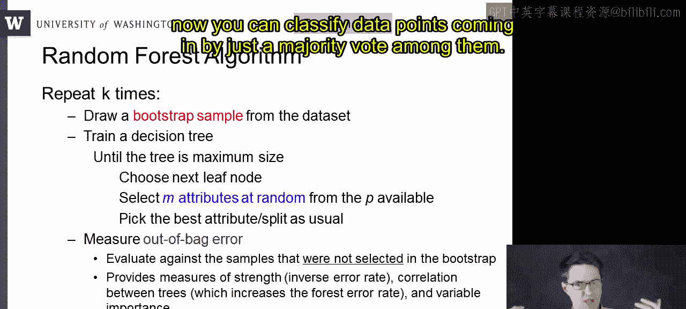
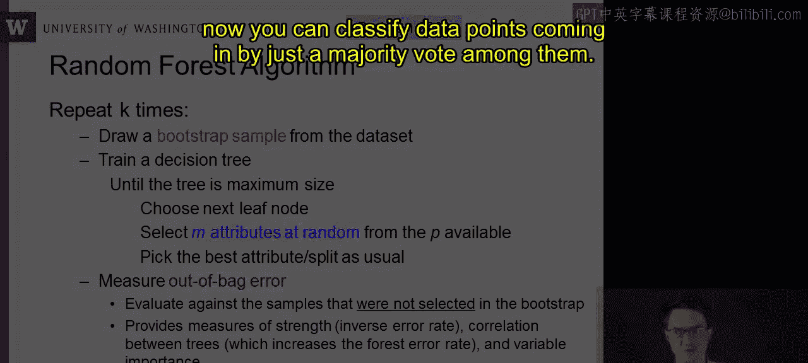

# 杜克大学《大规模数据科学（预测分析，交流数据科学结果，第2、3课⧸共3课有视频）｜Data Science at Scale》中英字幕 p49 48_随机森林.zh_en -BV1xf421Q7bH_p49-

。

So we talked about。Boosting and bagging and ensemble methods and。

Drawing bootstrap samples and so some of these ideas we can put together and apply them to decision trees in order to create an ensemble method based on decision trees and one such ensemble method is random forest due to Bremen in 2001。

 And so this one is really， really popular and really。

 really powerful Okay so it's a good one to know so。K times。

 you're gonna to repeat the following procedure。 Okay， where K is a parameter that youll specify。

 You'll draw a bootstap sample from the data set and then train your decision tree on that bootstap sample as follows。

 So until the tree is some maximum size， that is usually set pretty conservatively。

You'll choose a leaf node。Herate over all the leaf nodes and for each leaf node。

 select M attributes at random out of the P that are available。 Okay。

 so you're not going to use all the。 You're not going to consider all the attributes。

When you're deciding how to split a node， you're just going to select in at random and consider among those。

And then pick the best attribute or split of the attribute as usual。

 using entropy or other methods and we'll talk about one more。Okay。So now you have a tree。

That only involves in of the attributes， and it was derived from only part of the data set。 Okay。

 so now you measure the out of bag error。So what's the about bag of your error。 Well。

 when you draw a bootstrap sample， remember that you might get duplicates， right。

 So you have a data set of size in， you're going to draw a bootstrap sample also of size in。

 But whenever you get a duplicate， that means that some other data item was left out of the sample。

 Okay， so take all those。Date items that were left out of the sample， and that becomes your test set。

All right， so now evaluate the error on that test set and use this for you can use this for various purposes。

You don't necessarily need to use it to。啊。Make decisions as part of the algorithm。

 but it's computed on the fly as part of the algorithm for various other purposes。

So you can do this to estimate the strength。Which is the inverse of the error rate。

You can do this to measure the correlation between random trees， right。

 So each one of these is sort of a different tree using different。

 potentially different attributes and a different subset of the data。

 But you can imagine that just by chance， you might get a bunch of trees that all do the exact same thing and make all the same decisions right。

 This would lower the。Power， lower the strength of the overall ensemble classifier。

 and so you don't want that， and so this gives you a running measure of how correlated things are。

Okay。It also gives you a measure of variable importance， which we'll talk about in the next slide。

Okay， so finally， at the end of this， you have K trees。啊。That are hopefully more or less independent。

 And now you can。

Classify data points coming in by just a majority vote among them。

