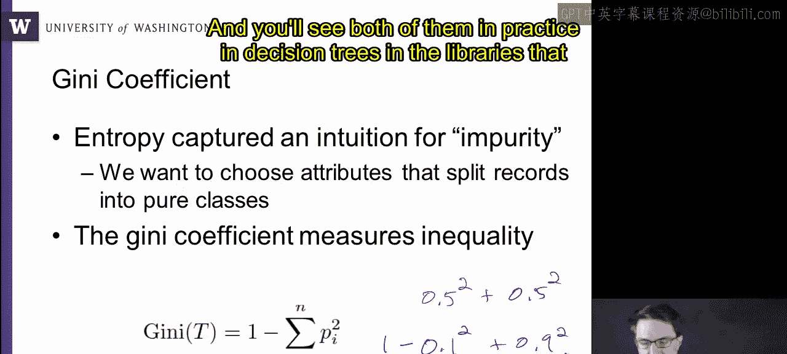

# 杜克大学《大规模数据科学（预测分析，交流数据科学结果，第2、3课⧸共3课有视频）｜Data Science at Scale》中英字幕 p50 49_随机森林：变量重要性.zh_en -BV1xf421Q7bH_p50-

。

So there's notion of variable importance。So one of the weaknesses of ensemble methods that we mentioned are perhaps the interpretability of them right so a single decision tree makes a lot of sense if I have a whole set of decision trees all sort of working in concert。

 it's a little less clear。What's going on and so if you're actually trying to。

Use these models to gain some insight about the domain that may be difficult with a random four is all you get is sort of the answers out and they have high accuracy but you don't really know why it works okay so。

Variable importance is a hedge against this。 So the idea is that you'll。

As an output of running this algorithm， you'll get a measure of how important to the accuracy。

The various attributes were。W we're using variable and attribute interchangeably， okay。

So how do you measure this， Well， as you're training each tree。You do this permutation experiment。

 and we've seen this。啊。Before， at least I think we have。

So you'll scramble the values of that attribute。And what you'd expect is that once you scramble these。

Li。啊。Accuracy。You know， the error rate。It may change。Okay， and if it's an important attribute。

 then it'll change a lot。 And if it's not a very important attribute。

 then it doesn't change very much。 And that's the idea。

 So if you scramble this and and the error rate does not change very much。

 then it must not have been an attribute that was heavily used in。The decision tree。Okay。

So you measure the error increase after pertuting these values。And。

You can plot for all the attributes in the data set。

 which ones came out to be most important by aggregating these across all the trees。Okay。

 and so this helps with interpretability of the overall random forest because you get a sense of which ones are really helping to make all the decisions。

All right， and so with some applications， in particular。

 a few places mentioned the medical applications。Need to eventually get down to root causes。啊。

Rather than sort of doing fire and forget treatments。F。

 so one other difference is the genie coefficient is often used。

 and this actually comes up not just in random four as it comes up in variations on decision tree algorithms。

 And so we talk about entropy as a measure of impurity when you're making a decision on each node。

 right， you need to decide。Which attribute to split on that'll give you the most。

Reduction in uncertainty。And so you're looking for choices thatll give you very pure choices to the left and very pure choices to the right。

 right where if I select。Female and male， then I get 100% of the。Records。

 when I go down the female branch， all survive in the Titanana data set。 Okay。

 so somewhere somewhere down the decision tree， this may turn out to be the case。

 in which case that would be a。A strong indication to use the gender attribute to make the split。

 okay。And so we measured we count out this measure of intuitive notion of impurity using entropy。

 another calculation of the intuitive notion of impurity is the gene coefficient。Okay， and so this。

Looks like this。And so if you think about what this is doing。

You can think about how this behaves we're not going to going。

Deriveve this and there's actually vary notions of how to compute the Gen coefficient in general。

Do you think about how this is behaving that if you have？Probability 0。5。Lin。😔。

Square that and it'll be plus 0。5 on the other side。

 say we have a binary classes so just survived and not survived。And this will be 0。25。Plus， 0。25。

 which is 0。5。ok。But if you have。0。1 squared， plus 0。9 squared。Well。

 that's going to be a lot smaller。Okay。So one minus that will be much bigger。

OkayAnd this makes sense because if 90% of the values are the same。You know。

 if 90% of the values are one value and its only 10% of the other。

 then this is this attribute is more pure than something that is evenly split and so you still got this function that's ranging from zero to one capturing it。

Some notion of purity and this has the same properties that are。

Has that same property as entropy did。All， so now you know both of those methods for measuring this impity。

 and you'll see both of them in practice and decision trees in their libraries that implement them。

