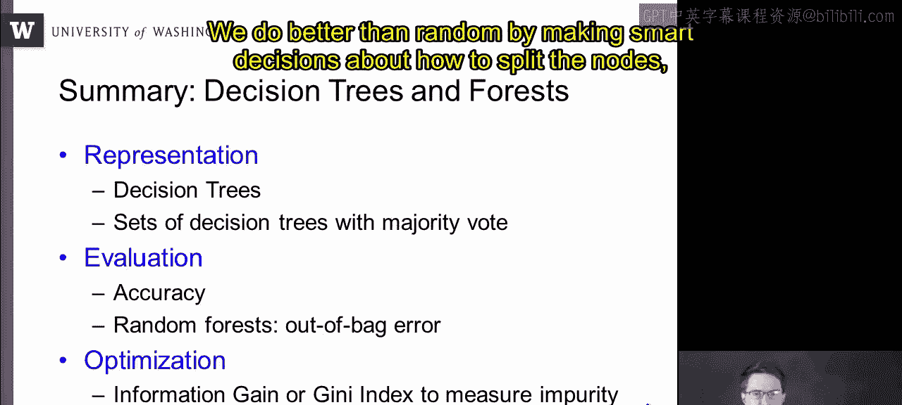

# 杜克大学《大规模数据科学（预测分析，交流数据科学结果，第2、3课⧸共3课有视频）｜Data Science at Scale》中英字幕 p51 50_总结：树和森林.zh_en -BV1xf421Q7bH_p51-

。

So there's just a couple of comments about these random forests。These are this is easy to parallelze。

 right， all that requires is being able to take a random bootstrap sample in parallel， which。

Is usually easy for most data sets。 If the data sets are very， very large， it can be expensive to。系。

Take random samples。But it's still a lot cheaper than training models。

Sequentialally okay and so other than that， the training the training of the trees can all happen in parallel and so this scales out really。

 really well the other nice feature this is because you're selecting those m attributes at random where M is oftentimes a lot less than P you know it's only selecting a few of the attributes。

Which makes sense right because if you're going to have a whole bunch of trees vote。

 well you're going to make sure that every attribute in the whole data set will be represented enough。

 you don't necessarily need to have them represented in every single tree。Well。

 this is nice because it sort of scales to very large numbers of attributes quite well。All right。

And then it has these other side effects of ven which generate on the fly estimates of its own。

Accuracy and variable importance and so on。And so just to summarize this。

 going back to this framework of representation， evaluation and optimization。

 you the representation here is trees or sets of trees where the majority vote determines the actual classification。

 the evaluation of these things has to do with just error rates and accuracy。

 although we talked about some of the other measures that you might use。

And then random forests we have this out of bag air， which is same thing as accuracy。

Defining where you get the test set from， right，'s the left it falls out naturally from from the fact that you're taking bootstrap samples。

All right。So you don't have to make a separate decision about cross validation and so on。

Although I should say you should this is sort of independent of cross validation。

 this is you know this out of bag error is generated on your training set。

 you should still beforehand before you even walk up to the table。

 consider how you're going to do cross validation or how you're going to split your training set into test and training。

 all right。And then finally， optimization， it's not so much an optimization as in we have a naive algorithm and we improved it with some optimization。

 but we do have this information gain Genie index。Approach to constructively build trees that have。

Good predictive power。So we could take， I mean， see we say random forest。

 but it's not truly random in the sense that we're just building random trees those wouldn't perform very well。

 we do better than random by making smart decisions about how to split the nodes。

 which attributes uses to split。

