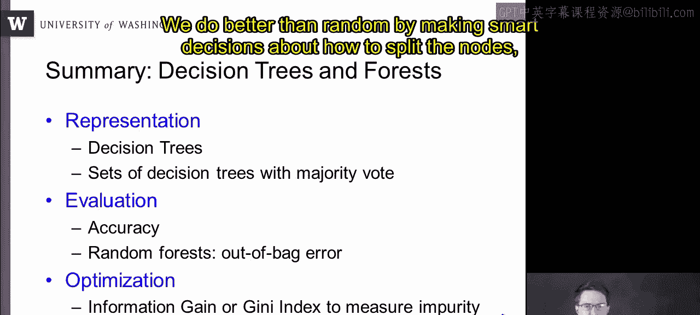

# 大规模数据科学（预测分析，交流数据科学结果）：第2、3课：总结：树和森林 🌲🌳

在本节课中，我们将总结关于决策树和随机森林的核心概念。我们将回顾它们的表示方法、评估指标、优化过程，并重点讨论随机森林的并行化优势、处理高维数据的能力以及其内置的评估特性。

---

## 关于随机森林的几点说明

上一节我们介绍了决策树的构建与评估，本节中我们来看看其集成方法——随机森林的几个关键特性。

随机森林易于并行化。其核心要求是能够并行地获取随机自助采样样本。对于大多数数据集，这通常很容易实现。如果数据集非常庞大，进行随机采样可能会耗费较多资源，但这仍然比顺序训练模型的成本低得多。

除了采样，所有决策树的训练过程也可以并行进行，这使得随机森林能够非常好地进行横向扩展。

随机森林的另一个优点是，它在每个节点分裂时，会从全部 `P` 个特征中随机选择 `M` 个特征（通常 `M` 远小于 `P`）。这意味着每棵树只考虑一部分特征。这很有意义，因为既然要让大量树进行投票，就需要确保整个数据集中的每个特征都能得到充分体现，而不必在每一棵单独的树中都出现。这个特性使得随机森林能够很好地扩展到具有大量特征的数据集。

此外，随机森林还有一些有益的“副作用”，例如可以即时生成对自身准确率和变量重要性的估计。

---

## 回顾：表示、评估与优化框架

现在，让我们回到表示、评估与优化的框架来总结决策树和随机森林。

*   **表示**：这里的模型是决策树或决策树的集合，其中最终的分类由多数投票决定。
*   **评估**：评估主要与错误率和准确率有关。我们也讨论过其他可能使用的评估指标。对于随机森林，我们拥有**袋外误差**，它与准确率定义相同，但区别在于测试集的来源。袋外误差自然地从自助采样过程中产生，因此无需单独决定如何进行交叉验证。
*   **优化**：在优化方面，我们并非通过改进某个朴素算法来实现，而是采用了基于信息增益或基尼指数的方法，来逐步构建具有良好预测能力的树。我们称之为“随机森林”，但并非指构建完全随机的树（那样性能会很差）。我们通过智能地决定如何分裂节点、选择哪个属性进行分裂，从而构建出优于随机猜测的树。

---

## 总结

本节课中我们一起学习了决策树与随机森林的核心内容。我们了解到随机森林因其并行化能力而具备出色的扩展性，通过特征随机选择能有效处理高维数据，并且其自助采样过程自然地提供了袋外误差这一内置评估工具。最后，我们再次通过表示、评估与优化的框架，系统性地回顾了这些模型的构建原理与评估方法。