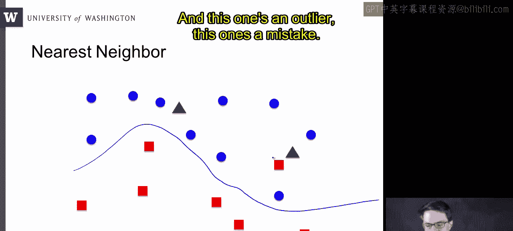

# 杜克大学《大规模数据科学（预测分析，交流数据科学结果，第2、3课⧸共3课有视频）｜Data Science at Scale》中英字幕 p52 51_最近邻.zh_en -BV1xf421Q7bH_p52-

。

Okay， so where are we， We're talking about classification problems and supervised learning。

 We talked about rules。 We talked about decision trees。

 and then we said a challenge of decision trees is that they。

Are prone to overfitting and so there's methods for avoiding overfitting an individual decision trees that we didn't really talk about。

 such as you build them and then you can prune out parts of the tree and aggregate parts of the tree so that they become a little more general。

But instead we shifted to another more general and more powerful technique to avoid overfitting。

 which is to use ensembles of models and so within the context of ensembles。

 we talked about boosting。In particular。Inion this algorithm。Ada boostt。Which is。A meta algorithm。

 meaning that it works on any。Machine learning application， it doesn't have to be about trees。

 but we talked about it in the context of trees， and we talked about bagging。

 which is about selecting subsets of your data to work on。And bagging itself relies on the bootstrap。

 which is a technique for resampling the same data set in order to drive。Hm。

Estimates of important statistics。 Okay， and we put some of that together and talked about random forest。

 which is an ensemble method for decision trees that has a couple of。Unique characteristics。

I went through this rules and thende trees and then ensembles approach。

 sort of sidestepping the well， postponing the。Regression oriented。Machine learning models。

 And there's a couple reasons for this。 One is random forest do turn out to be a pretty powerful method。

 a pretty general technique for a lot of things and generality。

 not just in their statistical power and their sort of efficacy and practice。

 but also the fact that they work on categorical attributes， the fact that they can handle。

Many attributes。 so big P smaller in cases， the fact that they can。

There's different variations of them that you can experiment with。

 the fact that frankly they're kind of simple to interpret the results of and also maybe even simple to implement yourself。

You， hopefullype you're armed with enough knowledge where you think you could make a go at this。

 So I think they're， they're actually a pretty fantastic general purpose approach。😊，All right。

 so let's consider a different method that's not rule or tree based。Nearest neighbor classification。

 So here this is actually one of the simpler ones。 And there's a reason you know it would be reasonable to actually present this first。

 But the reason I didn't do that is that it assumes only numeric attributes。

 And I think a lot of the intuitive data sets you work with。

 especially when you're coming from kind of a。knowMaybe data processing background。

 data science sort of scenario as opposed to a peer machine learning and pure statistical。background。

 the categorical data is quite common。Defining nearest neighbor is sometimes possible， but it's not。

 it's， it's not always very natural。 Okay， but now that we've sort of covered the more general techniques they can handle categorical data。

 we can think about these。 So nearest neighbor is。Dead， simple， right， This is to say。

Ploch your points in a space like this where the red squares represent one class and the blue squares up another。

 you know maybe survived or not survived in the Titanic example and when you have a new point that you want to classify。

 just drop it into the space。At who point the attributes tell you where should go and choose the class of the。

Nearest point to it。 Okay， so what's the class of this green triangle， Well。

 the closest point to it is a blue circle。 So we call it it blue。And。

What's the closest point to this green triangle？ Well， that one's a red square， So we call it red。

Now， as you can see in the second case。Maybe it's not that reasonable to call it red。

Because perhaps the class boundary is sort of something like this。

 and this one's you know an outlier， this one's a mistake。

 and so we perhaps would misclassify this second green triangle。

