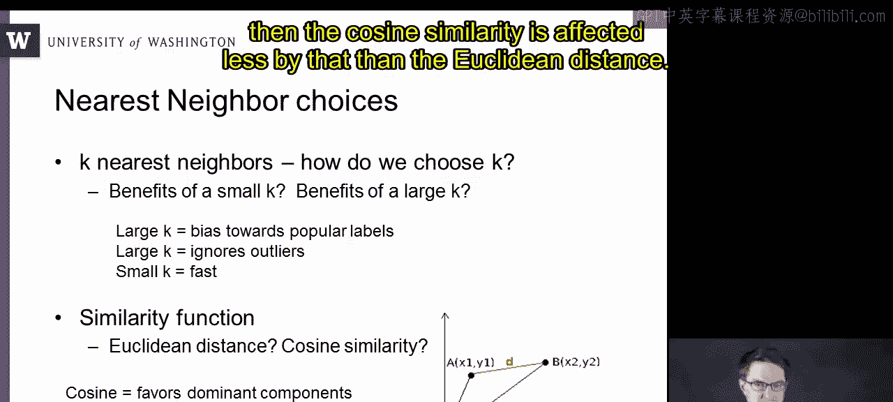

# 杜克大学《大规模数据科学（预测分析，交流数据科学结果，第2、3课⧸共3课有视频）｜Data Science at Scale》中英字幕 p53 52_最近邻：相似度函数.zh_en -BV1xf421Q7bH_p53-

。

So the intuition here is。You know。Going back to this sort of document classification example。 Well。

 the last document I saw that mentioned。The word falcons and the word sas was about sports。

 So I'm just going to go ahead and assume that this document is also about sports。

 And it has the same terms in it。 Okay， And so this is not the most unreasonable method to use。

 But as we saw， you know， perhaps it's a little bit sensitive to noise in the data。And so another。

You know， a simple extension of this is to imagine k nearest neighbors as opposed to just one nearest neighbor right so you find the K closest points and then they take a vote on what class it should be okay and this gives you a little more resilience to。

Noise in the data。下。At a cost， so you can ask yourself。How would you choose K？

All right what should KB well。The benefits of a small K。A that it's。Fast。

 and there's less of a bias towards。Popular labels。 So what I mean by that is。

That if you have imbalance in your data， right， So you have。

 say many more people that survive than didn't survive， then there's going to be a lot of those。

Blue circles relative to red squares， let's say right And so therefore。

 the odds that you're going to land somewhere near a blue circle。

 assuming a certain amount of noise in the data goes up and so you'll start to misclassify more and more and more。

You know， as a result。 And so imbal in the data。Translates into higher error rates。However， you know。

 the benefit of a large K。Even though it's sensitive to imbalance is that it ignores outliers。

 you're insensitive to the outlier。Choosing a K is perhaps problem specific。

 And there's been work on on。Making this more precise。 Okay。

 so the other decision you need to make is some kind of a similarity function。 And so typically。

 you would imagine just Euclidean distance。In in these cases。

 but another one that might make sense is。Cosine similarity。Which is。

A measure of the angle between the two vectors。 So if you have two points。In。Space。

This line D is the distance between them， while the cosine similarity is how far apart they are in the angle。

I to think a little bit about what the trade offs are here。So。If I was in the classroom。

 I would ask you guys， I would wait for some answers， because since I'm not all。Pause dramatically。

 and then just。Talk about it。One thing to remember in general is when anybody asks。

 what is the problem， what is the disadvantage of Euclidean distance。

 you should always have the same answer in mind right There's one big disadvantage of Euclidean distance。

And that is that it's。Sensitive to the number of dimensions， so as the number of dimensions goes up。

The distance between points is sort of hard to interpret， right， because it tends to go up as well。

For not necessarily any kind of good reason。 And remember that a lot of these machine learning applications will have a very large number of dimensions。

Right， so all the English words， for example， in the document classification case。So。So that's fine。

 That's the disadvantage of Euclidean is that you have this sort of cursive dimensionality。

Problem going on。The disadvantage of cosine is that it kind of favors the dominant components。

 meaning that。啊。If two vectors are the same in all dimensions。

 except for one where that value is much， much higher on one vector than the other。

 then the cosine similarity is affected less by that than the Euclidean distance。

