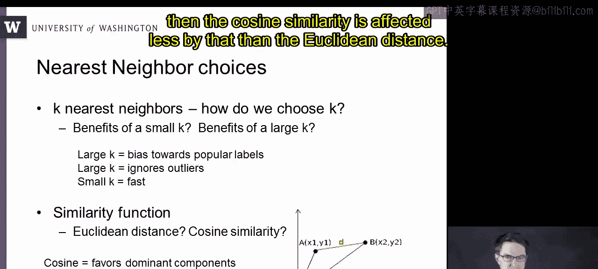

# 大规模数据科学：第2课：最近邻算法与相似度函数 📊

在本节课中，我们将学习最近邻算法的核心思想及其扩展——K最近邻算法，并探讨如何选择合适的相似度函数来度量数据点之间的距离。

---

## 最近邻算法的基本思想

上一节我们介绍了分类问题的基本概念，本节中我们来看看一种直观的分类方法：最近邻算法。

其基本思想是：对于一个待分类的新数据点，找到训练数据中与它最相似（即距离最近）的那个点，然后将新点归类为该最近邻点的类别。例如，在文档分类中，如果新文档与之前一篇关于体育的文档在词汇上高度相似，我们就将其也归类为体育文档。

这种方法虽然直观，但对数据中的噪声较为敏感。一个简单的扩展是使用K最近邻算法。

---

## K最近邻算法

为了提升对噪声的鲁棒性，我们可以不只看最近的一个邻居，而是考察K个最近的邻居。

以下是K最近邻算法的基本步骤：
1.  对于一个新数据点，计算它与训练集中所有点的距离。
2.  找出距离最近的K个点（邻居）。
3.  让这K个邻居进行投票，根据多数票决定新点的类别。

### 如何选择K值？

选择K值是一个权衡过程，以下是不同K值的特点：

*   **小K值（如K=1）的优点**：
    *   计算速度快。
    *   对数据中的类别不平衡问题不那么敏感。在类别不平衡的数据中（例如“存活”样本远多于“未存活”样本），大K值容易因多数类邻居过多而导致误分类。

*   **大K值的优点**：
    *   能更好地忽略异常值或噪声点的影响，使分类结果更稳定。

选择K值通常需要针对具体问题进行调整，已有许多研究工作致力于更精确地确定K值。

---

## 相似度函数的选择

除了K值，另一个关键决策是选择何种函数来衡量数据点之间的“相似度”或“距离”。

### 欧几里得距离

最常用的距离度量是**欧几里得距离**。对于两个点 `p` 和 `q`，其欧几里得距离公式为：
`distance(p, q) = sqrt( (q1 - p1)² + (q2 - p2)² + ... + (qn - pn)² )`

### 余弦相似度

另一种常用的度量是**余弦相似度**，它衡量的是两个向量在方向上的差异，即它们之间夹角θ的余弦值。
`cosine_similarity(p, q) = (p·q) / (||p|| * ||q||)`
其中 `p·q` 是点积，`||p||` 是向量p的模长。余弦相似度的值域为[-1, 1]，值越接近1，表示两个向量的方向越一致。

### 两种度量的权衡

现在我们来思考一下这两种度量方式的权衡。

*   **欧几里得距离的缺点**：它对维度数量敏感。随着数据维度（特征数量）的增加，点与点之间的距离会变得难以解释，并且普遍会增大，这被称为“维数灾难”。在许多机器学习应用（如文档分类，特征是所有英文单词）中，维度数量非常庞大，这是欧氏距离面临的主要挑战。

*   **余弦相似度的缺点**：它更倾向于受主导成分的影响。这意味着，如果两个向量在绝大多数维度上都相同，仅在一个维度上某个向量的值远高于另一个，余弦相似度受此差异的影响要小于欧几里得距离。这在某些情况下可能忽略掉重要的局部差异。

---

## 总结

本节课中我们一起学习了最近邻算法的核心思想及其扩展K最近邻算法。我们了解到，K最近邻通过让多个最近邻投票来提升分类的稳定性。同时，我们探讨了两种关键的相似度度量函数：欧几里得距离和余弦相似度，并分析了它们各自的优缺点及适用场景。理解这些基本概念是应用最近邻方法解决实际分类问题的基础。