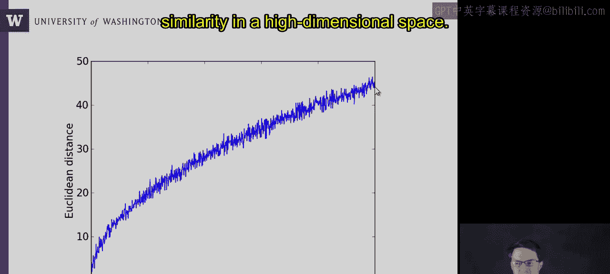

# 杜克大学《大规模数据科学（预测分析，交流数据科学结果，第2、3课⧸共3课有视频）｜Data Science at Scale》中英字幕 p54 53_最近邻：维度灾难.zh_en -BV1xf421Q7bH_p54-

。

So I've got a point here。In here， and then I've got a red point here。And way up here。Then。The angle。

To the blue。Is that while the angle to the red。Is that。 And so this distance。

Is relatively less sensitive to this increase。Then， Euclidean distance。

Where this point and this point。Are much further apart， are sort of linearly far apart。Okay。

 so what this translates into is that you'll tend to be more similar。To。Neighbors。Who have a very。

 very large value and what in some dimension。Okay。And that can be a good thing or a bad thing。

 So in one paper， they talk about sort of this being a good thing for image retrieval。

 because if you have。Very striking features in terms of say， color composition of the image。

 So this is like， you know you've got a query image and you're trying to look for other similar images and you extract a bunch of features from the image and you try to find similar ones。

And then you want the can nearest neighbors。Then say you have very strong red and brown or red and blue kind of colors in your image。

Then。You're going to find things that have。Red and blue， but perhaps less extreme。So lower magnitude。

 but still red and blue。Is should be a return in the results while。You know， close in magnitude。

 but in a different dimension。You know， so， so about the same magnitude intensity， but in。

Green and yellow is perhaps less similar in that application。

But this is all very application dependent。Okay， so one final point I want to make about this is。

This notion of Euclidean distance and sensitivity to the number of dimensions。This is。

Random data normally distributed with some variances of， I don't know。

 two or one or something like that。It's a little more than that， probably more like four or five。

And just taking two points。In a D dimensional space。Where D is going from 0 to 1000。

 So give me a random point in a 500 dimensional space and give me a random point in 50al space and measure the Euclidean distance。

Okay， and so you can see the Euclidean distance is sort of going up。

With respect to the number of dimensions， even though the。

Random distribution from which these points are drawn is the same。

 and so as the space sort of expands exponentially。Things get sort of further and further apart。Okay。

 and so this may or may not be the effect you want when you're trying to measure similarity。

In a highvin space right。

