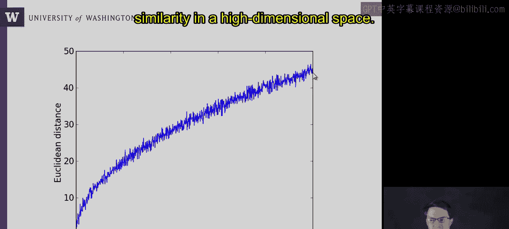

# 大规模数据科学：第2课：维度灾难与距离度量 📊


在本节课中，我们将探讨高维空间中的距离度量问题，特别是欧几里得距离和余弦相似度在不同维度下的行为差异，以及它们对最近邻搜索的影响。

---

## 高维空间中的距离度量

上一节我们介绍了最近邻算法的基本概念，本节中我们来看看当数据维度增加时，距离度量会发生什么变化。

假设空间中有一个点，这里有一个蓝点，远处有一个红点。从原点到蓝点的角度是θ_blue，到红点的角度是θ_red。此时，**余弦相似度**对此距离变化的敏感度相对较低。

相比之下，**欧几里得距离**则不同。这个点和那个点在线性距离上相隔很远。

**公式**：对于两个向量 **a** 和 **b**，欧几里得距离为 `dist = sqrt(∑(a_i - b_i)^2)`，而余弦相似度为 `cos_sim = (a·b) / (||a|| ||b||)`。

这意味着，你往往会与那些在某个维度上具有**非常大值**的邻居更为相似。这既可能是好事，也可能是坏事。

## 应用场景分析

以下是余弦相似度在特定应用中的优势分析。

在一篇论文中，作者认为这对于图像检索是件好事。例如，你有一个查询图像，试图寻找其他相似图像。你从图像中提取一系列特征，并尝试找到相似的特征。

假设你的图像具有非常强烈的红棕色或红蓝色调。那么，你将找到那些同样具有红蓝色调，但强度可能较低（即幅度较小）的图像作为返回结果。

相比之下，那些幅度相近但色调不同（例如绿色和黄色）的图像，在该应用场景下可能被认为相似度较低。

但这完全取决于具体的应用场景。

## 维度灾难现象

关于欧几里得距离对维度数量的敏感性，我想最后强调一点。

假设数据服从正态分布，方差约为4或5。在D维空间中随机选取两个点，其中D从0变化到1000。

**代码示例**（概念性）：
```python
import numpy as np
def random_distance(dim):
    point1 = np.random.randn(dim)
    point2 = np.random.randn(dim)
    return np.linalg.norm(point1 - point2) # 欧几里得距离
```

你可以看到，即使这些点是从相同的随机分布中抽取的，**欧几里得距离也随着维度的增加而上升**。

随着空间呈指数级扩展，事物之间的距离变得越来越远。当你在高维空间中尝试度量相似性时，这可能并不总是你想要的效果。

---



本节课中我们一起学习了高维空间对距离度量的影响，比较了欧几里得距离与余弦相似度的不同特性，并理解了“维度灾难”如何使数据点在高维空间中彼此远离，从而影响最近邻搜索等任务的性能。选择何种距离度量需要紧密结合具体的应用需求。