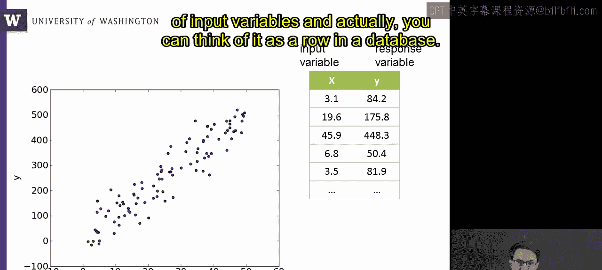

# 杜克大学《大规模数据科学（预测分析，交流数据科学结果，第2、3课⧸共3课有视频）｜Data Science at Scale》中英字幕 p55 54_梯度下降优化.zh_en -BV1xf421Q7bH_p55-

。

All， so we' recap of where we are， we talked about supervised learning。

 talked about deriving rules and arranging them into trees。

 we talked about how those trees are susceptible to overfitting。

And we talked about one way of combating overfitting is to use ensembles of weak learners and combine their results to form a strong learner and gave one example of this in random forests。

 We also mentioned that one disadvantage of these ensembles is that become pretty difficult to interpret。

 because it's a big vote among a bunch of。smaller models and so you not not quite clear where the decisions are coming from and random forest had one way of attacking this in that as you build the random forest it was producing an importance measure for the variables right so if particular attributes were more influential in the decision you would get a measure of this as one of the outputs and then we talked about can nearest neighbors。

Whi was a change in that it used numeric attributes and continuing that we're going to talk about gradient descent and some applications of it。

 okay。So。This。Remember the three components of a machine learning solution is the representation of the model。

 the evaluation of that model， how you tell how well it's doing， and then how you optimize。

The process。 And so the gradient to is an optimization method that's applicable in a lot of different contexts that will。

Touch on at the end。 Okay， so in a nutshell， what you're doing here is expressing your learning problem in terms of some kind of a cost function that you want minimized。

And starting at some initial point， you're going to， you know。

 roll the ball downhill until it settles in a trough。

 And so this process describes how to walk downhill。 It's not really a roll。 right。

 You're gonna take steps。 And that turns out to be one of the。Difficulties with。

 with gradient descent。And so some situations you can sort of design offer a guarantee that the minimum you find will be the global minimum other times you don't。

 and so getting trapped in local mini for more complex problems that we won't go into too much detail on。

I is another potential weakness of this。Method， okay。

So the problem we're going to be thinking about here is no longer classification。

 although we'll mention how you can use this for classification at the end we're going to think about just regression okay and so regression can still be used as a prediction task。

And we think about sort of fitting a line to data。 But the point is that you might use that line in order to make predictions of the outcome value。

 know， the response variable， given the inputs down the road。 Okay， so regression line is a。Predctor。

Okay， so rather than a discrete class variable， we're maybe talking about response variable that's continuous。

F， so in this case， we'll take the very simple case of just a single input variable。

 but in throughout this， we're going to be thinking about an entire vector of input variables and that vector you can think of it as a row in a database。

