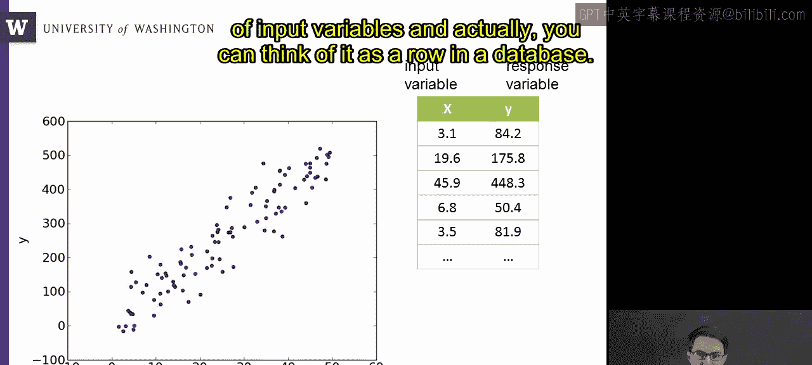

# 大规模数据科学：第2课：梯度下降优化 🎯

在本节课中，我们将学习一种重要的机器学习优化方法——梯度下降。我们将从回顾已学知识开始，然后深入探讨梯度下降的基本原理、应用场景及其优缺点。

上一节我们介绍了随机森林和K近邻等算法，本节中我们来看看梯度下降如何为机器学习模型提供另一种强大的优化思路。

---

## 概述 📋

梯度下降是一种广泛应用于机器学习的优化方法。其核心思想是将学习问题表达为一个需要最小化的**代价函数**，然后通过迭代“下山”的方式找到函数的最小值点。我们将首先理解其基本组件，然后探讨它在回归问题中的应用。

---

## 机器学习解决方案的三个组件 ⚙️

任何机器学习解决方案都包含三个核心部分：
1.  **模型表示**：如何用数学形式描述模型。
2.  **模型评估**：如何衡量模型的表现好坏。
3.  **优化过程**：如何调整模型以使其表现更好。

梯度下降主要属于**优化过程**的范畴，但它与代价函数（评估）紧密相关。

---

## 梯度下降的核心思想 🧠

梯度下降的本质是**最小化一个代价函数**。你可以将其想象成将一个球放在山坡上，让它滚到最低的山谷。

具体过程是：
1.  从一个初始点开始。
2.  计算当前点的“坡度”（梯度）。
3.  沿着坡度最陡的下坡方向迈出一步。
4.  重复步骤2和3，直到到达一个低点（收敛）。

这个过程并非真的“滚动”，而是**逐步向下行走**。这个“步进”的特性也带来了梯度下降的一些挑战。

以下是梯度下降的简单公式描述。假设代价函数为 `J(θ)`，参数为 `θ`，学习率为 `α`，则更新规则为：
`θ = θ - α * ∇J(θ)`
其中 `∇J(θ)` 是代价函数 `J` 在 `θ` 处的梯度。

---

## 梯度下降的潜在问题与优势 ⚖️

使用梯度下降时，需要注意以下潜在弱点：
*   **局部最小值陷阱**：对于复杂问题，梯度下降可能收敛到局部最小值，而非全局最小值。有些情况下可以设计保证找到全局最优解，但并非总是可行。
*   **步长选择**：如何确定每一步的大小（学习率）是一个关键问题，步长太大会错过最小值，步长太小则收敛过慢。

尽管如此，它仍是一种强大且应用广泛的优化方法。

---

## 从分类到回归的转变 🔄

之前我们讨论的主要是**分类**问题（如决策树、随机森林预测类别）。现在，我们将重点转向**回归**问题。

回归同样用于预测，但其目标是预测一个**连续的响应变量**（例如价格、温度），而不是离散的类别标签。其核心思想是为数据拟合一条线（或超平面），并用这条线来根据输入变量预测输出值。

因此，**回归线本身就是一个预测器**。

---

## 回归问题的设定 📈

为了使讲解清晰，我们先从最简单的**单输入变量**情况开始思考。但请记住，在整个讨论中，我们实际考虑的是**整个输入变量向量**。这个向量可以看作是数据库中的一行数据，包含多个特征。

即使我们以二维（一个X，一个Y）为例进行可视化，其原理可以直接推广到多维空间，即用超平面来拟合数据。

---

## 总结 🎓

本节课我们一起学习了梯度下降优化方法。我们回顾了机器学习的三个组件，并指出梯度下降属于优化过程。我们解释了梯度下降通过最小化代价函数来“下山”的核心思想，并讨论了其可能陷入局部最小值的弱点。最后，我们将上下文从分类问题切换到回归问题，明确了回归的目标是预测连续值，并通过拟合线（或超平面）来实现预测。

梯度下降为后续学习更复杂的模型（如线性回归、逻辑回归乃至神经网络）奠定了重要的优化基础。下一节我们将深入探讨如何将梯度下降具体应用于回归模型。