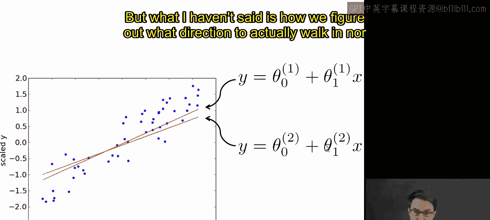

# 杜克大学《大规模数据科学（预测分析，交流数据科学结果，第2、3课⧸共3课有视频）｜Data Science at Scale》中英字幕 p56 55_梯度下降可视化.zh_en -BV1xf421Q7bH_p56-

。

So imagine we have these points scattered this way and you can see that this is a pretty。

Cleanly produced data set where there is kind of regression line that exists。

That that probably describes the data pretty well。 And， in fact。

 that's not a surprise that's sort of generated to have that effect for illustrative purposes。

 So the process here is， we're going to imagine that there is。That we split the data first into。

A training set and a test set， and that's always the first thing you。

Want to do if it hasn't been done for you already， and here we just put them half in half。

And we talked to a couple of segments ago about various ways to do this。

 but here we just can train on one half and test on the other and further I've scaled the data。

So that the original domain here of negative 10 to 60 or really zero to 60 and some kind of range of zero to 600。

Is scaled down to。啊。Variion around 0。This is actually a little suspect what I did here because I scaled the data all at once and then split it into the training and test data。

 and so the test data sort of influenced how the training data was scaled， which is。Typically， a no。

 no。Okay， so we want to scale them sort of separately。

 So how does this gradient decent work in this plot。

 What we have is the two parameters for the regression line。Which are theta 0 and theta 1。

 and it's the y intercept and the slope。 essentially right。

 these are two parameters for a single line。 This is the equation down here。

 I refers to the iteration number。 Okay， so this is really iteration0 that we're looking at。

Or really difference duration 0 and1。 So we started this process off at this point。

 and we picked that point。Randomly。And there's various deterministic ways to choose a starting point。

 but in general， the fact you have to decide a starting point is one of the weaknesses of gradientding descent。

 so we start off at a single point。And then we found the direction of steepest descent and took a step in that direction。

 So the cost function here。That we're trying to minimize。

 this says that the response variable y minus the function applied to the input variable and here the function is just a linear regression of intercept plus slope。

 take that difference and square it and add them all up for all the data points right that's the total amount of error。

That you received by by trying to explain all the data with this particular regression line that we started off of this first starting point and so we compute that gradient I haven't shown on this slide how to do that。

 but you compute that gradient and jump down quite a bit the error goes down a lot in this first step as we walk from here to here in this parameter space So now we've gone from one regression line to another regression line Here's the first regression line that we started with and we just kind of got lucky that it already is kind of in the right direction we may not have it could have gone this way。

So the next slide， we take another step and the air goes down a little bit more and we take another step towards the minimum over here。

 towards the center， and we've got another regression line that。Has rotated slightly， so it's。

Closer to what we intuitively think will be describing the data， and we can keep going with this。

And keep stepping down。 and the regressiongress line gets better and better and better。

 The error goes down。 We're finding a local minimum in that error。Untiltel it。

 we decide that it converges。The difference between the error and iteration I and the error and iteration I plus1 is less than some。

Threshold。Did we decide that it as converged， and in fact， in this case， it looks like it did。

Pretty well and that it got。What we see is or the minimum here。

And this line looks like it describes the data pretty well， which we can see on the next slide。

 So again， you know， each one of these lines。This line is perhaps the slope and intercept。

 right these two parameters， theta 1 is theta 0 and theta 1 from iteration1。

While this next line is the theta 0 and theta 1 from iteration 2。Okay。So at each step。

 we form a new line， test how well it describes the data and proceed。

 But what haven't said is how we figure out what direction to actually walk in nor how far to walk。

 So let's think about that。

