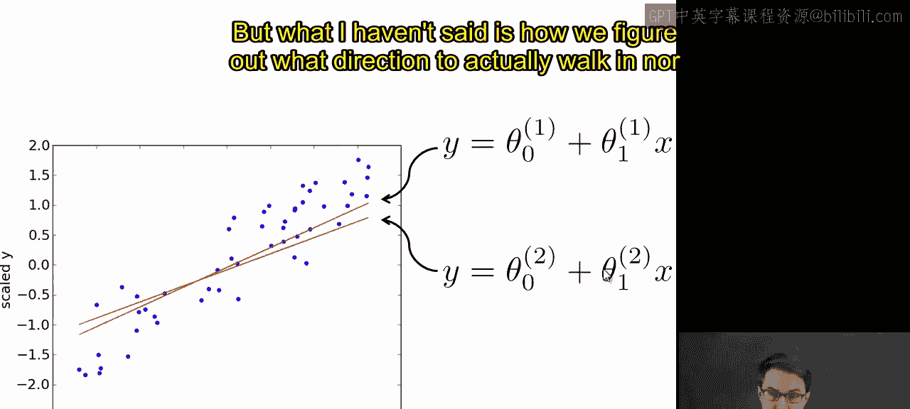

# 大规模数据科学（预测分析，交流数据科学结果，第2、3课⧸共3课有视频）：第56讲：梯度下降可视化 🎯

在本节课中，我们将学习梯度下降算法如何通过迭代优化线性回归模型的参数。我们将通过一个可视化的例子，理解算法如何从随机的初始参数出发，逐步找到使预测误差最小的最佳拟合直线。

---

## 概述 📋

梯度下降是一种用于寻找函数最小值的优化算法。在机器学习中，它常被用来最小化模型的误差（或成本）。本节课我们将通过一个线性回归的例子，可视化梯度下降的工作过程。

## 数据准备与分割

首先，我们有一组散点数据。这些数据被精心生成，以便存在一条能很好描述数据的回归线。

以下是数据处理的第一步：
*   将数据分割为训练集和测试集。这是建模前的标准步骤。本例中，我们简单地将数据对半分割。
*   对数据进行缩放。原始数据的范围（例如从-10到60或0到600）被缩放到以0为中心的范围。**注意**：本例中的缩放操作是在分割数据之前对整个数据集进行的，这通常是不正确的做法。正确做法应分别对训练集和测试集进行缩放，以避免测试集信息“泄露”影响训练过程。

## 梯度下降过程解析

上一节我们介绍了数据准备，本节中我们来看看梯度下降如何优化线性回归模型。

我们试图优化的模型是一个简单的线性方程：`y = θ₀ + θ₁ * x`。其中，`θ₀`是截距，`θ₁`是斜率。梯度下降的目标是找到使成本函数最小的 `θ₀` 和 `θ₁`。

成本函数（误差）定义为所有数据点的预测值与实际值之差的平方和：
`J(θ₀, θ₁) = Σ (y⁽ⁱ⁾ - (θ₀ + θ₁ * x⁽ⁱ⁾))²`

可视化过程如下：
1.  **随机初始化**：算法从一个随机选择的参数点开始（例如，一个随机的 `θ₀` 和 `θ₁` 组合）。选择初始点是梯度下降的一个弱点。
2.  **计算梯度与迈出第一步**：在初始点，我们计算成本函数的梯度（即最陡下降的方向），并沿该方向迈出一步。这一步使误差显著降低，参数从初始点移动到空间中的新位置。这对应着回归线从第一条变为第二条。
3.  **迭代优化**：接着，我们继续计算新位置的梯度，并再次迈步。误差进一步减小，回归线随之旋转，越来越接近能直观描述数据的方向。
4.  **收敛**：我们持续这个过程，每一步都生成一条新的回归线并评估其误差。当连续两次迭代的误差差值小于某个阈值时，算法判定已收敛。在本例中，算法成功找到了一个（局部）最小值，对应的回归线能很好地拟合数据。

## 关键问题与总结

我们描述了梯度下降的步骤，但尚未说明两个核心机制：如何精确计算下降方向，以及每一步应该迈多大。

本节课中我们一起学习了梯度下降算法的可视化过程。我们看到了算法如何从随机起点开始，通过迭代计算梯度和更新参数，使线性回归模型的拟合线逐步逼近数据的最佳描述线。理解这个过程有助于掌握梯度下降作为优化工具的核心思想。