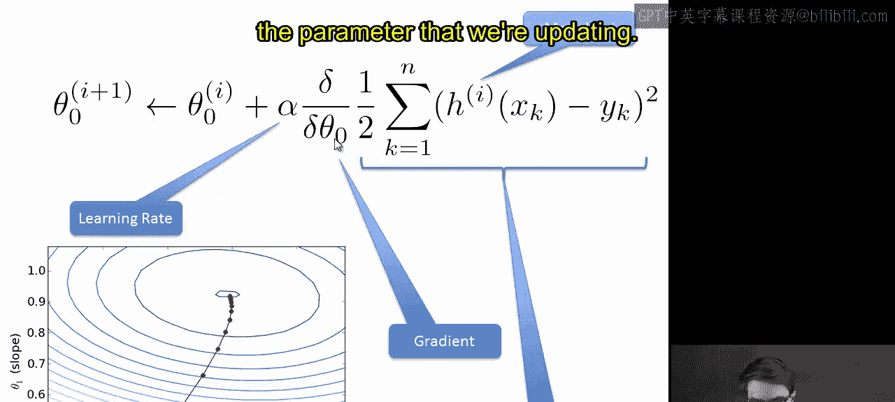

# 杜克大学《大规模数据科学（预测分析，交流数据科学结果，第2、3课⧸共3课有视频）｜Data Science at Scale》中英字幕 p57 56_梯度下降详解.zh_en -BV1xf421Q7bH_p57-

。

So how does this work， so each parameter is going to be updated with a new value derived from its old value。

 plus taking a step in the direction of the gradient。Okay， and so in these plots。You know， remember。

 this is the coordinate pair， theta zero， theta 1， right， that's the space we're in。

And at iteration one， the point is here and at iteration 2。

 the point is here in iteration 3 and so on。 Okay， so in order to get iteration I plus 1。

 we're going to take it the same value， the value of the parameter iteration I and add this。

Offset term。 Okay， so what's going on with this offset term。So this is the learning rate。

 which is just the step size。 how far are we going to go in that direction。

 and this is usually a small value， you know， maybe 0。001 or something。Okay。

 but really it's application specific， it's a bit silly to even。State what it should be。嗯。However。

 I didn't notice that in this example， I did scale everything down to a value so 0。

001 on scaled data may not be。An unreasonable thing to。Use as a default。And so this。

Operator is the partial derivative with respect to theta1。

 and if you remember you know a little bit of college calculus。

The sum of these partial derivatives is the gradient。

 And so we're just doing one of these partial derivative with respect to one particular variable。

 and then J is our cost function that I haven't shown yet。

 And J will be a function of these parameters， as well as a function of our data set We're going to take these parameters。

 plus all the data set and compute some new cost。So blowing up J。So this is our model at iteration I。

Remember we're trying to compute the new value of the parameter i plus1。

Apply that model to the data instance。X。Subtract the no， you know， the true value。

 the correct value Y， and that's our error。 Square that and then add it all up for all possible。

Values in the data set， which is what K is right， So we're going to run over all of our data points。

Check the difference， to square it， add it all up。And'll be the value。

 and actually we divide by two here， but that's more just to make things work out。 you'll see that。

A lot。 It's divided by constant factors。 It it doesn't actually change the。啊。Direction ball。 Okay。

 and so now we just need to differentiate this with respect to。

The parameter that we're updating in this case state is zero。

