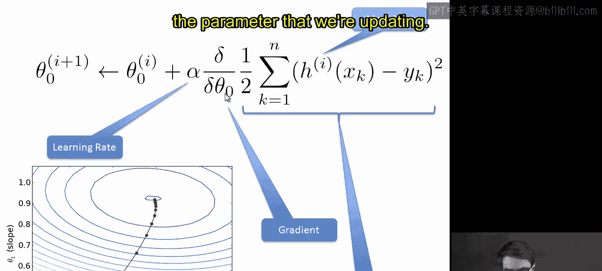

# 大规模数据科学：第2课：梯度下降详解 🧠

在本节课中，我们将学习梯度下降算法的核心工作原理。这是一种用于优化模型参数（例如线性回归中的权重）的关键方法，通过迭代调整参数来最小化模型的预测误差（成本函数）。

## 梯度下降更新规则

上一节我们介绍了梯度下降的目标是找到成本函数的最低点。本节中我们来看看参数是如何具体更新的。

每个参数都将根据其旧值更新为一个新值，更新方式是沿着梯度的方向移动一步。

在参数空间（例如由 θ₀ 和 θ₁ 构成的平面）中，迭代过程如下：在迭代1，参数点位于某个位置；迭代2时，点移动到新位置；迭代3再次移动，依此类推。

为了得到第 `i+1` 次迭代的参数值，我们将采用第 `i` 次迭代的参数值，并加上一个偏移项。

**公式：**
`θⱼ⁽ⁱ⁺¹⁾ = θⱼ⁽ⁱ⁾ - α * (∂J(θ) / ∂θⱼ)`

## 理解偏移项

现在，让我们深入理解这个偏移项的组成部分。

*   **学习率 (α)**：这是步长，决定了我们沿着梯度方向移动的距离。它通常是一个较小的值，例如 0.001。具体值取决于应用场景，但在此例中，数据经过缩放后，0.001 可以作为一个合理的默认值。
*   **偏导数 (∂J(θ)/∂θⱼ)**：这是成本函数 `J` 对特定参数 `θⱼ` 的偏导数。所有参数的偏导数之和构成了梯度向量。我们在这里是针对单个变量进行计算。
*   **成本函数 (J)**：这是我们尚未展示的函数，它衡量模型预测值与真实值之间的误差。`J` 是模型参数和整个数据集的函数。我们将使用当前参数和数据集来计算一个新的成本值。

## 成本函数 J 详解

为了更新参数，我们需要计算成本函数 `J` 及其梯度。以下是成本函数 `J` 的展开。

这是我们第 `i` 次迭代的模型。我们试图计算参数在第 `i+1` 次迭代的新值。

**公式：**
`J(θ) = (1/(2m)) * Σ (h_θ(x⁽ᵏ⁾) - y⁽ᵏ⁾)²`
其中求和符号 `Σ` 对 `k=1` 到 `m` 的所有数据点进行。

我们将模型应用于每个数据实例 `x`，减去其真实值 `y`，得到误差。将此误差平方，然后对数据集中所有可能的 `K` 个值（即所有数据点）进行求和。实际上，我们通常除以 2，这主要是为了使后续的数学推导更简洁，除以常数因子并不会改变优化的方向。

## 计算梯度

最后，我们只需要将这个成本函数 `J` 对当前正在更新的参数（例如 `θ₀`）进行求导。这个导数值将告诉我们，为了减少总误差，`θ₀` 应该向哪个方向调整以及调整多少。

---

**总结：** 本节课中我们一起学习了梯度下降算法的详细步骤。我们了解了参数更新规则，认识了学习率和偏导数的角色，并剖析了衡量模型误差的成本函数 `J` 的构成。通过迭代计算梯度并更新参数，模型得以逐步优化。