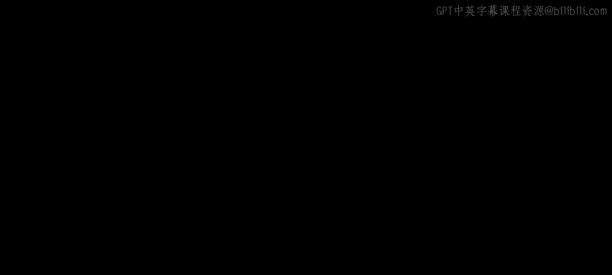
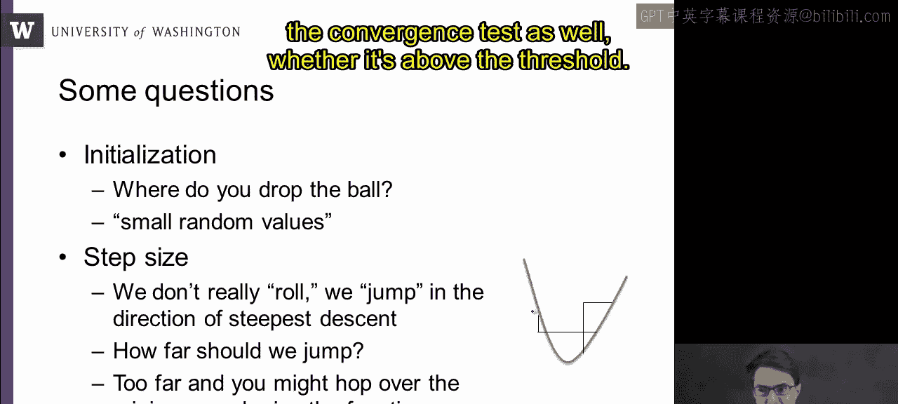

# 杜克大学《大规模数据科学（预测分析，交流数据科学结果，第2、3课⧸共3课有视频）｜Data Science at Scale》中英字幕 p58 57_梯度下降：需考虑的问题.zh_en -BV1xf421Q7bH_p58-

。

Okay so this is you know， elementary college calculus， but just to show the steps on one slide。

 you know， push the partial derivative through the sum and then apply the chain rule to get this。

Two factors。And then remember that H， our model is actually just a linear model。

 so we're multiplying the。X value times the slope parameter adding in the y intercept。

 and the only term in here that involves theta 1 is this theta 1 times xk。

 so the other ones don't involve theta 1 at all so we can just drop them， their derivative is0。

And so this just。Simplifies to xk itself， and so h of xk minus yk。Times X K is the。

Update rule that we're looking at。So this is just sort of putting the starting point in the final point together on。

 on one slide。 So the overall update rule looks like theta I plus one equals theta I plus the learning rate times the sum of。

The value。That we predict for Xk。Minus the true value。Times。X，k。And so overall。

 what you say here is while not converged， apply these update rules， update theta  zero。

 and then update theta 1。Okay， and then check for convergence and so that's the program that you that you could write if you're going to implement this。

By hand。So one detail here。Why is theta 0 for this datata 0 or why don't we have this multipied by x K。

 Well， the reason is is that because it's the y intercept， there's not an x value to multiply by。

 So it's actually just as soon to be 1。0。 And in fact， you can think of this as adding an x。

 if you've got just single attribute our x values。 and we're trying to predict y from x。

 we can think of it there actually being two attributes。

 one are x values and the other one being a constant attribute where every single。

Instance in our data is just the value 1。0， so it has no effect。On the learning。

But it allows us to have。You know， an x variable for every parameter。 So there's sort of a trivial。

X0 right here， and you can assume that x0 is always one。In which case would also appear out here。

So some questions that arise me， you know， there are some still some parameters to this process that have kind of leaked in。

 right， there's this initialization step of where we decide to start the process and we have to choose that point。

By some mechanism， you might have sort of small random values or you might pick always the same point and random as usual gives you a little bit of robustness。

Okay， and then you also need to decide the step size and this。Procedure is you know。

 notoriously sensitive to choosing a step size。 So if it's， you know， we don't really roll。

 we're not doing it kind of a continuous。Fall down the gradient。 We actually have to jump。

 And so we just figure out how far to jump。 So if you jump too far。

 you might actually skip over the minimum and come up with a higher function value than a lower one。

 And so some of the methods to。Decide this learning rate will adapt。

Based on how much of a difference you've how much of a difference in the error rate you've gotten。

 So if you're rolling on a relatively flat period， you might take a bigger jump。

 Well if you're going through a regular steep period， you might take a smaller step。

In in order to sort of keep。Approximately constant the amount of gain you get in the air。

 And so that's one trick you can do to sort of avoid this decision about the step size。Otherwise。

 you people sort of tune in an application specific way。And if it's too small。

 then you'll sort of fall in the gradient， but you'll take a very long time。

To get there and you have to also doctor in the convergence test as well。

 you know whether it's about the threshold。

Okay。