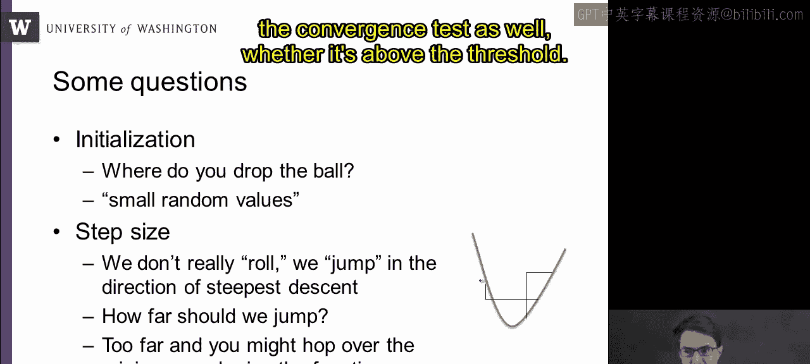

# 大规模数据科学：第2课：梯度下降：需考虑的问题 🎯

在本节课中，我们将学习梯度下降算法的具体实现细节，特别是更新规则是如何推导出来的，以及在实际应用时需要考虑的几个关键参数和问题。

---

上一节我们介绍了梯度下降的基本思想，即通过迭代调整参数来最小化损失函数。本节中，我们来看看如何具体计算参数的更新量，并讨论实现过程中需要注意的几个实际问题。

以下是推导线性回归模型中参数更新规则的关键步骤。首先，我们需要计算损失函数关于每个参数的偏导数。

1.  对于参数 θ₁（斜率），其偏导数计算过程如下：
    *   将偏导数算子移入求和符号内。
    *   应用链式法则，得到 `(h(xₖ) - yₖ) * ∂/∂θ₁ (h(xₖ))`。
    *   由于我们的模型 `h(x)` 是线性模型 `θ₀ + θ₁ * xₖ`，其中只有 `θ₁ * xₖ` 项包含 θ₁。
    *   因此，关于 θ₁ 的偏导数简化为 `(h(xₖ) - yₖ) * xₖ`。

2.  对于参数 θ₀（截距），其更新规则略有不同。因为截距项没有与之相乘的 x 值，可以将其视为一个恒为 1.0 的虚拟特征 `x₀`。这样，θ₀ 的更新量就是 `(h(xₖ) - yₖ) * 1`，即 `(h(xₖ) - yₖ)`。

将以上推导整合，我们得到完整的参数更新规则。以下是梯度下降算法的核心迭代步骤：

*   **参数更新**：`θ_i (新) = θ_i (旧) + α * Σ ( (h(xₖ) - yₖ) * xₖᵢ )`
    *   其中 `α` 是学习率，`xₖᵢ` 对于 θ₀ 是 1，对于 θ₁ 是 `xₖ`。
*   **算法流程**：
    1.  初始化参数 θ。
    2.  **当未收敛时**：循环执行以下操作。
    3.  应用上述更新规则同时更新 θ₀ 和 θ₁。
    4.  检查是否满足收敛条件。

这就是手动实现梯度下降算法可以遵循的程序。

---

了解了算法流程后，我们还需要关注几个影响算法性能的关键参数。以下是实现梯度下降时必须考虑和设定的几个因素：

*   **参数初始化**：我们需要决定梯度下降的起始点。通常可以选择小的随机值。随机初始化能提供一定的鲁棒性，避免陷入某些特殊的局部情况。
*   **学习率选择**：学习率 `α`（即步长）的选择至关重要。步长太大可能导致越过最低点，甚至使损失函数值上升；步长太小则收敛速度会非常慢。这是一个需要谨慎调整的参数。
*   **自适应学习率**：一种改进方法是使用自适应学习率。例如，在误差下降平缓时采用较大步长，在误差下降陡峭时采用较小步长，以保持每次迭代获得的“收益”大致稳定。这有助于缓解手动选择固定学习率的困难。
*   **收敛判断**：我们需要设定收敛的判定标准，例如当参数更新量或损失函数值的变化小于某个阈值时，停止迭代。

---

本节课中我们一起学习了梯度下降法在线性回归中的应用。我们详细推导了参数的更新公式，明确了算法迭代的步骤。同时，我们也探讨了实现梯度下降时几个必须处理的现实问题：参数的初始化、学习率的选择与自适应策略，以及收敛条件的判断。理解这些细节对于正确有效地应用梯度下降算法至关重要。