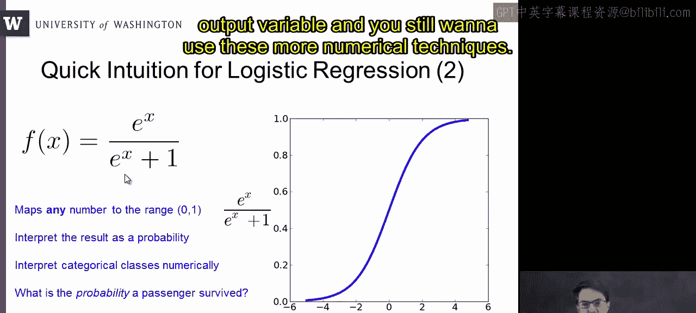

# 杜克大学《大规模数据科学（预测分析，交流数据科学结果，第2、3课⧸共3课有视频）｜Data Science at Scale》中英字幕 p59 58_逻辑回归直观理解.zh_en -BV1xf421Q7bH_p59-

。

So what's the point of all this， Well， the cost function is actually pretty general。

 that it can be almost anything and the model parameters can be almost anything as long as the cost function can be differentiated so you don't get sort of stuck in discontinuities as you're rolling down the gradient。

You can use this optimize a lot of different。Problems， okay。

 so a couple of other examples that you'll see in machine learning context are these logistic regression and support vector machines。

 And you can use gradient descents。With these methods， we won't have time in。

This course to go into these in much detail。 And there's plenty of great machine learning courses out there。

 But I do wantanna give you intuition for these。2 techniques so that you sort of call it calls to mind you know an image in your head when you hear the terms。

 Okay， so for both of these cases， you have our vector of weights like we had before。

 and we have a vector of instance values from our training data just like we did before。

 And here we're expressing that as kind of a dot product of two。Of two vectors。In some cases。

 you need to use the trick where you append a dummy attribute with just constant values of one in order to make this product work out。

But other than that， you've got。This kind of setup up with with these two。

 And I won't go through these in detail， except to call out this funny term over here。

 We will talk about what that's。What purpose that serves in a vet？So logistic regression。

 just a quick inner intuition for。What's being accomplished here。

 If you try to take our regression procedure that we just described。And apply it to， say。

 the Titanic data set that we were looking at previously。 you might end up。Recently like this here。

 I've got the X axis， which is age。 And I've scaled this data down。

 So it ranges between sort of negative 2 and。3， as opposed to 0 and 85 or something。

 which is the ages of。The passengers and on the Y axis is just zero if they did not survive and one if they did survive。

ok。And now if you just run regression， you know， maybe we could say， well， hey， look， we're going。

 we're going to create a line and then use that regression line to predict whether someone lived or died。

 Well， this is the regression line that。This to the gradient December procedure。Fs。

 so what is this really。Mean， given this kind of。Categorical data that's been。You know， in。

 embedded in， in a。Nummerical。Context， well， not probably not much， right。

 It's not clear that we really use this line to predict anything。 So with。Categorical variables。

 even if we kind of give them a numerical interpretation。

 regression doesn't make necessarily a lot of sense。However。

 there's a function called the logistic function。 That is this guy。

And it has this nice property that it can map values from。Negative infinity to infinity。

On to the range 0 to 1。 So it gives them kind of a probability。

 And you can interpret this like a probability。So they very， very high values。

Our typically does increasingly likely events。 And so you can use this for。Classification， right。

 So now instead of。A1 or a 0。 You get out a probability of it being one or probability of it being 0。

So this has a nice interpretation in terms of probability。

 it allows you to take a linear combination， well， let's say a linear combination of variables to produce a number。

And assign that to a class in a reasonable way。 Okay。

 and so the cost function is constructed using logistic function in such a way as to maximize the probability of a correct classification。

 And then given these exponentials， it's。It's sort of an easy function to work with mathematically。

 and this is what it looks like if you plot this。So that's the goal of。

 of logistic regressiong is to give you a way to work with probabilities in this optimization context。

 And in particular， you can think of it as useful when you have a。Categorical output variable。

 and you still want to use these more numerical techniques。

