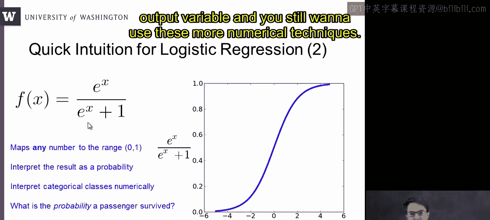

# 大规模数据科学（预测分析，交流数据科学结果，第2、3课⧸共3课有视频）：第59节：逻辑回归直观理解 🧠

在本节课中，我们将学习逻辑回归的基本概念及其在分类问题中的应用。我们将探讨逻辑回归如何将线性回归的输出转换为概率，并理解其背后的数学原理。

---

上一节我们介绍了梯度下降法及其在优化问题中的应用。本节中我们来看看逻辑回归，这是一种在机器学习中广泛使用的分类方法。

逻辑回归的核心思想是，当我们面对分类问题时，直接使用线性回归可能并不合适。例如，在泰坦尼克号数据集中，我们试图根据乘客年龄预测其是否幸存。线性回归会拟合出一条直线，但这条直线对于只有0（未幸存）和1（幸存）的输出来说，解释性不强。

逻辑回归通过引入一个特殊的函数——**逻辑函数**（或称Sigmoid函数）来解决这个问题。该函数能将任何实数映射到(0, 1)区间内，从而可以解释为概率。

以下是逻辑函数的标准形式：

**公式：** `σ(z) = 1 / (1 + e^(-z))`

其中，`z` 通常是输入特征的线性组合，例如 `z = w·x + b`（权重向量 `w` 与特征向量 `x` 的点积，加上偏置项 `b`）。

逻辑回归的目标是找到一组权重参数，使得模型预测的概率尽可能接近真实的类别标签。为此，我们需要定义一个成本函数（或称损失函数）。逻辑回归通常使用**对数损失**（Log Loss）作为成本函数，其形式如下：

**公式：** `J(w) = -1/m * Σ [y_i * log(ŷ_i) + (1 - y_i) * log(1 - ŷ_i)]`

其中：
*   `m` 是样本数量。
*   `y_i` 是第 `i` 个样本的真实标签（0或1）。
*   `ŷ_i` 是模型预测的第 `i` 个样本属于正类（1）的概率，即 `ŷ_i = σ(w·x_i + b)`。

这个成本函数的设计是为了**最大化正确分类的概率**。当预测概率 `ŷ_i` 接近真实标签 `y_i` 时，损失值会很小；反之，损失值会很大。

以下是逻辑回归的关键步骤概述：

1.  **模型定义**：计算线性组合 `z = w·x + b`，然后应用逻辑函数得到概率 `ŷ = σ(z)`。
2.  **成本函数**：使用对数损失函数来衡量预测概率与真实标签之间的差异。
3.  **参数优化**：使用梯度下降法等优化算法，最小化成本函数，从而找到最优的权重 `w` 和偏置 `b`。

逻辑回归的优势在于，它不仅给出分类结果（例如，是否幸存），还提供了属于某个类别的**概率**，这在实际应用中通常比单纯的“是/否”判断更有价值。

---

本节课中我们一起学习了逻辑回归的直观理解。我们了解到，逻辑回归通过逻辑函数将线性回归的输出转化为概率，适用于处理分类问题，特别是当输出变量是二分类时。其核心是构建一个基于概率的成本函数，并通过优化算法（如梯度下降）来训练模型。