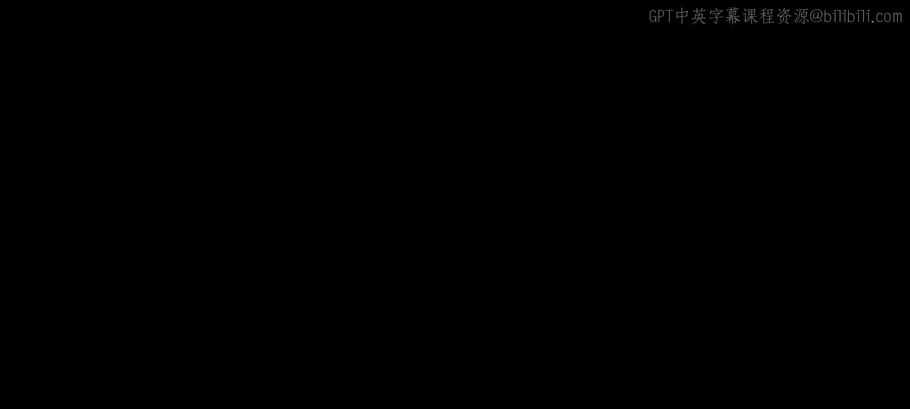
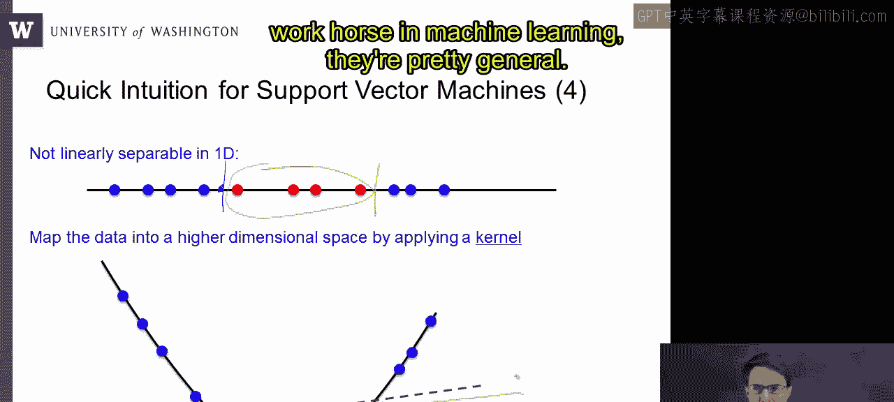
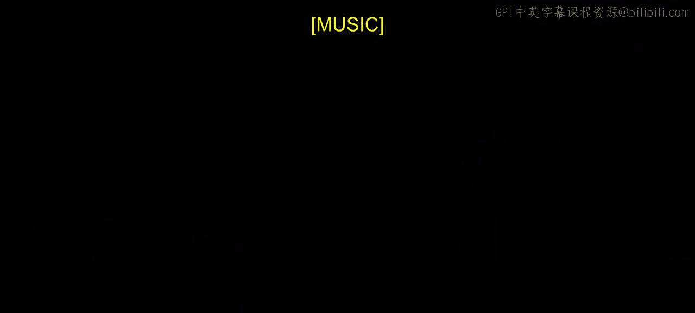

# 杜克大学《大规模数据科学（预测分析，交流数据科学结果，第2、3课⧸共3课有视频）｜Data Science at Scale》中英字幕 p60 59_支持向量机直观理解.zh_en -BV1xf421Q7bH_p60-

。

So what's a quick intuition for support vector machines。 So the idea。

 the context here is finding a line that will separate the two。Classes。

 so here we have red dots and blue dots。 And this is maybe where passengers survived。

 And when they didn't survive。 and we're trying to find a line that separates them。

 It won't always exist。 and we'll handle that。Case in a second。

 But imagine for a second that they do that it does exist that that you can draw a line。

 a straight line that will separate the blue ones from the red ones。 Okay。

 and so we want to find this line。 Well， there's various techniques that we won't go into that can walk through and finds such a line。

 But you can imagine that the best such line is one that is in the middle。

 And how do we define the middle。 Well you can define it maybe by maximizing the margin。

Between the blue and the red， it's the one that maximizes that margin。

 And so you can write that notion of a margin down precisely。 And what you come up with is。

That cost function that we showed for support vector machines，That's great。 Now。

 what about the case where it's not linearly separable。 Well， what you can do is。

Try to strike a balance between。Finding a line that gives you a nice fat margin。

Versus one that perfectly classifies the points。 and this allows you to maybe。

Find an alternative to this line。 so this line does actually separate them linearly。

 but the margin here is very， very skinny and so you might imagine that maybe this one's an outlier and should not be considered as part of the you know should not be considered a red dot for purposes of classifications if you should be considered error and so maybe that this line separates all the rest say we have a lot more blue ones and a lot more red ones on either side of this line。

 maybe it does a pretty good job overall of classifying and it also has a fatter margin。

Maybe we take that one Okay， so how do we add that term in in order to strike this balance well？

We'll come back to that in a second， but that's that regularization term。

So for those cases that are not linearly acceptablepar。

 you can also soften the definition of margin to allow for misclassified points using what are called Sck variables。

So fine， so these techniques handle。You know， sort of the outlier noise cases。 But in some cases。

 there might be a pattern to the。Data where it's not linearly separable。

But it's not because of noisy air of why on separables because the pattern is not。H。You know。

 the two classes are not defined by a straight line between them。

 and so if we don't you know we don't think about the 2 D case now think about just the 1 D case if we've got a。

Group of blue points here in 1 D and a group of blue points here in 1 D。 And then in between them。

 a group of red points。 Well， there's no one point I can draw that will separate these guys。

But clearly， there's kind of a group here where we want to do is sort of draw a circle around this and so another。

Capability that the formulation of support vector machines allows fairly naturally is to map the data into a higher dimensional space by applying these。

Colonels。And so， for example， here we map all these 1 d points into a 2D point onto a parabola。

 and then we can draw a straight line between them。 And so this allows you to turn kind of a。

Non nonlinear surface into a linear surface so that we can use the same technique。 And again。

 I'm not going to say too much more about the mathematics there。 I just want to give you that。

Intuition for why these are a pretty strong workhor in machine learning， they're pretty general okay。

