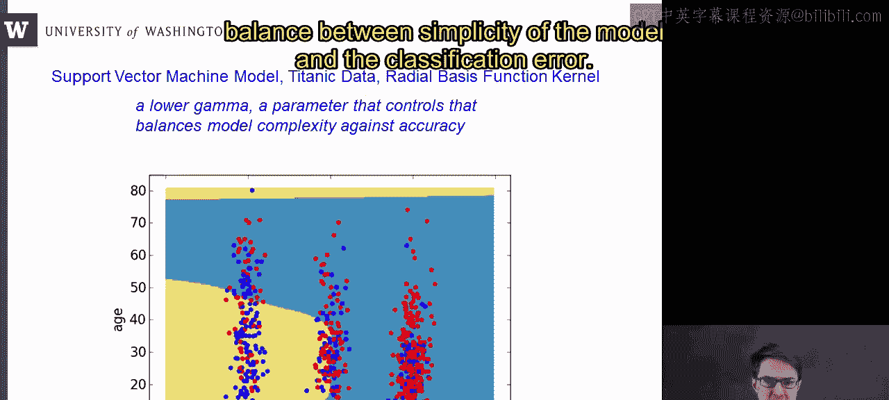

# 杜克大学《大规模数据科学（预测分析，交流数据科学结果，第2、3课⧸共3课有视频）｜Data Science at Scale》中英字幕 p61 60_支持向量机示例.zh_en -BV1xf421Q7bH_p61-

。

Going back to our。Titanic example， we can see some。Uses of support vector machine。 So here is the。

Linear support vector machine learned on this Titanic data where the attributes I've chosen are。

P class remember class being first class， second class， third class on the ship。

And gender and remember that red is did not survive and blue is survived and also remember that that I added some noise to the data just so you could see the blob of red and the blob of blue otherwise the points would be at exactly one。

You know， right here in the middle and right here in the middle and so on。

 So here it finds a line straight between male and female and decided that that was the best linear。

Clasifier， which makes sense。But here， learn a more complex surface。Where it's。

grouprouped the first class females and second class females and decided that they survive。

 and then it split the third class females。Okay， and so。

If we choose two different attributes in the Titanic data sets， given that those were。

Fairly simple categorical data here is age and first class， second class， third class。

 and again with the radio basis functions。As a kernel and the support vector machine learns a pretty complex surface。

 right， again， everything here in yellow is survived and everything in dark blue is not survived。

And so it。You know， kind of found this little patch over here where。It seems to think。

 you because of these two blue dots that。Second class and third class and older people from second class and third class must survive in this little narrow range and have found this one up here that a very old person from first class did as well。

 but this sort of should smell like overfitting to you right when you get this this complex of a surface。

In data that we can sort of look at and see that it doesn't have that much of a pattern going on。

This this might suggest that something's something's up。 And so， you know， as usual。

 there's other parameters you can tune on these learning methods to try to avoid。Overfitting okay。

In these cases， there's。A way to balance the complexity of the surface versus the number of misclassified points。

 and so here's where we've kind of dialed in those parameters in this particular library you think which is Python's sideK learn。

Okay， and so this is a simpler。Boundary surface between survived and not survived that perhaps has better generalization properties。

 right it'll work better if were trying to actually predict on the test data。All right。

 so next we'll talk about regularization， which allows you to strike this balance between simplicity of the model and the classification error。

