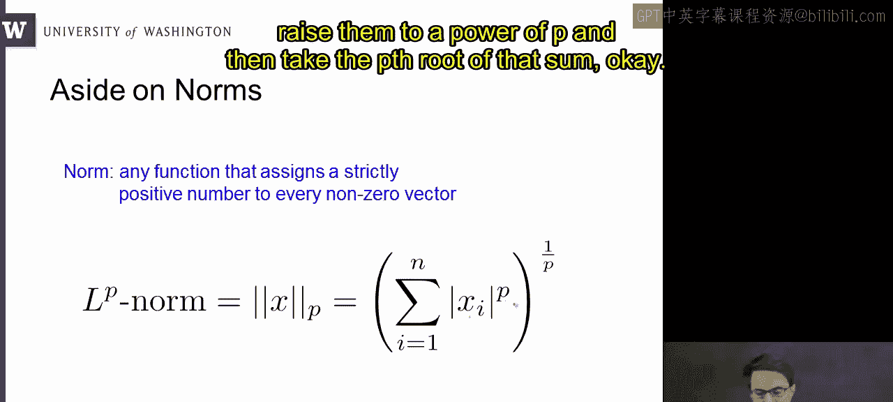

# 杜克大学《大规模数据科学（预测分析，交流数据科学结果，第2、3课⧸共3课有视频）｜Data Science at Scale》中英字幕 p62 61_正则化直观理解.zh_en -BV1xf421Q7bH_p62-

。

So going back to the cost functions， we're now ready to talk about this regularization term and to motivate。

Why this is needed。 You can think about。These high dimensional problems。 So image classification。

woWould have a separate attribute for every pixel in the image and so there might be millions of those or these text and analytics problems where documents are represented as vectors of terms。

 there might be 500，000 different terms that may or may not be in the document。

 and so each one of those gets its own。Weight， okay， and so with all these attributes。

 with all these weights， with all these variables， it's likely that many of them are going to be correlated。

So for example， two terms tend to appear together in a document and tend not to appear together in a document or。

You know， as in this example， pixels an image， if you look at a pixel on an image and you look at nearby pixels。

 they're likely to be the same color。 right， if you pick a picture， a pixel in the green field。

 the nearby ones are also likely to be green。 If you pick a pixel on the black cow。

 then the nearby pixels is also likely to be black。 Okay， And so there's a problem here。

 because as we're training the model， one way to。Change the weights significantly and yet not really improve the error much。

Is to make one of these pixels get a very， very high weight and the other nearby pixel get a very。

 very low weight， and so they'll cancel each other out。

And the air doesn't improve much because they're so highly correlated。Okay， and so here in the。

 you know， what's going on here is the model's becoming more complex in some sense， right。

 it's getting very specialized to your particular。Problem。But you haven't actually。Learned anything。

 right， doesn' It's not going to generalize well。 And so you need to have some sort of a condition on。

 well， all else being equal。 We prefer simple models and maybe not even all else be equal。

 even even if it makes us misclassify some。Some of the images or some of the documents。

 we'd really prefer simple models because we know that those tend to generalize better than something that's。

You know， overfit over specializedize to our particular data sets。

 And so this regularization term provides this balance。So let's take a quick digression on norms。

 so a norm is any function that assigns a positive number。

To the input with the condition that the the only one that's allowed to have a zero value on the output is zero itself in the input。

And so you've seen these before， right， this is the。

L1 norms and L2 norms that are just the magnitude of a vector right is its L2 norm you add up the square of all the values in the vector and you take the square root of all that。

That's a norm。 And that assigns a positive number because you've squared it。

 So L2 norm is perhaps the most common， but L1 norms is perfectly valid as well。 And in fact。

 you can generalize this to LP norm， which looks like this。 The notation is these。

Pairs of vertical lines， and it means take the sum of all the members of the set from one to n。

 raise into a power of P， and then take the P root of that sum。

Okay。