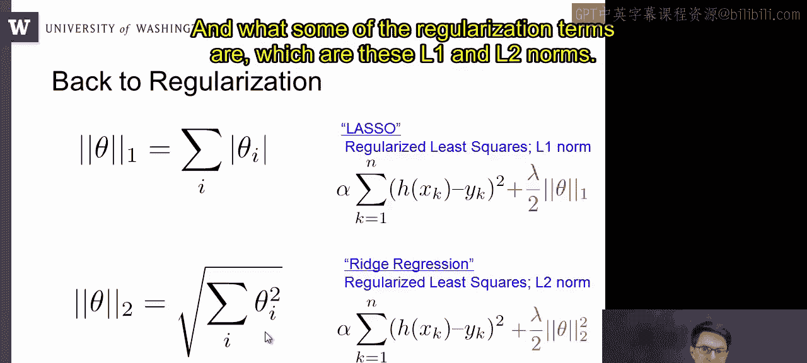

# 杜克大学《大规模数据科学（预测分析，交流数据科学结果，第2、3课⧸共3课有视频）｜Data Science at Scale》中英字幕 p63 62_Lasso和岭回归直观理解.zh_en -BV1xf421Q7bH_p63-

。

So let's put one more digression on the stack here and talk about cost functions so we make a prediction。

And we have our true known values we want to。系。Somehow compute a single number that summarizes the mistakes weve made。

 summarizes the amount of error。 And so the simplest one that we don't tend to use might be this。

 right， Just subtract your value， subtract the true value from your predicted value and add of add those all up。

 Well， this is not usually what you're going to want because。You know。

 if you're above the value or below the value， you might get canceled out and look really。

 really good。 You might look like you've done a great job。 Okay。

 so that's not a good choice isn And as a cost function。

 Another one that is reasonable as a cost function might be， well， look。

 let's just solve the problem and take the absolute value of this difference and add those up Okay and so this is sort of asserting that you know。

 one error of seven units in one on a particular date item is just as bad as seven errors。

Across seven different date items of one unit each。 and that may or may not be true in your。

Application。And then the error function that we may be seeing more is to square the error。

 And so this is asserting that one error of7 units is as bad as 49 errors of one unit。

 except for the fact that perhaps we take the square root。 Now。

 a lot of times we don't take the square root and we just。

Divide by in or even divide by two in some cases。Okay and so this is the average squared error per data point might be useful in comparing methods that filter the data in different ways so that you get the amount of error per data point as opposed to having a factor of how much data was in there influencing the number。

But。All of these might be reasonable functions。😡，And I want to point out that these， in fact。

 are the L1 norm and the L2 norm。Okay， so they have for a natural interpretation of why you might want to make things positive。

 because maybe you're adding up the error is why you might want to want to mapping into。

Stly positive numbers。 And they also point out that this one wasn't very good as error as an error condition。

 but also it's not a norm because it might produce a negative number。 So fine。

 So this is why these norms come up in different context。

Pop cost functions off the stack and go back to regularization。

Different uses of these norms to control the complexity of the model。

Correspond to different techniques that you'll see in the machine learning literature。

 and we're not going to go into a lot of。Detail here， but it's what we're doing here is we're。

Coming up with a penalty that adds into our error。The absolute value of all the parameters。

 say in the L1 norm case。 And so this means that high values of parameters。

 positive or negative will increase。The cost。And so。

The optimization procedure will be incentivized to keep that down and same thing with the L2 norm it's also mapping into a positive number。

 and so it gives this penalty to increase the cost when these parameter values get out of whack。

 either too high or too low。Okay， and in some case， you'll see the squared Lt norm， which is just。

The L sum of squares without the without the square root and so there's。

An enormous amount of work on understanding the properties that these choices have on different types of problems and we're not going to get into that。

Here， but I want to make sure that you walk away with the intuition for why regularization was important。

 and which is to avoid overfitting and penalize complex models to get those complex surface like we saw with the sport vector machine。

And。What some of the regularization terms are， which are these L1 and L2 norms。

