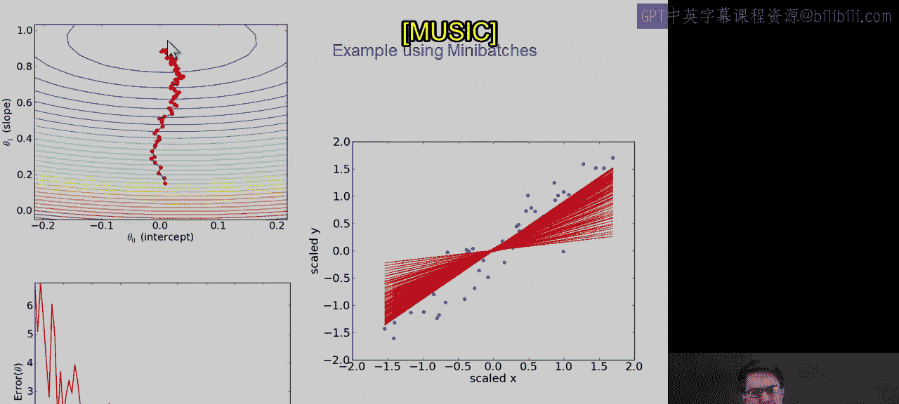

# 杜克大学《大规模数据科学（预测分析，交流数据科学结果，第2、3课⧸共3课有视频）｜Data Science at Scale》中英字幕 p64 63_随机和批量梯度下降.zh_en -BV1xf421Q7bH_p64-

。

Okay， so going back to gradient descent and looking at it as an algorithm。

 you know we may notice that we process the entire data set on every iteration in order to estimate a parameter。

 we use the old value of that parameter and we modify it by the error estimate。😡。

Computed on the entire training dataset set。Okay， use that to estimate the gradient。 So a very。

 and this is， this is infeasible for large。Data sets of the variety that we will encounter fairly frequently in a data science context。

So a variation on gradient decent is what。It's called stochastic gradient asscent。 It stochastic。

 as usual means probabilistic。 means you're going to be selecting something at random。

 And so in this case， we select a single data point from the training set and use that to estimate the gradient as opposed to。

The the entire data set。All right， and so we just continue on in that iteration as if that one data point was our entire training data set。

 and then on the next iteration， we select another point at random and so on。Okay， so in the。

What you'll be doing here is your。Estimate of the direction of the gradient won't be as good because you considering one data point。

But your。You'll be able to compute that iteration much， much faster and so you'll get through。

More of them， hopefully。And so what compromise between these two extremes using the entire data set and using just a single value is what some call mini batch gradient descent。

 where at each step you pick a small subset of points。

As opposed to just a single pointer as opposed to using the entire data set。

 and then you continue on as if that subset was your。Training data set。

 And so I think all three of these methods， when you look at this algorithmically， are really。

Pretty simple， intuitive variations of each other。 Now， they do have some different properties。

Mathematically and statistically， which is why there's been a ton of work on them。

 but just as from a programming perspective， they're pretty minor variants of each other and they arise in a fairly natural way just in the interest of almost a performance optimization。

Okay。And I'll come back to that point in a moment。 But first， let's look at what this。

Kind of an effect。 this change has on。The procedure。

 So here's an example of where you know I modified this gradient descent。

Program that produce these plots to use stochastic gradient And where just picked a single value。

 And you can see it kind of as it。Wals down the gra， and he kind of wanders about。A bit more。

 And doesn't always。Find the exact correct direction。

 And so it might take more iterations to get there。

 and also the air is kind of jumping around at each。Point now。

 I wouldn't read too much into this particular example。 And you know。

 if you run this a bunch of different times， you'll see a bunch of different patterns。

 Some of them will converge in just a few steps and some of them will take a lot longer and so on。

 but it does give you a flavor of the kind of。Cost to using this method where it doesn't sort of make a be line for the。

 for the low， for the optimum。Point， like it did with gradient。

 the same we' using the entire training data。ok。And in example using mini batches。

 this one happened to have sort of a little bit better of an error character。

 but you can still just see some noise here and this one happened to take many more iterations to。

Get to the middle。Okay。One other factor here is that as your。Changing the method。

 stochtastic mini batches， changing the size， the mini batch and so on。

The learning rate may have an effect here too， right so here the learning rate is pretty small so it looks like we're taking very small steps。

On each iteration， and if it gets too big， it might sort of jump down here to the bottom and then just bounce around for a while。

 hopping over the medium and not converging。Okay， and so the choice of method with the learning rate is sort of sensitive here and you know。

 in some cases where an application you may be doing a little bit of trial and error and a lot of the research work goes into try to understand these trade offs more analytically all right。

So fine， So that's that's。Two different methods for optimizing this optimization procedure for applying performance optimization to this optimization procedure to handle larger data sets。

But we made the point。Several lectures ago， several weeks ago about。You know。

 scalability nowadays is really not about。Making things a little bit faster here and there is' really about parallelization。

 right， Everything has to be paralyzed。嗯。As you scale data up beyond the size。

 they can fit on a single single machine and everything is going that way。

 And so if you're not paralleled then you don't scale。 So how would you parallelze this well。

Everything we've talked about is sort of inherently sequential， right， because you。

Even in stochastic gradient and sin， it's very， very fast because it's only processinging a single data point。

 but each data point changes the parameters。 And then those parameters are used to compute the next data point。

 So there's this dependency， iteration toeration。

All right。