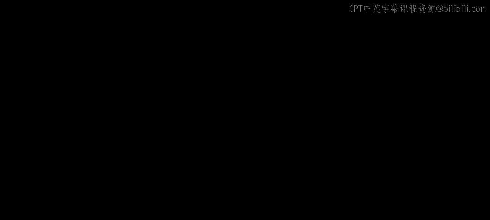
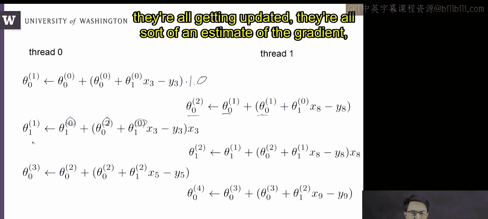

# 杜克大学《大规模数据科学（预测分析，交流数据科学结果，第2、3课⧸共3课有视频）｜Data Science at Scale》中英字幕 p65 64_并行化梯度下降.zh_en -BV1xf421Q7bH_p65-

。

So what would happen？If you。Just did this in parallel。

Without worrying too much about making a sequential。 So the result could be nonsense。

 but it turns out that it's not nonsense and it could actually converge。

 And so what some folks have shown in a couple different groups actually。

 more or less independently in the paper I've cited here is the one。

That I'd recommend has this approach called hog Wilde， these authors name their approach Hog Wild。

 which is to paralyze storccraastic gradient descent。

 just take in each of the threads in each of the independent processes。

Start trying to update the parameters， using。A random data point。

 and you can apply this to mini batches as well。嗯。Now， you know。It's unpredictable。Which。

Order these updates will happen in， and therefore， it's unpredictable which。

Values are the parameters you'll use to compute the new value。Right， you may have。

One threads updates， but not have another threads updates and so on。

But what they were able to show is that you still make progress on this。

 And so what was kind of fun about this is it came out you know。

 very empirically from a student of Chris Rays working to try to improve performance here and just trying out ideas。

 And so they said， look， you know what what might happen if we just remove the concurrency control in this parallel program。

 we just remove the locks。So we no longer sort of worry about what order things are going in just let everything update Willy Nilly。

 which is why they kind of called it hog wild， and so it turned out it kind of worked and they got a good answer and you applied to other data sets and they got a good answer still。

 and so they went back and looked analytically and sort of studied。

Whether this would actually converge in most cases and we' were able to sort of prove that it would。

 But I think you know， one thing I like about this is。

 first of all it gives you a parallel method for stochastic gradient and descent， which is nice。

 But it also sort of shows that know the exploration in the empirical kind of trial and error approach doing intuitively what might make sense in some of these cases is perfectly reasonable。

 And then it doesn't necessarily tell you any formal guarantees about what you've done。

 but it might sort of give you。A starting point， so how does this actually look like？

Let's say we have two different threads。That are all going to be applying this parallel stochastic gradient descent algorithm。

And if we say sort of say time is increasing， going down the slide here。 Well， in the first step。

 we update parameter theta 0 from its old values and the and the current， you know。

 the old value of theta 1 as well。 And we happen to randomly pick the third instance。 So x3。

 and we compare it with y3。 And remember， we don't need this multiplication by x3 here out here because of。

This is parameter 0， which is the。Slope， so this is kind of times 1。0 here。Okay， and then at time 2。

A different thread。We'll see these new values created。

That were updated time at time zero and use those to compute a new theta0 here。

 and then at time three。We're still using the original zeroth value of theta 1。

 but we're using the second value of theta0。And so on。

 and so it's unpredictable with only two threads you could sort of see maybe a pattern here if they're interleaved exactly the way I've seen。

 although there's no guarantee that they would be interleaved in this way。

But you can see that's sort of unpredictable， but the point is as long as it's generally making progress。

 it's perhaps the exact ordering the afternoon leaving maybe doesn't matter。

 they're all getting updated， they're all sort of an estimate of the gradient and they're all getting closer to that minimum。

