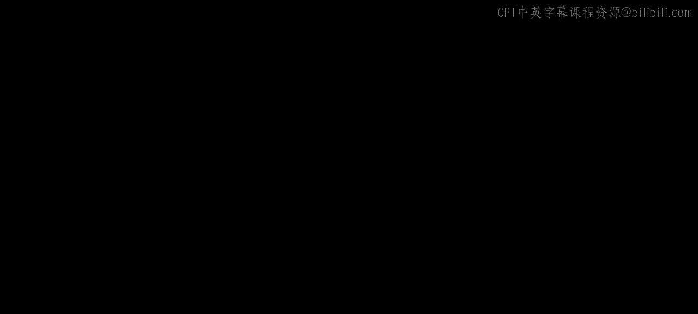
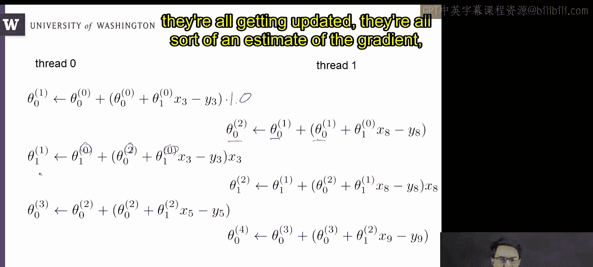

# 大规模数据科学：第2课：并行化梯度下降 🚀



在本节课中，我们将学习一种名为“Hog Wild”的并行化随机梯度下降方法。我们将探讨其基本思想、工作原理，并理解为何这种看似无序的并行更新方式在实践中依然有效。

---

## 概述

随机梯度下降是机器学习中优化模型参数的核心算法。然而，在大规模数据集上，其计算可能非常耗时。为了加速这一过程，我们可以尝试并行化计算。本节将介绍一种大胆的并行化策略——Hog Wild，它通过移除传统的并发控制（如锁），允许多个线程同时、无序地更新参数，并证明这种方法在许多情况下依然能够收敛到有效解。

上一节我们介绍了随机梯度下降的基本原理，本节中我们来看看如何将其并行化以提升计算效率。

---

## Hog Wild 并行策略

如果我们在并行计算时，不刻意确保更新的顺序性，结果会怎样？结果可能变得毫无意义。但事实证明，结果并非无意义，算法实际上可以收敛。

一些研究团队几乎独立地发现了这一点。这里引用的论文中，作者将他们的方法命名为“Hog Wild”。这种方法旨在并行化随机梯度下降。

其核心思想是：让每个线程或独立进程，都尝试使用一个随机数据点来更新参数。这种方法也可以应用于小批量数据。

现在，这些更新的顺序是不可预测的，因此用于计算新参数值的参数本身也是不可预测的。一个线程的更新可能尚未被另一个线程看到，依此类推。

但研究者们能够证明，这种方法仍然能使优化过程取得进展。

关于这个方法的一个有趣之处在于，它最初源于Chris Re学生的实践经验。他们试图提升性能，并尝试了各种想法。他们提出：如果我们在这个并行程序中移除并发控制会怎样？我们直接移除锁。不再担心事情发生的顺序，只是让所有更新“肆意妄为”地进行。正因如此，他们称之为“Hog Wild”。结果发现它居然有效，他们得到了不错的答案。将其应用到其他数据集后，答案依然不错。

于是他们回过头来，从分析角度研究这种方法在大多数情况下是否真的会收敛，并能够证明它确实会收敛。

我认为，这个方法的好处首先在于它提供了一种随机梯度下降的并行方法，这很棒。其次，它也表明，基于经验和直觉的试错探索方法在这些情况下是完全合理的。它不一定能提供关于你所做事情的形式化保证，但可以为你提供一个起点。

---

## 工作原理示例

那么，这实际上是如何运作的呢？假设我们有两个不同的线程，它们都将应用这种并行随机梯度下降算法。

如果我们假设时间在向下推进（如下滑所示）。在第一步，我们使用参数θ0和θ1的旧值，并随机选择第三个实例（x3），将其与y3进行比较。请注意，对于参数θ0（即截距项），我们不需要乘以x3，因为这里相当于乘以1.0。

在时间点2，另一个线程看到了在时间点0创建的新值，并使用它们来计算此处新的θ0。

在时间点3，我们仍然使用θ1的初始值（第0次的值），但使用的是θ0的第二个值（更新后的值）。以此类推。

即使只有两个线程，其顺序也是不可预测的。虽然我展示了一种交错模式，但无法保证它们一定会以这种方式交错。关键在于，只要总体上在取得进展，也许确切的顺序和细微的延迟并不重要。所有参数都在被更新，所有更新都是对梯度的某种估计，并且都在向最小值靠近。

以下是该过程的简化描述：

```python
# 伪代码示意：每个线程独立执行类似以下操作
while not converged:
    i = random_select_data_index()  # 随机选择一个数据点索引
    theta = read_current_parameters()  # 读取当前参数（可能已过时）
    gradient = compute_gradient(theta, data[i])  # 计算梯度
    theta_new = theta - learning_rate * gradient  # 更新参数
    write_parameters(theta_new)  # 写回参数（可能覆盖其他线程的更新）
```

---

## 总结



本节课中我们一起学习了“Hog Wild”并行随机梯度下降法。我们了解到，通过移除严格的顺序控制，允许多个线程异步、甚至基于略微过时的参数值进行更新，这种看似混乱的方法在大规模优化问题中依然能够有效工作并收敛。这体现了在实践探索中，有时打破常规的直觉尝试能带来高效的解决方案。