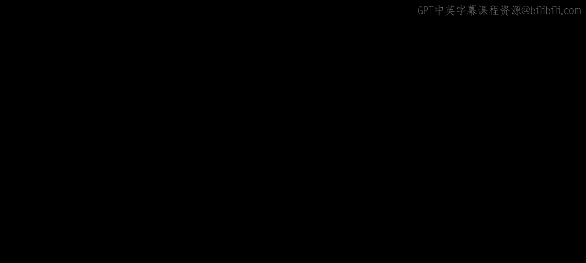
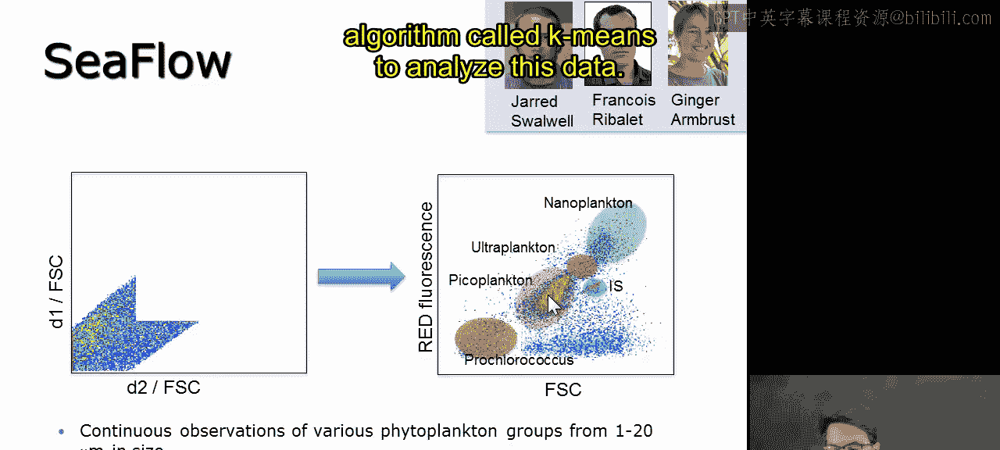

# 杜克大学《大规模数据科学（预测分析，交流数据科学结果，第2、3课⧸共3课有视频）｜Data Science at Scale》中英字幕 p66 65_无监督学习简介.zh_en -BV1xf421Q7bH_p66-

你。

Okay， so where are we， We've covered some selected topics in a very。

 very broad field of machine learning。 And in particular， we've talking about supervised learning。

 So we covered。Rules and trees as representation of certain kinds of hypotheses。

 we covered combining a set of weak learners to make a stronger learner with ensembles and boosting and we talked about this optimization technique of gradient descent along with some applications of it and how to speed it up with stochastic gradient descent and then how to parallellyze it。

 and so now we're going to talk about a few selected topics in unsupervised learning。

 So this is a very broad field as well。And we're only going to cover。

A couple of selected topics that。Data scientists ought to be familiar with it is by no means a coverage of the entire area。

 So what is unsupervised learning。 So if we have these four categories of machine learning that are characterized by where the feedback comes from。

 then unsupervised learning is perhaps the one that stands out the most。

 So we've only we've only talked about supervised learning。

 But you can think about all four of these。 So in supervised learning。

 the feedback for the learning comes explicitly in the data。In reinforcement and learning。

 the feedback is supplied by the environment。 So this is。You know。

 control theory when you're trying to keep a plane in the air， for example， and in game theory。

 the feedback comes from the other participants in the system， the other players in the game。

But in nonsupervised learning， there is no feedback。

And so here you're just looking for patterns in the data itself and trying to put them to use。Okay。

 so maybe almost all work in unsupervised learning can be viewed as terms of learning a probabilistic model。

Of the data。So applications on supervised learning include detecting outliers。

YouSo is this factory behaving normally or not？Clasification， which。

Is a little different than classification that we talked about given that there's no class labels。

 but you might find groups of similar items and then when you see a new item come in。

 you can figure out which of among the groups you found previously is this one most similar for and thereby classifiedify it as within that group。

You can also think about compression and communication。 So instead of sending。A sequence of A， B， A。

 B， A B， A， B pairs， you may say。Let's just send the sequence A B and repeat seven times。

And so this is a shorter representation of that string。So in all cases。

 we're identifying these patterns that describe the data and then putting them into use for various services。

Okay， so in particular， what I want to do is talk about clustering。

 And this is by no means the only form of unsupervised learning。

 But it's the one that you'll bump into quite a bit。

 Another common one that we're not going spend much time on is dimension reduction。So in clustering。

 there's perhaps no precise definition of what a cluster is。

 but which is one of the reasons why you see all these different algorithms for different scenarios。

But the output is usually the same， which is a set of sets of data items。Okay。

 so these items may be points in some multidisional space。 And your goal is to。

Group them by similarity。Or the others maybe you say vertices in a graph。

 And your goal is to find communities that help that discuss。

That collaborate more closely than other communities or that communicate more closely than other communities。

 Okay， so here you're looking at the edge structure of the graph。To identify the clusters。

 But the output is still the same。 It's a set of sets of。Items。All right。

 so let me give you an example that comes up。In a collaboration we have with some oceanographers。

Here the University of Washington。 So in this sea flow device。

 they've borrowed techniques from flow cytometry and adapted them for environmental monitoring。

 So in flow cytometry， the idea is to take。It's a diagnostic tool in medical applications and the idea is to take particulate matter blood or plasma from the patient and。

Put particles in that sample through a capillillaary single file， bounce light off of it。

 and by the absorption and refraction patterns of the particle。

 you can sort of work out which kind of pathogen it is。

 And so in these applications you're typically looking for one of a small set of possible critters and so you kind of know what you're looking for Moreover。

 it's on a lab bench and kind of a controlled environment。

What these researchers have done is taken one of these devices or not one of these devices。

 developed their own device from scratch。Rugggedized it and turned it upside down and put it on the bottom of an ocean goinging vessel in order to in real time get a continuous stream of labeled particles representing the microbial populations of the open ocean。

 and this is completely unknown。There's， you can get some information out of satellite images。

 but there's really nothing that's known below the surface。

 There's no real ground truth for measuring this。 besides very sparse data from。

 from direct sampling。Okay， so how this works is。You，So one of the challenges here。

 why you I said they push them through single file here， they do not。

 They actually open up the pipe a little bit and allow lots of particles to go through because the engineering is。

Too difficult to get things to go through a single file。 you know。

 when you're underwater and the boats。Doing this。Okay。

 so that's one of the problems you have to save energy and the engineering problem。

 you have to make it up in the data analysis because now the data is much noisier。Okay。

 so as light shines through。This particle stream it's collected on either side by various detectors。

 and there's two detectors that work。Initially to help filter out to help identify which particles are at the center of the stream and which ones are at the edges so you can filter out the ones of the edges。

 And then there's other detectors for various wavelengths of light。

 And what you can do here is first filter the data so that you only are worried about the。

Particles that were in the middle of the stream。 And then you can start inspecting the。

Different wavelengths to identify these clusters that represent different microbial populations so。

In this case， we're looking at size， nanonoplankton，plankton and picoplankton。

 and some of the absorption refraction patterns of these different populations are understood。

 But in the data stream， you still need to figure out what these clusters are。

 And so they apply a clustering algorithm， a variation on on a very popular cluster algorithm called K means to。

Analyze this data， and so we'll talk about key means next。

