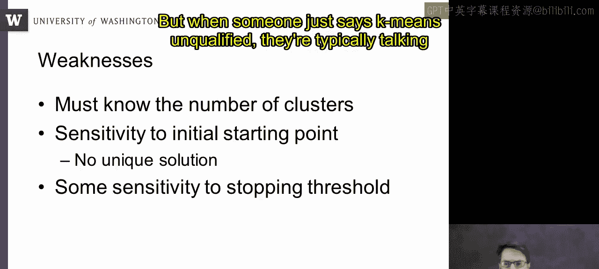

# 杜克大学《大规模数据科学（预测分析，交流数据科学结果，第2、3课⧸共3课有视频）｜Data Science at Scale》中英字幕 p67 66_K-均值.zh_en -BV1xf421Q7bH_p67-

你。

So let's talk about the K means clustering algorithm。This algorithm has some weaknesses。

 but it's very， very， very popular in part because it's so simple to understand。

 So it's a really good one to be very familiar with。

 So the K and K means refers to the number of clusters you're looking for。

 which is the first and perhaps most prominent weakness is that you have to know this upfront。

So imagine you had data scattered in two dimensional data scattered。

As in the slide and you're trying to find two clusters。 The way you begin is take the centroid。

Of each cluster and drop it into this space randomly as an initial guess as to where that where that cluster would be centered。

 Okay， so maybe we say。Here and here。Okay。And then the algorithm proceeds as follows。

 for each point in the data set， figure out which of these two synroids it's closer to。

This is closer to this one， this one， that's about halfway， but probably this one。

And this one's about half the saves over here。So this is our initial guess of the clustering。

 We think that all these points belong to this cluster and all these points belong to this cluster。

So now you take the。Average of all the positions in that cluster to compute a new centroid value and move the centroid there。

So for example， here， this one will shift this way。And this one will shift sort of this way。

So in the second iteration。Our points， our two centuriesries might look。Like this。

 And then we just repeat the process。 So for every data point。

 figure out which centroid it's closer to。About halfway， but I put it there。

And this is our guess at time equals2。For the clusters。 And now， once again。

 average all the positions within that cluster to find the new centroid。 And so here。

 these two points will pull a little bit in that direction， but most of the。

Most of the points are this way， so it'll probably shift that way a little bit。

And the similarly with this one， it'll shift this way。And so at time three。We have a synroid there。

We have this centroid。Here and now they close once again assign the points to the closest centroid。

And recompte the new centroid value。 So this one will finally shift。Into the middle here。

 and this one will finally shift perhaps a little bit this way。And then a time equals four。

We can repeat once more。And find that。The synroids in this case。

 don't move that much on the next iteration。And so once the movement of all the synroids is below a certain threshold。

 they haven't moved much， things don't change much， things have settled down。

 we stop the algorithm and that's our。That's our clustering。 And so in this case。

 all of these points will be assigned at this cluster and all of these points will be assigned。

To this cluster。So you can paralyze this algorithm by splitting the data items across multiple machines and one of the key ideas here is that the number of centroids is pretty small or at least all of them to fit in memory you're not typically looking for billions of clusters。

And so you can broadcast those to every map task in say a Ma reduceuce setup so in the map phase。

 the maprs look at each data point and they have access to all the synroids and they can figure out one which one each data point is closest to and then send that to the reduce phase。

According to the cluster that it was assigned to。Okay， so all that can happen in parallel。

 And then on the reduced side， there's one reduced task per cluster， and it can。

Compute the new centroid value。 and so there's a bit of a weakness here because one reduced task could have a lot of work to do because it might have most of the data points。

And that could be a problem。In principle， things are balanced。

 you might get a pretty good parallel speed up。And the other weakness with this Mareduce implementation is that there's no direct support for this iterative nature of cans。

 We have to repeat this over and over again， so you have to have some kind of external driver program that will keep kicking off Mareduce jobs one at a time。

 and we'll talk a little more about this in the final week of lectures。

So summarizing the weaknesses of ks， you know， first of all。

 you have to know the number of clusters up front， you have a fair amount of sensitivity to the initial starting conditions。

In that there's no unique solution depending on the starting conditions。

 you may get a different answer， And there's also some sensitivity to the stopping threshold theres。

As is always the case， there's been a lot of work on repairing these various problems。

 but when someone just says canine's unqualified。They're typically talking about the algorithm we just described。

 which is sensitive to these issues。

