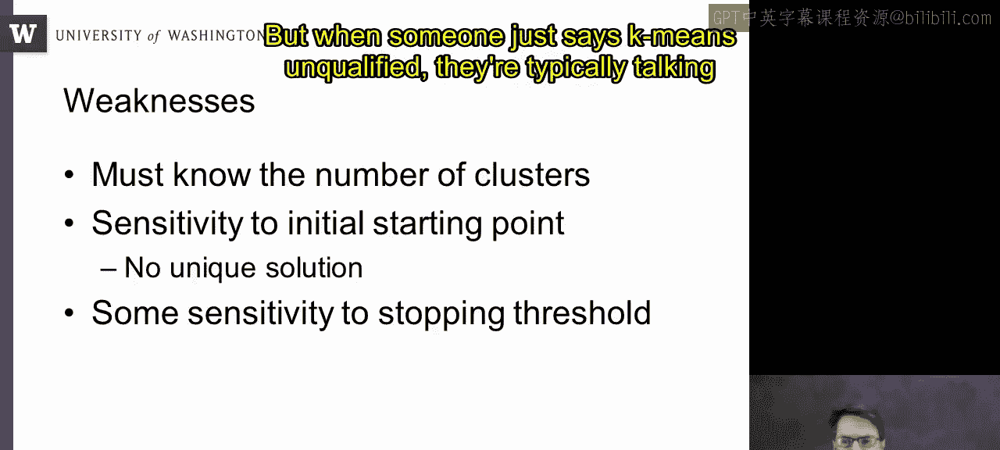

# 大规模数据科学：第2课：K-均值聚类算法 🧮

在本节课中，我们将学习K-均值聚类算法。这是一种非常流行且易于理解的聚类方法，尤其适合处理大规模数据集。我们将详细介绍其工作原理、步骤、优缺点，并探讨其在大数据环境下的并行实现。

---

## 算法概述

K-均值算法是一种迭代聚类方法。其核心思想是：预先指定聚类数量K，通过迭代计算，将数据点分配到K个簇中，使得每个数据点到其所属簇中心的距离平方和最小。

## 算法步骤详解

上一节我们介绍了算法的基本思想，本节中我们来看看其具体的迭代步骤。

K-均值算法的执行过程可以概括为以下几个步骤：

以下是算法的主要迭代循环：

1.  **初始化**：随机选择K个数据点作为初始的簇中心（质心）。
2.  **分配点**：对于数据集中的每一个点，计算其到所有K个质心的距离，并将其分配给距离最近的质心所在的簇。
3.  **更新质心**：对于每一个新形成的簇，计算该簇内所有数据点的平均值（即坐标的均值），将这个平均值作为该簇新的质心。
4.  **迭代**：重复步骤2和步骤3，直到质心的位置不再发生显著变化（即移动距离低于某个阈值），或者达到预设的迭代次数。

## 图解算法过程

为了更直观地理解，我们通过一个寻找两个簇（K=2）的例子来演示算法的迭代过程。

1.  **初始猜测**：在二维空间中随机放置两个质心（如图中两个“X”所示）。
2.  **第一次分配**：每个数据点根据距离被分配到最近的质心，形成两个初始簇。
3.  **第一次更新**：计算每个簇中所有点的平均位置，将质心移动到该平均位置。
4.  **后续迭代**：重复“分配-更新”过程。质心会逐渐向各自簇的“中心”移动。
5.  **收敛**：当质心的移动非常微小，数据点的分配不再改变时，算法停止。最终，所有点被清晰地划分为两个簇。

## 并行化实现

K-均值算法天然适合并行计算，可以借助MapReduce等框架处理海量数据。

其并行化的关键在于：质心的数量K通常较小，可以轻松地广播到所有计算节点。以下是基于MapReduce的实现思路：

*   **Map阶段**：每个Map任务读取一部分数据点。由于所有质心已广播到每个任务，Map任务可以为每个数据点计算其最近的质心，并输出键值对：`(cluster_id, point)`。
*   **Shuffle阶段**：系统将所有相同`cluster_id`的键值对发送到同一个Reduce任务。
*   **Reduce阶段**：每个Reduce任务负责一个簇。它接收分配给该簇的所有数据点，计算这些点的平均值，从而得到该簇新的质心。

这个过程在一次迭代中完成。整个K-均值算法需要驱动程序来循环启动多次MapReduce作业，直到收敛。

## 算法的优缺点

K-均值算法简单高效，但也有一些明显的局限性。

以下是K-均值算法的主要弱点：

*   **需预先指定K值**：用户必须事先知道或猜测数据中簇的数量，这在实际应用中往往很困难。
*   **对初始值敏感**：由于初始质心是随机选择的，不同的初始值可能导致完全不同的最终聚类结果。
*   **对异常值敏感**：均值计算容易受到极端值（异常点）的影响。
*   **假设簇为凸形**：算法倾向于发现大小相近、呈球状（凸形）的簇，对于其他形状（如环形、流形）的簇效果不佳。
*   **迭代式MapReduce开销**：在Hadoop MapReduce等框架中实现多轮迭代需要外部驱动，作业启动和中间数据读写会带来额外开销。

尽管存在这些弱点，并且已有大量研究致力于改进它们，但当人们不加修饰地提到“K-均值”时，通常指的就是我们刚刚描述的这个基础算法。

---

## 总结

本节课中我们一起学习了K-均值聚类算法。我们了解了它通过“分配-更新”的迭代过程寻找簇中心的核心机制，学习了其基于距离的**公式化**目标（最小化簇内平方误差），并探讨了其利用`(cluster_id, point)`**键值对**在MapReduce框架下的并行实现思路。同时，我们也认识到该算法需要预先设定簇数量、对初始值敏感等主要局限性。掌握K-均值是理解更复杂聚类方法的重要基础。