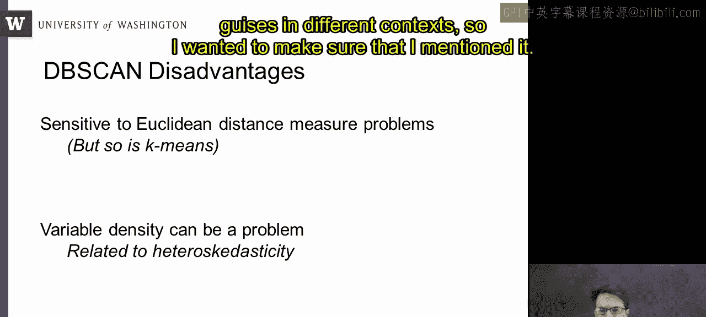

# 杜克大学《大规模数据科学（预测分析，交流数据科学结果，第2、3课⧸共3课有视频）｜Data Science at Scale》中英字幕 p68 67_DBSCAN.zh_en -BV1xf421Q7bH_p68-

你。

So there's one more algorithm I want to talk about that's less well known than k means。

 but it has slightly nicer property。 So it's another good one to be familiar with， and that is。

DB scan。 So how DB scan works is given points， say in a two dimensional space。 As always。

 we're going to look for points that are separated by a distance of no more than some epsilon。

And so if you can hop from one point to another。By hopping no more than epsilon at each point。

 then all those points will be considered to be in the same cluster。

 And so whenever you need to jump a little further than Epsilon。You'll be entering a new cluster。

Okay。So， in this example。🎼It epsilon is this distance。 Then we know we can get。

Its driving me nuts a little bit。These points are within Epsilon。

 These points are within epsilon and so on。 And you sort of induced this graph over the。

Over the data。 And so all of these A is， B is reachable from A by hops of no more than epsilon。

 So all these are in the same cluster。And actually。

C is also reachable from B by hops in the same cluster， but D is not。

 And so D is in a different cluster。 So all the solid points are in one cluster。

And all these hollow points are in another one。All right。So there's some advantages here。

That are kind of illustrated by this picture。 So one is it can find non linearly separable clusters。

 So right here， there's no line you can draw to separate these two。Cluters。 and yet clearly。

 there's kind of a dense region and another dense region。

 And so you want to try to draw a curve line。 And Db scan finds this naturally。

 but canines won't cans will sort of find a point。 know， depending again。

 depending on where you start， you know， maybe。Here and here or something。In which case you'll get。

Clusters like this。Okay。So there is no dependence on a fixed number of。

Starting clusters like Ka meanss was， there's no dependence on starting conditions sort。

Compte this from。Any of the vertices in the graph and start making hops？

There's only two parameters to this， one is this distance threshold epsilon。

 and the other is a minimum number of neighbors and what this controls is like if I find a point way out here in space。

That doesn't have any neighbors， doesn't you know only has a few neighbors。

 then maybe I just consider that point noise and I ignore it completely。

 I don't try to put it in any cluster whatsoever。And so here， if you put min neighbors at zero。

 you'd get。This one in its own very own little cluster。

 this one is very own little cluster and so on。 And so that just keeps requires extra bit of bookkeeping。

 It's not necessarily a big fall on the algorithm。 you'll still find the obvious two main clusters。

 but you can set this guy。Second， mid neighbors parameter two。

Control the extra bookkeeping of to maintain these singleton clusters。F。

 and then you know the core primitive here as it's operating is to find me all the neighbors within epsilon。

 find me all the neighbors within epsilon， find me all the neighbors within epsilon。

 and so this operation is amenable to spatial indexing techniques。

Which can be implemented in login so that every lookup requires only a logarithmic number of steps。

 remember as we talked about in the scalability lecture。

 and so the overall runtime of this is in login。So some disadvantages here is that it's sensitive to Euclidean distance measure problems and if you remember a few lectures ago I。

Made a point to say that whenever you see Elidean distance， you should be thinking about there's。

 there's one big major problem with it， which is the curse of dimensionality， right。

 So as you get a very， very large number of of dimensions。

 Euclidean distance starts to become somewhat meaningless。 It starts to get。

Bigger and bigger and bigger。And the data set starts to get sparser and sparser and sparser。

 the space that it's embedded in is。Very， very sparse。

 but Kines also has this problem because it also tends to rely on Euclidean distance and you actually can define other distance measures and have an adapt canines and Ds can both to use them。

And then another problem is that you're kind of making this implicit assumption that the density that defines a cluster is constant throughout the data set。

And so this is related to this concept of hetero scasticity that we talked about that may have seemed a little unusual at the time。

 but it comes up in various guises in different contexts。 I want to make sure that I mentioned it。

