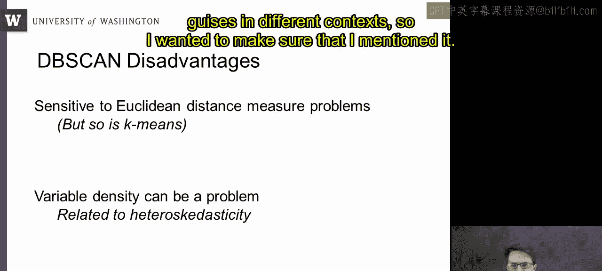

# 大规模数据科学：第2课：DBSCAN 聚类算法详解 🧩

在本节课中，我们将学习一种名为 DBSCAN 的聚类算法。与 K-Means 相比，它知名度稍低，但具备一些更优的特性。DBSCAN 能够发现任意形状的簇，并且对噪声数据有较好的处理能力。

## 算法原理

上一节我们介绍了 K-Means 算法，本节中我们来看看 DBSCAN 是如何工作的。DBSCAN 的基本思想是：给定一组点（例如在二维空间中），算法会寻找那些彼此间距离不超过某个阈值 **ε** 的点。

如果可以通过一系列不超过 **ε** 的“跳跃”从一个点到达另一个点，那么所有这些点都被视为属于同一个簇。每当需要跳跃的距离超过 **ε** 时，就意味着进入了一个新的簇。

在下面的示例中，**ε** 是图中所示的距离。点 A 和点 B 之间的距离在 **ε** 之内，点 B 和点 C 之间也在 **ε** 之内，因此 A、B、C 属于同一个簇。然而，点 D 无法通过 **ε** 内的跳跃从 B 到达，因此 D 属于另一个簇。所有实心点构成一个簇，所有空心点构成另一个簇。

## 算法优势

以下是 DBSCAN 算法的一些主要优势：

*   **发现非线性可分的簇**：如图所示，这两个簇无法用一条直线分开，但显然存在两个密集区域。DBSCAN 可以自然地发现这种弯曲边界划分的簇，而 K-Means 则可能根据初始中心点的不同，划分出不同的直线边界。
*   **不依赖预设的簇数量**：与 K-Means 需要预先指定 K 值不同，DBSCAN 不需要。
*   **对初始条件不敏感**：算法从数据图中的任何顶点开始进行“跳跃”探索，结果稳定。
*   **参数较少**：主要参数只有两个：距离阈值 **ε** 和最小邻居数 `min_neighbors`。
*   **能处理噪声**：`min_neighbors` 参数可以控制将孤立点视为噪声。例如，如果一个点周围在 **ε** 范围内没有足够多的邻居（少于 `min_neighbors`），它就不会被归入任何簇，而是被标记为噪声。如果将 `min_neighbors` 设为 0，每个孤立点都会形成自己的小簇。
*   **时间复杂度可优化**：算法的核心操作是反复查找 **ε** 范围内的所有邻居。这个操作适合使用空间索引技术（如 k-d 树）进行优化，使得每次查找仅需对数级步骤。因此，整体运行时间可以达到 **O(n log n)**。

## 算法局限

当然，DBSCAN 也存在一些局限性：

*   **对欧氏距离敏感**：和 K-Means 一样，DBSCAN 通常默认使用欧氏距离。在高维空间中，数据会变得非常稀疏，欧氏距离可能失去意义，这就是所谓的“维度灾难”。不过，DBSCAN 和 K-Means 都可以适配使用其他距离度量。
*   **假设簇密度均匀**：DBSCAN 隐含地假设数据集中定义簇的密度是恒定的。这涉及到我们之前讨论过的“异方差性”概念。如果数据集中不同区域的簇密度差异很大，DBSCAN 可能难以同时正确识别所有簇。

## 总结

本节课中我们一起学习了 DBSCAN 聚类算法。我们了解了其基于密度和连通性的核心原理，探讨了它能够发现任意形状簇、无需预设簇数量、能有效处理噪声等优点。同时，我们也认识到它对距离度量的选择敏感，并且假设簇密度相对均匀。DBSCAN 是数据科学工具箱中一个非常有价值的补充，特别适用于簇形状复杂或存在噪声的数据集。