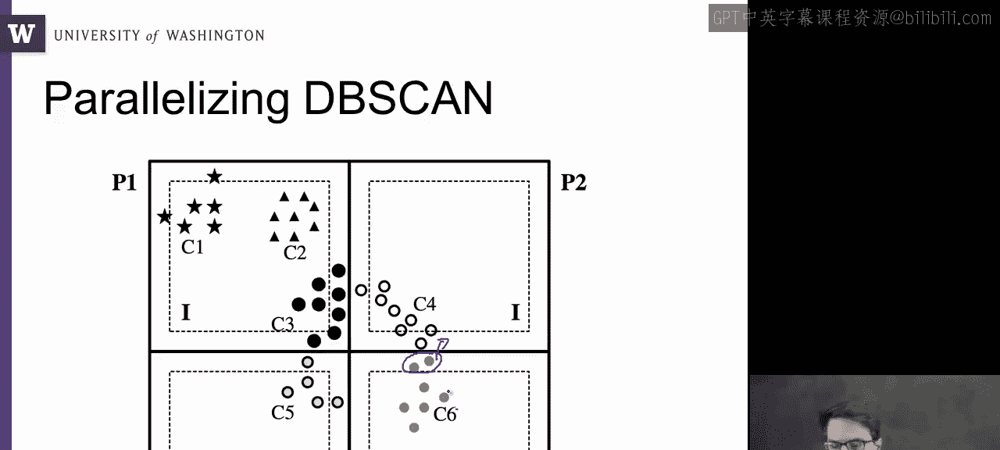

# 杜克大学《大规模数据科学（预测分析，交流数据科学结果，第2、3课⧸共3课有视频）｜Data Science at Scale》中英字幕 p69 68_DBSCAN：可变密度和并行算法.zh_en -BV1xf421Q7bH_p69-

你。

So for example， this plot is actually the same one that we generated for to make the point about hetero scasticity in the statistics segments。

 but what I've done is just cut out。er。Some portions of the data here and here and so now。

It looks to our eyes like there ought to be three clusters here， right， one here。

One here and one here。But DB scan， given its sensitivity to this epsilon number。

 do you define epsilon such that this cluster is easy to detect？You know。

 a very small epsilon about this kind of distance。 or do you find it a slightly bigger epsilon。

So that you can capture these kinds of clusters。And if you're not careful， I suppose here。

 I've actually doctored this one where it's probably okay to use the bigger one。

 but if you're not careful，' you'll。嗯。You know， the density region here may be on par with the distance between these two clusters here。

 in which case with a small change to Epsilon， you might all of a sudden put the whole data set into one cluster。

Okay， and so adaptive epsilons， depending on which region you're in。

Might be something you could think about。And just like with K meanss。

 you can think about how to paralyzze DB scan and the only trick I wanted to point out here is that you need to worry about this halo region around each。

Cluster。Or rather around each segment。 So here we divide up the space into。

 say four different processors and each processors can be responsible for that space。

And in the middle， internal to this。Processor， you can run D scan as usual。

 but when you get close to the boundary of the region。Handled by this processor。You need to be。

 you need to do some careful bookkeeping。Okay， and so all the ones that are within this boundary region need to be sent to this other processor for comparison to see whether you need to relabel C4 and C6 as part of the same cluster。

 whether those two clusters are connected by a distance of epsilon or they're not。

 And so they'll independently find all their clusters。

 but then you'll merge some clusters when you combine and you can actually。

Express this in terms of a sequence of map reduced jobs。Which I won't go into the details。

 but there's some work done by a student here a few years ago too。Describe。

And analyze the algorithm here。Okay。

So finally， I just want to wrap up with this。Great picture from the psyit learn。

Python library website， which talks about the differences between various。Cllustering algorithms。

 And we've only talked about two of these。 We talked about canines。

 and we talked about Db scan and mini batch canines is。啊。诶。

Online version of Kames that uses batch at a time to。Compfuse androids。

But you can see some some of the strengths and weaknesses here。

 Cans actually doesn't do that great in any one of these admittedly tricky challenge problems where here you would probably think that you want this。

Internal circle to be a cluster in this outer circle to be a second cluster。

 and canines doesn't quite get that right depending on where you have the starting condition。

Meanwhile， these two clusters kind of overlap in space as well。And here。

 if you have a bad starting condition in between these two clusters。

 you might put them all in the same cluster。Or really anything。

 anytime the starting condition is up here and say down here。

 this one will sort of gravitate towards this cluster and this one will sort of gravitate towards this cluster and end up in the middle。

And so on。 meanwhile， in D scan。This hop from this cluster to this cluster is greater than epsilon。

And so you'll do what seems to be the correct thing， which is put the inner circle in one cluster。

 the outer circle in another。Similarly here， the distance between these clusters is enough where DB scan figures it out。

And similarly here and for the noisy case。DD camp puts all these points all in the same cluster。

 which， you， to our eyes， that's probably the right thing to do。

So the big takeaway here is that at least in these four challenge problems。

DB scan does the right thing in every case。 And so it's a good one to be familiar with。

